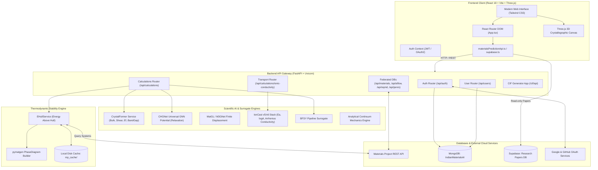
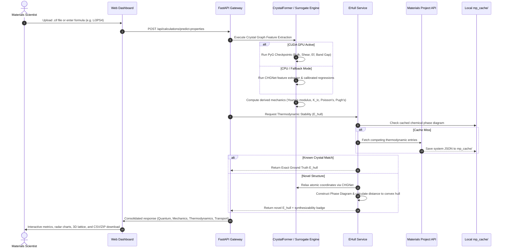

# IndianMaterialsAI (IndianMatter Platform)

> **Next-Generation High-Throughput Materials Discovery & Quantum Property Screening Engine**  
> Accelerated computational synthesis, graph neural network property prediction, and thermodynamic stability screening for solid-state battery electrolytes and functional crystalline materials.

---

## 📑 Table of Contents

1. [Executive Overview](#-executive-overview)
2. [End-to-End System Architecture](#-end-to-end-system-architecture)
3. [Core Workflow & Data Pipelines](#-core-workflow--data-pipelines)
4. [Complete Tech Stack](#-complete-tech-stack)
5. [Project Directory Layout](#-project-directory-layout)
6. [Core Functional Modules](#-core-functional-modules)
7. [Physics-Informed Property Taxonomy](#-physics-informed-property-taxonomy)
8. [REST API Route Reference](#-rest-api-route-reference)
9. [Installation & Setup](#-installation--setup)
10. [Environment Variables](#-environment-variables)
11. [Deployment & Hardware Targets](#-deployment--hardware-targets)
12. [Operational Standards & Contributor Guidelines](#-operational-standards--contributor-guidelines)
13. [Contact & Enquiries](#-contact--enquiries)
14. [License & Acknowledgments](#-license--acknowledgments)

---

## 🔬 Executive Overview

**IndianMaterialsAI** closes the gap between expensive *ab initio* Density Functional Theory (DFT) calculations and high-throughput materials discovery. Traditional experimental synthesis and quantum mechanical calculations take weeks to months per crystal candidate. This platform delivers sub-second property inference and thermodynamic stability verification through a unified surrogate model stack.

### Key Capabilities:
- **Unified Deep Learning Surrogates:** Powered by **CrystalFormer** (space-group-aware geometric transformers), pre-trained **CHGNet** universal graph potentials, and **IonCast** ensemble stacking.
- **Thermodynamic Grounding ($E_{\text{hull}}$):** Every structural prediction calculates the energy above the convex hull against the Materials Project Phase Diagram database, identifying true synthesizable candidates ($\le 25\text{ meV/atom}$).
- **Dual Inference Modes:**
  - *Interactive Single-Structure Analysis:* Immediate assessment of `.cif` crystals or stoichiometry formulas.
  - *Parallel Batch Processing:* Asynchronous queue processing up to 500 `.cif` structures or zipped archives with live polling and consolidated CSV export.
- **Crystal Lattice Synthesis & Doping:** Algorithmic generation of CIF files from chemical formulas, dopant substitutions, and structure symmetry optimization.
- **WebGL 3D Crystallography:** Interactive 3D lattice visualizer with coordination polyhedra, unit-cell vectors, and bond-distance measurement.
- **Multi-Database Federation:** Unified querying across Materials Project, AFLOW, OQMD, JARVIS, and the internal IndianMatter database.
- **Literature & RAG Integration:** Scientific literature indexing powered by Supabase and OpenAlex data schemas.

---

## 🏛️ End-to-End System Architecture



---

## 🔄 Core Workflow & Data Pipelines



---

## 🛠️ Complete Tech Stack

### 1. Frontend Architecture
| Layer | Technology | Details |
|---|---|---|
| **Core Framework** | React 18 (`react`, `react-dom` ^18.2.0) | Component-driven UI |
| **Language** | TypeScript (^5.0.2) | Strict type contracts across APIs |
| **Build Tooling** | Vite (^4.4.5) | Fast HMR, ESM bundling, GPU dev mode (`npm run dev:gpu`) |
| **Routing** | React Router DOM (^6.30.3) | Declarative public & authenticated routes |
| **Styling** | Tailwind CSS (^3.3.2) + PostCSS | Custom color palettes (`im.orange`, `im.cream`, `im.surface`) |
| **Animations** | Framer Motion (^12.38.0) | Smooth state transitions & deck settle effects |
| **3D Graphics** | Three.js (^0.186.0) + `@types/three` | WebGL crystallographic lattice viewer |
| **Icons** | Lucide React (^0.454.0) | Minimalist iconography |
| **Authentication** | `@react-oauth/google` (^0.13.5), `jwt-decode` | Single Sign-On (SSO) & token decode |
| **Typography** | Inter, Space Grotesk, JetBrains Mono, Caveat | Google Fonts integration |

### 2. Backend Architecture
| Layer | Technology | Details |
|---|---|---|
| **Web Framework** | FastAPI (≥0.115.0) | High-performance async ASGI application |
| **ASGI Server** | Uvicorn (≥0.30.0) | Production ASGI server with reload support |
| **Data Validation** | Pydantic v2 (≥2.12.4), `pydantic-settings` | Request/response schema contracts |
| **Legacy Sub-app** | Flask (==3.1.3), `flask-cors` | Sub-mounted legacy CIF generator app (`/cif`) |
| **Session & CORS** | Starlette (≥0.38.6) | CORS headers and session cookies |
| **Authentication** | PyJWT (≥2.12.1), `passlib[bcrypt]`, `authlib` | OAuth2 Bearer tokens, GitHub/Google flows |
| **Background Tasks** | FastAPI `BackgroundTasks`, APScheduler (==3.11.2) | Asynchronous batch job execution |

### 3. Machine Learning & Materials Informatics
| Category | Libraries / Models | Description |
|---|---|---|
| **Deep Learning** | PyTorch (≥2.5.0), PyTorch Lightning (==2.6.1) | Primary deep learning engine |
| **Geometric GNN** | PyTorch Geometric (`torch-geometric` ==2.7.0) | Crystal graph representation & convolution |
| **Inference Runtime** | ONNX Runtime (==1.26.0), MACE-Torch (≥0.3.0) | Optimized model execution |
| **Materials Graph** | MatGL (==2.1.1), CHGNet (≥0.1.4) | Universal machine learning interatomic potentials |
| **Crystallography** | `pymatgen` (≥2025.10.7), `spglib` (≥2.7.0), `ASE` (≥3.29.0) | Unit-cell manipulations, symmetry, space groups |
| **Materials APIs** | `mp-api` (≥0.46.0), `jarvis-tools` (≥2024.1.1) | Direct connectivity to Materials Project & JARVIS |
| **Featurization** | `matminer` (≥0.10.0) | MAGPIE composition, symmetry, and density features |
| **Ensemble Models** | `scikit-learn` (≥1.7.0), `xgboost` (≥3.4.1), `lightgbm` (≥4.7.0), `catboost` | IonCast stacking ensemble (v5/v6) |
| **Data Science** | `numpy` (≥2.4.4), `pandas` (≥2.3.0), `scipy` (≥1.17.0), `pyarrow` | High-performance matrix and tabular processing |

### 4. Databases & Storage
| Store | Engine | Usage |
|---|---|---|
| **User & App Data** | MongoDB via `pymongo` (≥4.16.0) | Users collection, saved materials, job metadata |
| **Relational / ORM** | PostgreSQL via `psycopg2`, `SQLAlchemy` (==2.0.50) | Relational tabular records |
| **Research Papers** | Supabase (`@supabase/supabase-js` ^2.117.3) | Read-only published paper search via `papers` table |
| **Thermodynamic Cache** | Local filesystem (`mp_cache/*.json`) | Cached chemical system phase diagrams |

### 5. LLM & NLP Ecosystem
| Provider / Library | Purpose |
|---|---|
| **OpenAI / Anthropic / Google GenAI / Groq** | Multi-provider LLM inference |
| **LiteLLM (==1.98.0) / RouteLLM (==0.2.0)** | Unified prompt routing and cost optimization |
| **Transformers / Sentence-Transformers** | Hugging Face embedding pipelines |
| **PyMuPDF / PyPDF2 / BeautifulSoup4 / BibTeXParser** | Literature paper scraping and parsing |

---

## 📁 Project Directory Layout

The platform is structured into **four specialized, decoupled directories**:

```text
Final_ validation/
│
├── 1) backend/                                # Core API Gateway & Platform Services
│   ├── main.py                                # FastAPI application entry point, lifespan, & sub-app mounting
│   ├── requirements.txt                       # Python dependencies
│   ├── auth.py / database.py                  # JWT authentication logic & MongoDB connection
│   ├── db_models.py                           # Pydantic & database schema models
│   ├── model_service.py                       # IonCast v5/v6 stacking ensemble loader
│   ├── model_paths.py                         # Dynamic path resolver for pre-trained weights
│   ├── predict_ionic_conductivity.py          # Unified Arrhenius & feature extractor runner
│   ├── api/
│   │   └── calculator_router.py               # Main prediction, batch, and metric router
│   ├── routes/                                # Domain-specific REST API routers
│   │   ├── auth_routes.py                     # Register, Login, OAuth2 callbacks
│   │   ├── user_routes.py                     # User profile, history, bookmarks
│   │   ├── cif_routes.py                      # CIF parsing & descriptor extraction
│   │   ├── transport_router.py                # Ionic conductivity & Arrhenius evaluation
│   │   ├── materials_routes.py                # Materials Project integration
│   │   ├── oqmd.py / aflow.py / jarvis.py     # External federated database endpoints
│   │   ├── database_routes.py                 # Dataset pagination and querying
│   │   └── indianmatter.py                    # IndianMatter custom database queries
│   ├── services/                              # Background services (MongoDB, export packages, DB federation)
│   ├── utils/                                 # Structural analysis, GNN feature helpers
│   ├── workers/                               # Asynchronous batch prediction workers
│   └── mp_cache/                              # Local JSON cache for chemical phase diagrams
│
├── 2) frontend/                               # React 18 + Vite + Three.js Web Application
│   ├── package.json                           # Frontend dependencies & npm build scripts
│   ├── vite.config.ts                         # Vite configuration with path aliases (@/*)
│   ├── tailwind.config.js                     # Custom design system and palette tokens
│   ├── tsconfig.json                          # TypeScript compiler configuration
│   ├── index.html                             # Single-Page Application HTML entry point
│   ├── dist/                                  # Production compiled bundle
│   ├── public/                                # Static media, 3D assets, logos, and textures
│   └── src/                                   # Application source code
│       ├── App.tsx                            # Central client-side router & providers
│       ├── main.tsx                           # Application bootstrap
│       ├── components/                        # Reusable UI widgets & protected route wrappers
│       ├── contexts/                          # Global state contexts (AuthContext, etc.)
│       ├── layouts/                           # Shell layouts (MainLayout, PublicLayout)
│       ├── lib/                               # Shared API clients (materialsPredictionApi, supabase)
│       ├── data/                              # Static presets, benchmarks, IndianMatter datasets
│       └── pages/                             # Feature pages (LandingPage, Dashboard, Predict, Structures, etc.)
│
├── 3) cif_generator/                          # Algorithmic CIF Generation & Crystal Synthesis
│   ├── __init__.py                            # Python package entry
│   ├── webapp.py                              # Standalone & mountable CIF Generator FastAPI app (mounted at /cif)
│   ├── cif_descriptors.py                     # Crystallographic descriptor extraction
│   ├── cif_pipeline/                          # Core algorithmic synthesis engine
│   │   ├── orchestrator.py                    # Multi-stage synthesis pipeline coordinator
│   │   ├── classify.py / filter_rules.py      # Chemical formula classification & validation
│   │   ├── generate.py / supercell.py         # Prototype lattice builders & supercells
│   │   ├── doping.py / general_doping.py      # Fractional site substitution & cation doping
│   │   ├── spinel_build.py / spinel_cif.py    # Spinel-specific coordination & occupancy builders
│   │   ├── symmetry_matrix.py                 # Wyckoff site and symmetry constraints
│   │   └── relax.py                           # MACE-MP-0 float64 ionic relaxation
│   ├── cif_analyzer/                          # Standalone CIF verification and analyzer tools
│   └── frontend/                              # Dedicated web UI for CIF synthesis pipeline
│
├── 4) property_prediction_models/             # Scientific ML, GNN Surrogates & Model Weights
│   ├── __init__.py                            # Python package entry
│   ├── CrystalFormer/                         # Space-group-aware geometric transformer package
│   │   ├── crystalformer_service.py           # Unified service wrapper for GNN inference
│   │   ├── derived_properties.py              # Analytical mechanics (Young's, fracture toughness)
│   │   ├── cif_generator_bridge.py            # Bridge connecting cif_pipeline and CrystalFormer
│   │   └── weights/                           # Checkpoints (Bulk, Shear, Ef, Band Gap)
│   ├── Surrogative_models/                    # Stored ML artifacts & validation
│   │   ├── feature_extractor.py               # Magpie & structural featurizer
│   │   └── final_validation/                  # Prediction validation & confidence bounds
│   ├── prediction/                            # Property prediction pipelines
│   │   ├── BFSY_pipeline.py                   # Fallback property surrogate pipeline
│   │   ├── bfsy_pipeline.pkl                  # Serialized BFSY model pipeline
│   │   └── EHull_Prediction_Tool/             # Convex hull thermodynamic stability engine
│   ├── calculations/                          # Quantum mechanical & continuum mechanics algorithms
│   │   ├── descriptor_pipeline.py             # Geometric and neighbor-distance statistics
│   │   ├── continuum_mechanics.py             # Voigt-Reuss-Hill elastic tensor averaging
│   │   └── alignn_properties.py               # ALIGNN graph neural network property inference
│   ├── models/ & prediction_models/           # Adapters for CHGNet, M3GNet, MACE, and Model Registry
│   ├── pretrained_models/                     # Production pre-trained models (.pkl)
│   │   ├── v5_base_models.pkl                 # Base learners (LightGBM, XGBoost, CatBoost, HGB, ET)
│   │   ├── v5_meta_model.pkl                  # Meta-learner for activation energy (Ea)
│   │   ├── v5_mlp_models.pkl                  # Multi-layer perceptron neural surrogate
│   │   ├── v5_model2_A.pkl                    # Pre-exponential factor (logA) predictor
│   │   ├── v5_quantile_transformer.pkl        # 343-feature fitted quantile transformer
│   │   ├── v6_corrector_model.pkl             # Residual error corrector
│   │   ├── chgnet_bandgap_model.pkl           # Band gap surrogate
│   │   ├── chgnet_Ef_model.pkl                # Formation energy surrogate
│   │   ├── chgnet_logG_model.pkl              # Shear modulus surrogate
│   │   ├── chgnet_logK_model.pkl              # Bulk modulus surrogate
│   │   ├── chgnet_thermal_model.pkl           # Thermal conductivity surrogate
│   │   ├── a_cols.pkl                         # Model A feature column definitions
│   │   └── base_cols.pkl                      # Base 343 feature column definitions
│   └── final_models/                          # Universal neural potentials
│       ├── chgnet_weights/                    # CHGNet PyTorch checkpoint
│       ├── m3gnet_weights/                    # M3GNet PyTorch checkpoint
│       └── mace_weights/                      # MACE-MP-0 PyTorch checkpoint
│
├── offline_training_and_research/             # Offline notebooks, dataset caches, training scripts
└── docs/                                      # Master documentation & architecture records
```

---

## 💡 Core Functional Modules

### 1. Unified Property Prediction (`/app/predict`)
- Direct drag-and-drop CIF upload or formula input.
- Real-time prediction of fundamental quantum properties and continuum mechanics.
- Temperature slider ($250\text{ K} - 1000\text{ K}$) for Arrhenius conductivity extrapolation.
- Synthesizability confidence indicator based on feature coverage and domain validity.

### 2. High-Throughput Batch Screening (`/app/batch`)
- Processes up to **500 `.cif` files** or compressed `.zip` archives.
- Automated pre-flight syntax and disorder validation.
- Background asynchronous queue with live polling:
  - Progress percentage, completed file count, and current file indicator.
- Download consolidated output as a standardized CSV report or ZIP package.

### 3. CIF Structure Synthesis & Doping (`/app/cif-gen`)
- Converts plain chemical formulas (e.g. `Li7La3Zr2O12`) into crystallographic coordinates.
- Supports fractional dopant substitution (e.g., Al-doped LLZO).
- Symmetry space group analyzer, density check, and unit cell vector calculation.

### 4. 3D Crystallographic Lattice Viewer (`/app/structures`)
- High-performance Three.js WebGL canvas.
- Features:
  - Interactive orbit rotation, pan, and zoom.
  - Coordination polyhedra rendering.
  - Unit cell bounding boxes.
  - Atom-to-atom distance and angle measurements.

### 5. Federated Materials Explorer (`/app/materials`)
- Unified search across 5 repositories:
  - **Materials Project** (DFT-grounded calculations)
  - **AFLOW** (Automated materials discovery library)
  - **OQMD** (Open Quantum Materials Database)
  - **JARVIS-DFT** (NIST materials database)
  - **IndianMatter DB** (Custom lithium solid-state electrolyte library)

---

## 📐 Physics-Informed Property Taxonomy

| Physical Class | Property | Engine | Mathematical Formulation / Significance | Target Solid-State Boundary |
|---|---|---|---|---|
| **Core Quantum** | Bulk Modulus ($K$) | CrystalFormer GNN | Direct regression (`mp_bulk_modulus.ckpt`) | Uniform hydrostatic compression resistance |
| **Core Quantum** | Shear Modulus ($G$) | CrystalFormer GNN | Direct regression (`mp_shear_modulus.ckpt`) | Resistance to plastic shear strain |
| **Core Quantum** | Formation Energy ($E_f$) | CrystalFormer GNN | Direct regression (`mp_e_form.ckpt`) | Ground-state thermodynamic formation energy |
| **Core Quantum** | Band Gap ($E_g$) | CrystalFormer GNN | Direct regression (`mp_bandgap.ckpt`) | $E_g > 2.5\text{ eV}$ (electronic insulator) |
| **Derived Mechanics** | Young's Modulus ($E$) | Continuum Mechanics | $E = \frac{9KG}{3K + G}$ | Uniaxial stiffness for separator integrity |
| **Derived Mechanics** | Fracture Toughness ($K_{Ic}$) | Mazhnik-Oganov | $K_{Ic} = \alpha \cdot V_0^{1/6} \cdot G \cdot \sqrt{K/G}$ | Resistance to lithium dendrite penetration |
| **Derived Mechanics** | Poisson's Ratio ($\nu$) | Elasticity Tensor | $\nu = \frac{3K - 2G}{2(3K + G)}$ | Ductility criterion ($\nu > 0.26$ ductile) |
| **Derived Mechanics** | Pugh's Ratio ($K/G$) | Pugh Criteria | Ratio $K / G$ | Ductility boundary ($K/G > 1.75$ ductile) |
| **Derived Transport** | Electronic Cond. ($\sigma_e$) | Arrhenius Intrinsic | $\sigma_e = \sigma_0 \exp(-E_g / 2k_B T)$ | Dendrite suppression criterion ($\sigma_e < 10^{-10}\text{ S/cm}$) |
| **Thermodynamics** | Distance to Hull ($E_{\text{hull}}$) | `EHullService` | Distance to Convex Hull Decomposition | $\mathbf{E_{\text{hull}} \le 25\text{ meV/atom}}$ (Synthesizable) |
| **Fast-Ion Transport** | Ionic Conductivity ($\sigma_i$) | IonCast v5/v6 Stack | $\sigma_i(T) = \frac{\sigma_0}{T} \exp(-E_a / k_B T)$ | High-throughput fast lithium transport |

---

## 🌐 REST API Route Reference

### Authentication & Users
- `POST /api/auth/register` — Register a new account.
- `POST /api/auth/login` — Authenticate and receive a JWT Bearer token.
- `GET /api/auth/google/login` & `GET /api/auth/google/callback` — Google OAuth2 workflow.
- `GET /api/auth/github/login` & `GET /api/auth/github/callback` — GitHub OAuth2 workflow.
- `GET /api/users/profile` — Fetch current user profile.
- `POST /api/users/save-material` — Bookmark a material configuration.

### Calculations & Predictions
- `POST /api/calculations/predict-properties` — Unified prediction endpoint for single CIF uploads.
- `POST /api/calculations/crystalformer/predict` — Direct CrystalFormer inference.
- `POST /api/calculations/analyze-mechanical` — Specialized mechanical property analysis.
- `POST /api/calculations/analyze-electrical` — Electronic band gap surrogate analysis.
- `POST /api/calculations/analyze-thermal` — Thermal conductivity / phonon proxy.
- `POST /api/calculations/ionic-conductivity` — IonCast activation energy and Arrhenius conductivity.

### High-Throughput Batch Inference
- `GET /api/calculations/batch-properties` — List available properties for batch jobs.
- `GET /api/calculations/batch-sample-cifs` — Download sample CIF files for testing.
- `POST /api/calculations/batch-predict` — Submit a batch of CIF files for asynchronous execution.
- `GET /api/calculations/batch-predict/status/{job_id}` — Poll execution progress and current file.
- `GET /api/calculations/batch-predict/results/{job_id}` — Fetch JSON summary and completed records.
- `GET /api/calculations/batch-predict/download/{job_id}` — Download final consolidated CSV report.

### CIF Synthesis & Federated Databases
- `POST /cif/api/generate` — Generate a CIF crystal from a stoichiometry formula.
- `POST /cif/api/doped-cif` — Synthesize doped solid-state structure variants.
- `GET /api/materials/explore` — Query Materials Project entries.
- `GET /api/aflow/explore` — Query AFLOW database structures.
- `GET /api/oqmd/explore` — Query Open Quantum Materials Database.
- `GET /api/jarvis/explore` — Query NIST JARVIS structures.
- `GET /api/indianmatter/explore` — Query curated IndianMatter lithium database.

---

## 🚀 Installation & Setup

### Prerequisites
- **Operating System:** Ubuntu 22.04 LTS (recommended for GPU), Windows 11 / WSL2, or macOS.
- **Python:** **Python 3.11.x (Strictly required)**. *Do NOT use 3.12 or 3.10.*
- **Node.js:** Node.js 18.x or 20.x and `npm`.
- **Database:** Local MongoDB instance running on `mongodb://localhost:27017/`.

---

### Step 1: Clone the Repository
```bash
git clone https://github.com/SaiSubodh27/IonCast.git
cd "Final_ validation"
```

---

### Step 2: Backend Setup (Python 3.11)

1. **Create and activate a virtual or Conda environment:**
   ```bash
   conda create -n materials_ai python=3.11 -y
   conda activate materials_ai
   ```

2. **Install PyTorch with CUDA 12.1 (for GPU) or CPU:**
   ```bash
   # GPU (CUDA 12.1)
   pip install torch torchvision --index-url https://download.pytorch.org/whl/cu121

   # CPU Only
   pip install torch torchvision
   ```

3. **Install backend requirements:**
   ```bash
   cd backend
   pip install -r requirements.txt
   ```

4. **Configure environment variables:**
   ```bash
   cp .env.example .env
   # Edit .env and supply your MP_API_KEY and OAuth credentials
   ```

5. **Start the FastAPI backend server:**
   ```bash
   python -m uvicorn main:app --host 0.0.0.0 --port 8000 --reload
   ```
   *The interactive Swagger documentation will be available at `http://localhost:8000/docs`.*

---

### Step 3: Frontend Setup (Vite + React)

1. **Install Node dependencies:**
   ```bash
   # From project root
   npm install
   ```

2. **Configure frontend environment variables:**
   ```bash
   cp .env.example .env.local
   # Ensure VITE_API_BASE_URL points to http://localhost:8000
   ```

3. **Start the development server:**
   ```bash
   npm run dev
   ```
   *Open your browser and navigate to `http://localhost:5173`.*

---

## 🔑 Environment Variables

### Backend Configuration (`backend/.env`)
| Variable | Required | Description | Example |
|---|---|---|---|
| `MP_API_KEY` | **Yes** | Materials Project API key for Phase Diagrams & $E_{\text{hull}}$ | `UVRcjuj5...` |
| `SESSION_SECRET` | **Yes** | Random 64-character secret for cookie sessions | `super-secret-random-hash` |
| `FRONTEND_URL` | No | Frontend origin URL for CORS | `http://localhost:5173` |
| `GOOGLE_CLIENT_ID` | Optional | Google OAuth2 client ID for SSO | `xxxx.apps.googleusercontent.com` |
| `GOOGLE_CLIENT_SECRET` | Optional | Google OAuth2 client secret | `GOCSPX-xxxx` |
| `GITHUB_CLIENT_ID` | Optional | GitHub OAuth App client ID | `Iv1.xxxx` |
| `GITHUB_CLIENT_SECRET` | Optional | GitHub OAuth App client secret | `xxxx` |

### Frontend Configuration (`.env.local`)
| Variable | Required | Description | Example |
|---|---|---|---|
| `VITE_API_BASE_URL` | **Yes** | Base endpoint of the FastAPI server | `http://localhost:8000` |
| `VITE_SUPABASE_URL` | Optional | Supabase project URL for published papers | `https://xyz.supabase.co` |
| `VITE_SUPABASE_ANON_KEY` | Optional | Supabase read-only anonymous key | `eyJhbGciOi...` |

---

## 🖥️ Deployment & Hardware Targets

| Environment | Target Spec | PyTorch Backend | Primary Engine |
|---|---|---|---|
| **Production GPU Cluster** | NVIDIA A100 (80GB) / Driver $\ge 525$ | PyTorch 2.2.0 + cu121 | Full CrystalFormer GNN checkpoint inference |
| **High-End Workstation** | RTX 4090 / A6000 (CUDA 12.1) | PyTorch 2.2.0 + cu121 | Full CrystalFormer GNN + CHGNet relaxation |
| **Local CPU Workstation** | 8+ Cores x86_64, 16GB+ RAM | PyTorch CPU / DirectML | CHGNet feature extractor & calibrated fallback |

### Docker Build (NVIDIA Container Toolkit):
```bash
# Verify GPU availability
nvidia-smi

# Execute automated build and validation
bash backend/CrystalFormer/setup_linux.sh

# Run high-throughput prediction container
bash run_linux.sh predict --batch-size 64
```

---

## 📜 Operational Standards & Contributor Guidelines

> [!CAUTION]
> **Strict compliance with these rules is mandatory to maintain physical validity and reproducibility:**

1. **Python 3.11 Strict Versioning:**  
   Always develop within Python 3.11. Do not use Python 3.12 (incompatible with CuPy and certain PyG compiled wheels) or Python 3.9/3.10.
2. **Zero-Mock Policy:**  
   Under no circumstances should static dummy numbers or randomized mocking be returned from calculation endpoints. If a physical parameter cannot be computed, return status `"warning"` or `"unavailable"` with explanatory notes.
3. **Preserve Phase Diagram Cache:**  
   Never delete or bypass the `mp_cache/` directory. It stores downloaded convex hull phase diagrams to avoid hitting Materials Project API rate limits.
4. **Thermodynamic Grounding:**  
   Always apply the standard criterion $E_{\text{hull}} \le 25\text{ meV/atom}$ ($0.025\text{ eV/atom}$) when classifying a crystal as `is_stable = True`.
5. **Credential Safety:**  
   Never commit private keys, `.env` files, or production credentials to the repository.

---

## 📬 Contact & Enquiries

For all research partnerships, platform enquiries, bug reports, custom functional setup, or collaboration requests:
- **Official Enquiries Email:** [`indianmatter.team@gmail.com`](mailto:indianmatter.team@gmail.com)
- **Lead Developer & Maintainer:** Sai Subodh ([@SaiSubodh27](https://github.com/SaiSubodh27))
- **Issue Tracker:** [GitHub Issues](https://github.com/SaiSubodh27/Final_validation/issues)

---

## 📄 License & Acknowledgments

- **Lead Developer & Maintainer:** Sai Subodh ([@SaiSubodh27](https://github.com/SaiSubodh27))
- **Scientific Foundations:** Built upon the [Materials Project](https://materialsproject.org/), [Pymatgen](https://pymatgen.org/), [CHGNet](https://github.com/CederGroupHub/chgnet), [MatGL](https://github.com/materialsvirtuallab/matgl), and the [CrystalFormer](https://github.com/omron-sinicx/crystalformer) research community.
- **License:** MIT License. See [LICENSE](LICENSE) for details.
