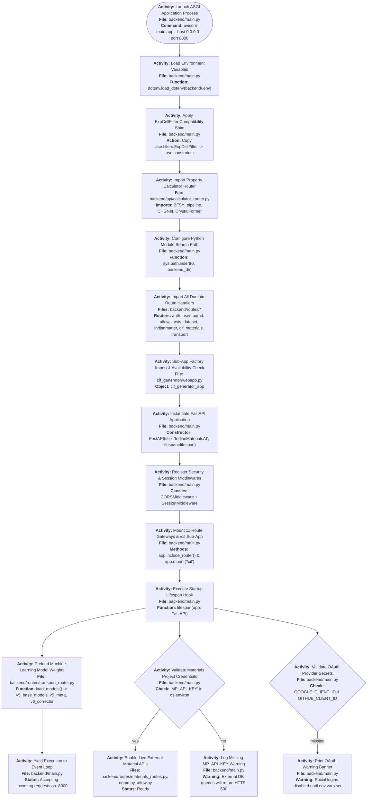
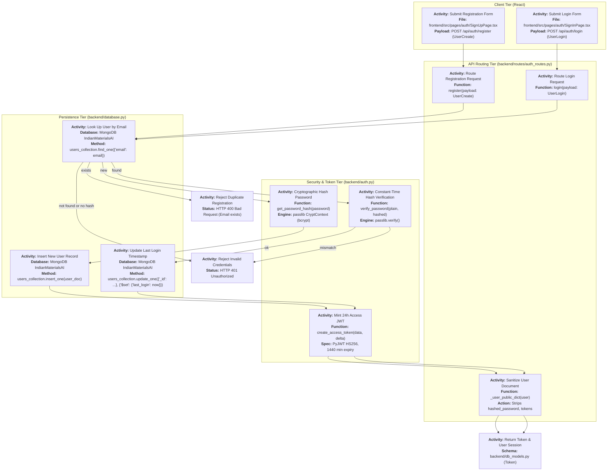
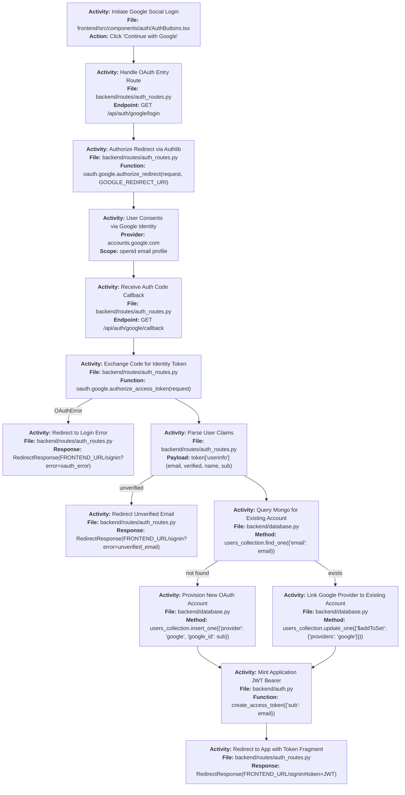
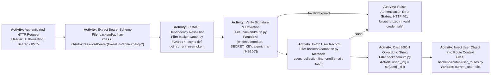
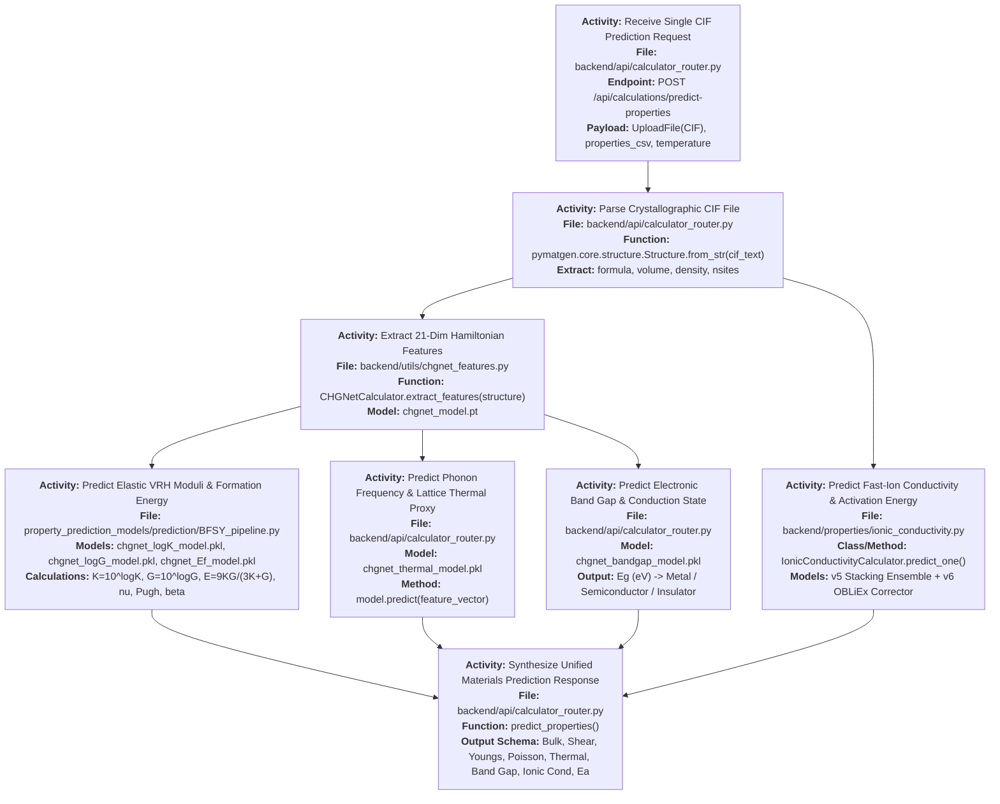
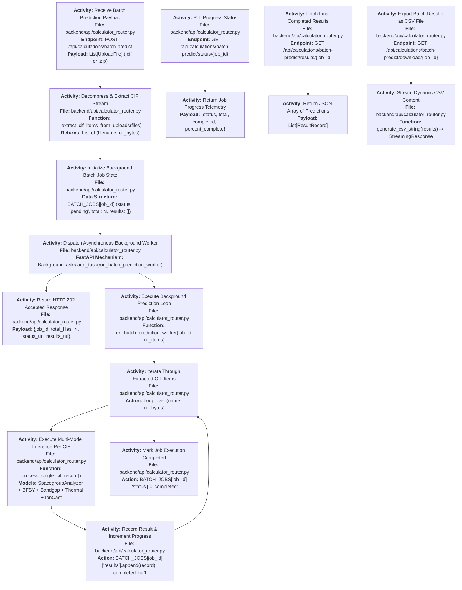
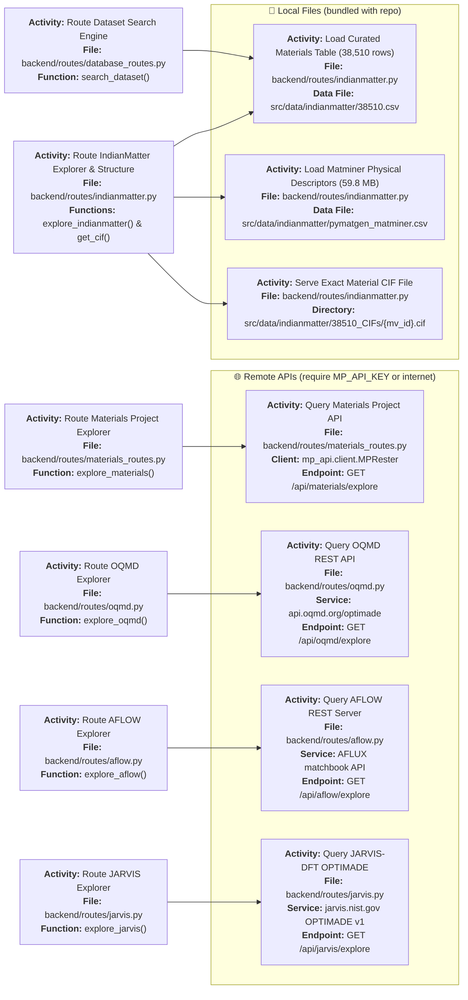
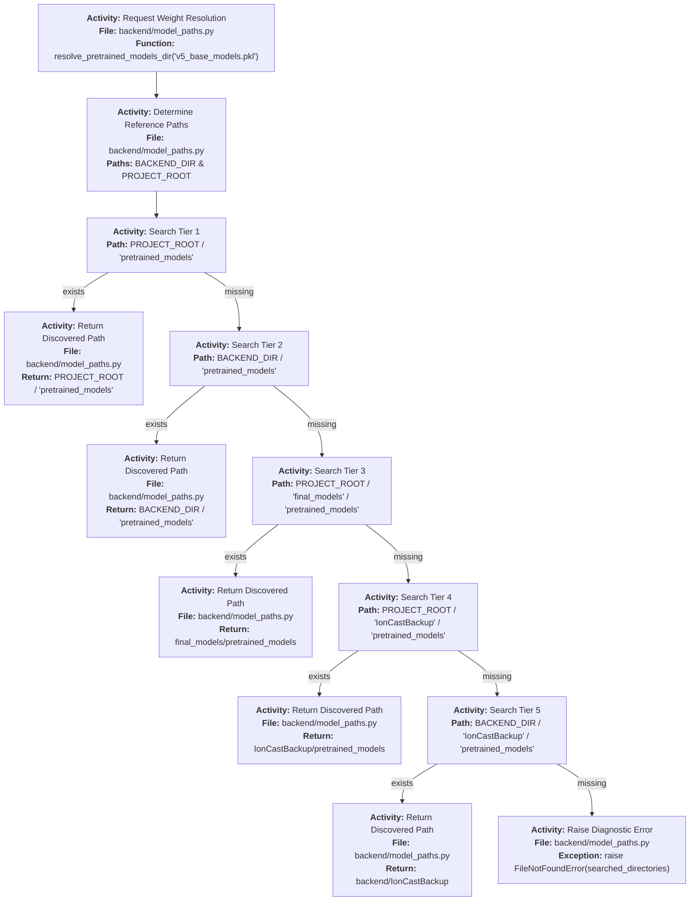

# IndianMatter — Backend Architecture & File Guide

> **Scope:** `E:\IndianMatter\backend\` — FastAPI server, routers, auth, prediction stack, service layers.
> **Entry point:** `backend/main.py` · Default port: **8000** · Run: `uvicorn main:app`

---

## Table of Contents

1. [Entry Point & Startup (`main.py`)](#1-entry-point--startup-mainpy)
2. [Router Mount Map](#2-router-mount-map)
3. [Authentication System](#3-authentication-system)
4. [User Management (`user_routes.py`)](#4-user-management-user_routespy)
5. [Property Prediction Stack](#5-property-prediction-stack)
6. [IonCast Ionic Conductivity (`model_service.py`)](#6-ioncast-ionic-conductivity-model_servicepy)
7. [Dataset & External DB Routers](#7-dataset--external-db-routers)
8. [Support Modules](#8-support-modules)
9. [File Connection Matrix](#9-file-connection-matrix)
10. [Known Gaps & Dead Code](#10-known-gaps--dead-code)

---

## 1. Entry Point & Startup (`main.py`)

**File:** [`backend/main.py`](file:///e:/IndianMatter/backend/main.py)

`main.py` is the single orchestrator. It must be the first module `uvicorn` loads; every other import flows from it. The module's docstring is precise about its contract: it builds the FastAPI app, applies middleware, includes all 11 router entries, mounts the CIF sub-app, and hands off to the ASGI lifecycle.

### 1.1 What Happens at Import Time (Before `lifespan`)

| Step | Code Location | What It Does |
|------|--------------|--------------|
| `load_dotenv()` | Line 44 | Reads `backend/.env` into `os.environ` before any router module is imported |
| ASE shim | Lines 47–53 | Checks if `ase.constraints.ExpCellFilter` exists; if not, copies it from `ase.filters.ExpCellFilter` — prevents `AttributeError` when CHGNet calls `ase.constraints.ExpCellFilter` on newer ASE versions |
| `from api.calculator_router import router` | Line 55 | **Earliest heavy import** — triggers loading of BFSY pipeline + CHGNet feature extractor |
| `sys.path.insert(0, ...)` | Line 58 | Inserts `backend/` at the front of `sys.path` so all `from routes.*` imports work regardless of the working directory |
| `from routes import (...)` | Lines 60–71 | Imports all 9 route modules; each has its own side-effects (OAuth registration in `auth_routes`, CSV path setup in `indianmatter`, etc.) |
| `from model_service import load_models` | Line 72 | Imports the function; does **not** call it yet — that happens in `lifespan()` |
| CIF sub-app import (try/except) | Lines 77–83 | `from webapp import app as cif_generator_app` — wrapped in try/except so a missing ML dependency (e.g. MACE not installed) does NOT prevent the main API from starting |

> [!IMPORTANT]
> `auth_routes.py` calls its own `load_dotenv(env_path)` at **module import time** — before `main.py`'s `load_dotenv()` runs. This is intentional: `oauth.register()` for Google/GitHub is called at import time and needs the credentials immediately. Any change to env-loading order would break OAuth registration.

### 1.2 `lifespan()` — Step by Step

```python
@asynccontextmanager
async def lifespan(app: FastAPI):
    ...
    yield
    ...
```

`lifespan()` is the FastAPI ASGI lifespan hook. Everything **before** `yield` runs at startup; everything **after** runs at shutdown.

| Step | Code | Effect |
|------|------|--------|
| 1 | `print("[startup] Loading global ML models...")` | Startup banner |
| 2 | `load_models()` | Calls `model_service.load_models()` — loads all IonCast v5/v6 `.pkl` artefacts into module-global variables |
| 3 | `mp_key = os.getenv("MP_API_KEY")` | Checks for Materials Project API key; prints warning if missing |
| 4 | Check `GOOGLE_CLIENT_ID` + `GOOGLE_CLIENT_SECRET` | Prints 60-char error banner if either is missing; does NOT abort startup |
| 5 | Check `GITHUB_CLIENT_ID` + `GITHUB_CLIENT_SECRET` | Same — missing prints warning but server continues |
| 6 | `yield` | App is now fully ready; ASGI server starts accepting requests |
| 7 | `print("[shutdown] Cleaning up resources...")` | On SIGTERM / Ctrl-C — currently no explicit cleanup (no background threads to join) |

> [!NOTE]
> Missing MP/Google/GitHub credentials do not crash the server — they just disable the corresponding endpoints at request time (500 from Materials Project queries, broken consent-screen redirects for OAuth). The design is intentionally permissive so partial deployments work.

### 1.3 Middleware Stack

```python
app.add_middleware(CORSMiddleware,
    allow_origins=["*"],
    allow_credentials=True,
    allow_methods=["*"],
    allow_headers=["*"],
)
app.add_middleware(SessionMiddleware,
    secret_key=session_secret   # os.getenv("SESSION_SECRET", "fallback-secret-change-me")
)
```

| Middleware | Purpose |
|-----------|---------|
| `CORSMiddleware` | Wildcard CORS — allows any origin (including the Vite dev server on `:5173`) with credentials |
| `SessionMiddleware` | Starlette session cookies used by authlib to store OAuth `state` nonce between `/login` → `/callback` round-trips |

> [!CAUTION]
> `allow_origins=["*"]` with `allow_credentials=True` is technically invalid per the CORS spec (browsers reject wildcard+credentials). In practice Chromium is permissive here, but this should be restricted to `FRONTEND_URL` in production.

### 1.4 Router Mount Map (all 11 entries)

| # | Prefix | Router Object | Source File | Tag |
|---|--------|--------------|-------------|-----|
| 1 | `/api/auth` | `auth_routes.router` | `routes/auth_routes.py` | Auth |
| 2 | `/api/users` | `user_routes.router` | `routes/user_routes.py` | Users |
| 3 | `/api/cif` | `cif_routes.router` | `routes/cif_routes.py` | CIF Generator & Analyzer |
| 4 | `/api/materials` | `materials_routes.router` | `routes/materials_routes.py` | Materials Project |
| 5 | `/api/oqmd` | `oqmd.router` | `routes/oqmd.py` | OQMD |
| 6 | `/api/aflow` | `aflow.router` | `routes/aflow.py` | AFLOW |
| 7 | `/api/jarvis` | `jarvis.router` | `routes/jarvis.py` | JARVIS |
| 8 | `/api/dataset` | `database_routes.router` | `routes/database_routes.py` | Dataset |
| 9 | `/api/indianmatter` | `indianmatter.router` | `routes/indianmatter.py` | IndianMatter DB |
| 10 | `/api/calculations` | `calculator_router` | `api/calculator_router.py` | Calculations |
| 11 | `/api/calculations` | `transport_router.router` | `routes/transport_router.py` | Calculations |
| — | `/cif` (mounted sub-app) | `cif_generator_app` | `webapp.py` | (sub-app) |

> [!NOTE]
> Routers 10 and 11 **share the same prefix** `/api/calculations`. FastAPI handles this correctly because each router registers unique path suffixes. `calculator_router` owns `predict-properties`, `analyze-cif`, `batch-predict*`, `ionic-conductivity`; `transport_router` owns `/predict`, `/analyze-ionic`, `/ionic-conductivity` (aliases of one handler).

### 1.5 Startup Sequence Flowchart



---

## 2. Router Mount Map

Complete table of every HTTP endpoint wired in `main.py`, with the exact function name and a plain-English description.

| Method | Full Route | File | Function | What It Does |
|--------|-----------|------|----------|--------------|
| `POST` | `/api/auth/register` | `routes/auth_routes.py` | `register` | Validates `UserCreate` (email+password+name), checks for duplicate email in Mongo, hashes password with bcrypt, inserts user doc with `provider="email"`, mints 24h JWT with `create_access_token({"sub": email})`, returns `Token` |
| `POST` | `/api/auth/login` | `routes/auth_routes.py` | `login` | Looks up user by email, checks `hashed_password` exists (rejects OAuth-only users), calls `verify_password`, updates `last_login`, mints JWT, returns `Token` |
| `GET` | `/api/auth/google/login` | `routes/auth_routes.py` | `google_login` | Calls `oauth.google.authorize_redirect(request, redirect_uri)` — redirects browser to Google consent screen |
| `GET` | `/api/auth/google/callback` | `routes/auth_routes.py` | `google_callback` | Exchanges auth code via `authorize_access_token`, extracts `userinfo` (requires `email_verified=True`), upserts Mongo user, appends `"google"` to `providers`, mints JWT, redirects to `FRONTEND_URL/signin#token=<JWT>` |
| `GET` | `/api/auth/github/login` | `routes/auth_routes.py` | `github_login` | Calls `oauth.github.authorize_redirect` — redirects to GitHub consent |
| `GET` | `/api/auth/github/callback` | `routes/auth_routes.py` | `github_callback` | Exchanges code, fetches `/user` then `/user/emails` fallback (for private email), upserts Mongo user, appends `"github"` to `providers`, mints JWT, redirects to `FRONTEND_URL/signin#token=<JWT>` |
| `GET` | `/api/users/profile` | `routes/user_routes.py` | `get_profile` | `Depends(get_current_user)` → returns id, email, name, provider, providers list, github_id, created_at, last_login |
| `GET` | `/api/users/dashboard` | `routes/user_routes.py` | `get_dashboard` | Returns user sub-dict + last 5 `prediction_history` entries + full `saved_materials` list |
| `POST` | `/api/users/predict` | `routes/user_routes.py` | `make_prediction` | **MOCK** — always returns Ea=0.46 eV, σ=1.3e-3 S/cm; pushes `PredictionHistory` doc to Mongo via `$push` |
| `POST` | `/api/users/save-material` | `routes/user_routes.py` | `save_user_material` | Accepts `MaterialSaveRequest`, builds `SavedMaterial` with server timestamp, pushes to Mongo `$push saved_materials` |
| `POST` | `/api/cif/parse` | `routes/cif_routes.py` | (unnamed) | Receives CIF upload, runs `pymatgen.io.cif.CifParser`, returns lattice params, sites, space-group info |
| `GET` | `/api/materials/explore` | `routes/materials_routes.py` | (query handler) | Queries Materials Project via `mp_api.MPRester` with `MP_API_KEY`, returns normalized rows |
| `GET` | `/api/oqmd/explore` | `routes/oqmd.py` | (query handler) | OQMD REST API with `filter=` grammar, returns materials rows |
| `GET` | `/api/aflow/explore` | `routes/aflow.py` | (query handler) | AFLUX matchbook query against AFLOW servers, returns rows |
| `GET` | `/api/jarvis/explore` | `routes/jarvis.py` | (query handler) | OPTIMADE query + Python post-filters against JARVIS, returns rows |
| `GET` | `/api/indianmatter/explore` | `routes/indianmatter.py` | (explore handler) | Loads module-global DataFrame from `38510.csv` + `pymatgen_matminer.csv`, applies 17 range-pair filters + element/formula/crystal-system/stability filters, returns paginated rows |
| `GET` | `/api/indianmatter/structure/{id}` | `routes/indianmatter.py` | (structure handler) | Serves `38510_CIFs/{id}.cif` as `FileResponse` |
| `GET` | `/api/dataset/search` | `routes/database_routes.py` | (search handler) | Loads `38510.csv`, periodic-table element filtering + formula text search + pagination |
| `POST` | `/api/calculations/predict-properties` | `api/calculator_router.py` | `predict_properties` | CIF upload → `Structure.from_str` → CHGNet feature vector (21-dim) → BFSY mechanical + thermal surrogate + bandgap surrogate + IonCast ionic conductivity → unified JSON |
| `POST` | `/api/calculations/analyze-cif` | `api/calculator_router.py` | `analyze_cif` | CIF → `SpacegroupAnalyzer` + Magpie featurizer → structural metadata |
| `POST` | `/api/calculations/batch-predict` | `api/calculator_router.py` | `batch_predict` | `.cif`/`.zip` upload → `_extract_cif_items_from_uploads` → new entry in `BATCH_JOBS` dict → `BackgroundTasks.add_task(run_batch_prediction_worker)` |
| `GET` | `/api/calculations/batch-predict/status/{job_id}` | `api/calculator_router.py` | `batch_status` | Returns `BATCH_JOBS[job_id]` progress |
| `GET` | `/api/calculations/batch-predict/results/{job_id}` | `api/calculator_router.py` | `batch_results` | Returns completed results list |
| `GET` | `/api/calculations/batch-predict/download/{job_id}` | `api/calculator_router.py` | `batch_download` | Calls `generate_csv_string(results)` → `StreamingResponse` CSV |
| `POST` | `/api/calculations/batch-predict-bfsy` | `api/calculator_router.py` | (bfsy handler) | BFSY batch inference → CSV response |
| `POST` | `/api/calculations/predict` | `routes/transport_router.py` | `predict_conductivity` | CIF upload → temp file → `predict_conductivity_from_path` → IonCast `predict_one` → result JSON |
| `POST` | `/api/calculations/analyze-ionic` | `routes/transport_router.py` | `predict_conductivity` | **Alias** of `/predict` — same handler |
| `POST` | `/api/calculations/ionic-conductivity` | `routes/transport_router.py` | `predict_conductivity` | **Alias** of `/predict` — same handler |
| `POST` | `/cif/api/generate` | `webapp.py` | (generate handler) | CIF Generator pipeline — see CIF artifact |
| `GET` | `/` | `main.py` | `read_root` | Health check — returns `{"status": "online", "message": ..., "documentation": "/docs"}` |

---

## 3. Authentication System

**Files:** [`auth.py`](file:///e:/IndianMatter/backend/auth.py) · [`routes/auth_routes.py`](file:///e:/IndianMatter/backend/routes/auth_routes.py) · [`db_models.py`](file:///e:/IndianMatter/backend/db_models.py) · [`database.py`](file:///e:/IndianMatter/backend/database.py)

### 3.1 Email/Password Registration & Login Flow



### 3.2 Google OAuth Callback Flow



### 3.3 GitHub OAuth — Key Differences from Google

GitHub's public user API **may omit the email** if the user's GitHub email is set to private. `github_callback` handles this with a two-step fetch:

1. `GET /user` → `user_info` (may have `email: null`)
2. If email is null → `GET /user/emails` → iterate to find `primary=True AND verified=True`; fall back to any verified email
3. If still no email → redirect with `error=unverified_email`

GitHub does not provide an OIDC `userinfo` endpoint (unlike Google), so the name is taken as `user_info["name"] or user_info["login"]`.

### 3.4 JWT Bearer Auth for Protected Endpoints



> [!CAUTION]
> `get_current_user` returns the **full Mongo document** including `hashed_password`. Callers in `user_routes.py` carefully cherry-pick only public fields for their responses — but any future endpoint that accidentally returns `current_user` directly would leak the hash.

### 3.5 File-by-File Function Reference

#### `auth.py`

| Symbol | Type | Inputs | Returns | Notes |
|--------|------|--------|---------|-------|
| `SECRET_KEY` | constant | — | `str` | Hardcoded `"indian-materials-ai-secret-key-change-it-in-prod"` — **must move to env** |
| `ALGORITHM` | constant | — | `"HS256"` | — |
| `ACCESS_TOKEN_EXPIRE_MINUTES` | constant | — | `1440` | 24 hours |
| `pwd_context` | `CryptContext` | schemes=["bcrypt"] | — | `deprecated="auto"` re-hashes legacy schemes on verify |
| `oauth2_scheme` | `OAuth2PasswordBearer` | tokenUrl="api/auth/login" | — | Used by FastAPI Swagger "Authorize" button |
| `verify_password(plain, hashed)` | function | plaintext + bcrypt hash | `bool` | Constant-time via passlib |
| `get_password_hash(password)` | function | plaintext | bcrypt hash string | — |
| `create_access_token(data, expires_delta)` | function | dict + optional timedelta | JWT string | Adds `exp` claim; default 15 min if no delta passed |
| `get_current_user(token)` | async dependency | Bearer token string | user dict | Raises HTTP 401 on any decode error; casts `_id` to str |

#### `database.py`

| Symbol | Type | Value | Notes |
|--------|------|-------|-------|
| `MONGO_URL` | constant | `"mongodb://localhost:27017/"` | Hardcoded — override via env in production |
| `client` | `MongoClient` | lazy connection | Created at import time; connection pool is pymongo default |
| `db` | `Database` | `"IndianMaterialsAI"` | Selected on `client` |
| `users_collection` | `Collection` | `db["users"]` | The only collection used by auth/user stack |

#### `db_models.py`

| Pydantic Model | Fields | Used By |
|---------------|--------|---------|
| `UserCreate` | `email: EmailStr`, `password: str`, `name: Optional[str]` | `register` endpoint body |
| `UserLogin` | `email: EmailStr`, `password: str` | `login` endpoint body |
| `GoogleLogin` | `token: str` | Legacy — not used by current OAuth redirect flow |
| `PredictionHistory` | `material: str`, `Ea: float`, `conductivity: float`, `timestamp: datetime` | `make_prediction` mock; pushed to Mongo |
| `SavedMaterial` | `material: str`, `notes: Optional[str]`, `saved_at: datetime` | `save_user_material`; pushed to Mongo |
| `UserInDB` | email, hashed_password, name, provider, providers, google_id, github_id, created_at, last_login, saved_materials, prediction_history | Schema reference; not used as a Pydantic validator in queries |
| `Token` | `access_token: str`, `token_type: str`, `user: dict` | Response model for register/login |
| `MaterialSaveRequest` | `material: str`, `notes: Optional[str]` | `save_user_material` endpoint body |

#### `routes/auth_routes.py` — All Functions

| Function | Decorator | Description |
|----------|-----------|-------------|
| `_user_public_dict(user)` | — | Helper that strips `hashed_password`, `google_id`, `github_id`, `providers` from a Mongo doc; casts `_id` to str |
| `register(payload: UserCreate)` | `@router.post("/register")` | Full email+bcrypt registration flow; returns `Token` |
| `login(payload: UserLogin)` | `@router.post("/login")` | bcrypt verify + `last_login` update + JWT |
| `google_login(request)` | `@router.get("/google/login")` | `oauth.google.authorize_redirect` — redirects to Google |
| `google_callback(request)` | `@router.get("/google/callback")` | Token exchange → userinfo → upsert Mongo → JWT → redirect |
| `github_login(request)` | `@router.get("/github/login")` | `oauth.github.authorize_redirect` — redirects to GitHub |
| `github_callback(request)` | `@router.get("/github/callback")` | Code exchange → `/user` + `/user/emails` fallback → upsert Mongo → JWT → redirect |

---

## 4. User Management (`user_routes.py`)

**File:** [`backend/routes/user_routes.py`](file:///e:/IndianMatter/backend/routes/user_routes.py)
**Mount:** `app.include_router(user_routes.router, prefix="/api/users")`
**Auth:** Every endpoint uses `Depends(get_current_user)` — all require a valid JWT Bearer token.

### 4.1 Endpoint Details

#### `GET /api/users/profile` → `get_profile`

Returns a **public** projection of the current user. Fields returned:

```json
{
  "id": "<ObjectId as str>",
  "email": "user@example.com",
  "name": "User Name",
  "provider": "email",
  "providers": ["email"],
  "github_id": null,
  "created_at": "...",
  "last_login": "..."
}
```

> Note: `providers` falls back to `[current_user.get("provider")]` for users created before the `providers` list field was added.

#### `GET /api/users/dashboard` → `get_dashboard`

Returns a dashboard summary:
- `user`: `{id, email, name}`
- `recent_predictions`: last 5 items from `prediction_history` list (Python slice `[-5:]`)
- `saved_materials`: full `saved_materials` array (no pagination)

#### `POST /api/users/predict` → `make_prediction`

> [!WARNING]
> **This is a MOCK endpoint.** It always returns the same hardcoded values and does NOT call any ML model.

```python
prediction = PredictionHistory(
    material=material_name,
    Ea=0.46,          # eV — hardcoded
    conductivity=1.3e-3,  # S/cm — hardcoded
    timestamp=datetime.utcnow(),
)
users_collection.update_one(
    {"_id": ObjectId(current_user["_id"])},
    {"$push": {"prediction_history": prediction.model_dump()}},
)
```

The real ionic conductivity prediction is at `POST /api/calculations/ionic-conductivity` (IonCast v5/v6).

#### `POST /api/users/save-material` → `save_user_material`

Accepts `MaterialSaveRequest{material, notes}`. Stamps `saved_at=datetime.utcnow()`, builds `SavedMaterial`, pushes to Mongo `$push saved_materials`.

### 4.2 Import Dependencies

```
user_routes.py
  ├── fastapi: APIRouter, Depends, HTTPException
  ├── datetime.datetime
  ├── bson.objectid.ObjectId   ← for $push queries
  ├── auth.get_current_user    ← JWT dependency
  ├── db_models: PredictionHistory, SavedMaterial, MaterialSaveRequest
  └── database.users_collection
```

---

## 5. Property Prediction Stack

### 5.1 Files Involved

| File | Role |
|------|------|
| `api/calculator_router.py` | Main calculations router — orchestrates all prediction sub-calls |
| `routes/transport_router.py` | Thin IonCast wrapper — 3 aliased endpoints |
| `predict_ionic_conductivity.py` / `model_service.py` | v5/v6 IonCast inference engine |
| `prediction/BFSY_pipeline.py` | Mechanical property prediction (bulk/shear modulus → derived) |
| `utils/chgnet_features.py` | Global CHGNetCalculator → 21-dim feature vector |
| `properties/ionic_conductivity.py` | `IonicConductivityCalculator` helper used in batch path |
| `model_paths.py` | Resolves `pretrained_models/` directory |

### 5.2 `predict-properties` Single-CIF Flow



### 5.3 Batch Prediction Flow



### 5.4 `transport_router.py` — IonCast Direct Endpoint

**File:** [`backend/routes/transport_router.py`](file:///e:/IndianMatter/backend/routes/transport_router.py)

This router provides a streamlined single-endpoint path to IonCast without the full `predict-properties` overhead (no BFSY, no bandgap).

| Symbol | Type | Description |
|--------|------|-------------|
| `MODELS_BASE` | `str` | Path from `resolve_pretrained_models_dir("v5_base_models.pkl")` — resolved at import time |
| `IONIC_MODELS` | `dict` | Result of `load_models()` called at import time; `MODELS_LOADED=False` if this fails |
| `predict_conductivity_from_path(file_path, temperature)` | function | Internal helper: calls `predict_one(Path(file_path), T, IONIC_MODELS, apply_corrector=True, opts=AlignOpts(strict=False))`, unpacks `pred["material"]`, `pred["conductivity"]`, `pred["model_outputs"]`, prefers `corrected_conductivity_S_per_cm` over `base_conductivity_S_per_cm` |
| `predict_conductivity(file, temperature)` | async endpoint | Validates `.cif` extension, writes `temp_{filename}` to CWD, calls `predict_conductivity_from_path`, removes temp file in both success and error paths |

Three decorator routes are stacked on one function:
```python
@router.post("/predict")
@router.post("/analyze-ionic")
@router.post("/ionic-conductivity")
async def predict_conductivity(...):
```

Response shape:
```json
{
  "status": "success",
  "formula": "Li6PS5Cl",
  "space_group": "F-43m",
  "volume": 1589.4,
  "density": 1.857,
  "ea": 0.312,
  "conductivity": 0.00412,
  "temp": 298.15
}
```

---

## 6. IonCast Ionic Conductivity (`model_service.py`)

**File:** [`backend/model_service.py`](file:///e:/IndianMatter/backend/model_service.py)
**Called from:** `main.py` `lifespan()` and `routes/transport_router.py` (at import)

`model_service.py` (882 lines) is the in-process IonCast v5/v6 inference engine. It is the largest file in the backend.

### 6.1 Model Artefacts

| File | Format | Purpose |
|------|--------|---------|
| `v5_base_models.pkl` | joblib | LightGBM + XGBoost base learners (Ea prediction) |
| `v5_mlp_models.pkl` | joblib | MLP ensemble models (Ea prediction) |
| `v5_meta_model.pkl` | joblib | Stacking meta-learner combining base + MLP outputs |
| `v5_quantile_transformer.pkl` | joblib | `QuantileTransformer` — normalizes features before MLP stack |
| `v5_model2_A.pkl` | joblib | Arrhenius prefactor log(A) model |
| `v6_corrector_model.pkl` | joblib | Optional LightGBM residual corrector; loaded with `try/except` — missing is non-fatal |

All paths resolved via `resolve_pretrained_models_dir()` from `model_paths.py`.

### 6.2 Global State Variables

```python
v5_base_models = None       # loaded by load_models()
v5_mlp_models = None        # loaded by load_models()
v5_meta_model = None        # loaded by load_models()
v5_quantile_transformer = None
v5_model2_A = None          # log(A) Arrhenius prefactor model
v6_corrector_model = None   # optional — None if not found
LOG_A_MODEL_IS_CONSTANT = False  # probed at load time
```

`LOKY_MAX_CPU_COUNT=1` is set at module import to prevent joblib from spawning multiple processes inside the already-concurrent FastAPI event loop.

### 6.3 IonCast Full Inference Chain

```mermaid
flowchart LR
    CIF["<b>Activity:</b> Ingest CIF Data / Path<br/><b>File:</b> backend/routes/transport_router.py<br/><b>Function:</b> predict_conductivity()"] --> STRUCT["<b>Activity:</b> Construct Pymatgen Structure<br/><b>File:</b> backend/predict_ionic_conductivity.py<br/><b>Function:</b> pymatgen.core.structure.Structure.from_str()"]
    STRUCT --> FEAT["<b>Activity:</b> Extract OBLiEx Multi-Group Features<br/><b>File:</b> backend/predict_ionic_conductivity.py<br/><b>Function:</b> extract_obliex_style_features(structure)"]

    subgraph FEATURES["Feature Groups (backend/predict_ionic_conductivity.py)"]
        F1["<b>Activity:</b> MAGPIE Compositional Descriptors<br/><b>Class:</b> matminer.featurizers.composition.ElementProperty"]
        F2["<b>Activity:</b> Density & Packing Metrics<br/><b>Class:</b> matminer.featurizers.structure.DensityFeatures"]
        F3["<b>Activity:</b> Global Symmetry Properties<br/><b>Class:</b> matminer.featurizers.structure.GlobalSymmetryFeatures"]
        F4["<b>Activity:</b> CrystalNN Bond Coordination<br/><b>Class:</b> pymatgen.analysis.local_env.CrystalNN"]
        F5["<b>Activity:</b> Li Wyckoff Site Multiplicities<br/><b>Function:</b> compute_li_geometry()"]
        F6["<b>Activity:</b> Li Percolation Connectivity<br/><b>Function:</b> estimate_percolation_dim()"]
        F7["<b>Activity:</b> Optional DFT Formation Properties<br/><b>Service:</b> MPRester.get_entry()"]
    end

    FEAT --> FEATURES
    FEATURES --> ALIGN["<b>Activity:</b> Align Feature Schema with Imputation<br/><b>File:</b> backend/predict_ionic_conductivity.py<br/><b>Function:</b> align_features(raw_features, expected_cols)"]

    ALIGN --> MA["<b>Activity:</b> Predict Arrhenius Prefactor log10(A)<br/><b>File:</b> property_prediction_models/pretrained_models/v5_model2_A.pkl<br/><b>Model:</b> GradientBoostingRegressor (Model A)"]
    ALIGN --> BASE["<b>Activity:</b> Predict Base log10(Ea)<br/><b>File:</b> property_prediction_models/pretrained_models/v5_base_models.pkl<br/><b>Models:</b> LightGBM + XGBoost Ensemble"]
    ALIGN --> QT["<b>Activity:</b> Quantile Normalization to Gaussian<br/><b>File:</b> property_prediction_models/pretrained_models/v5_quantile_transformer.pkl<br/><b>Class:</b> sklearn.preprocessing.QuantileTransformer"]
    QT --> MLP["<b>Activity:</b> Infer Neural Representation<br/><b>File:</b> property_prediction_models/pretrained_models/v5_mlp_models.pkl<br/><b>Model:</b> 3-Layer MLP Regressor Ensemble"]
    BASE --> META["<b>Activity:</b> Stacking Meta-Learner Prediction<br/><b>File:</b> property_prediction_models/pretrained_models/v5_meta_model.pkl<br/><b>Model:</b> Ridge / LightGBM Meta-Regressor"]
    MLP --> META

    META --> EA["<b>Activity:</b> Calculate & Bound Activation Energy<br/><b>File:</b> backend/predict_ionic_conductivity.py<br/><b>Formula:</b> Ea = clip(expm1(log_pred) / 10, 0.005, 5.0 eV)"]
    MA --> ARR["<b>Activity:</b> Compute Base Arrhenius Transport<br/><b>File:</b> backend/predict_ionic_conductivity.py<br/><b>Formula:</b> sigma_base = (A / T) * exp(-Ea / (k_B * T))"]
    EA --> ARR

    ARR --> CORR{"<b>Activity:</b> Verify v6 Residual Corrector<br/><b>File:</b> backend/predict_ionic_conductivity.py<br/><b>Condition:</b> v6_corrector_model is not None"}
    CORR -- "yes" --> V6["<b>Activity:</b> Apply Experimental Residual Shift<br/><b>File:</b> property_prediction_models/pretrained_models/v6_corrector_model.pkl<br/><b>Model:</b> LightGBM Residual anchored at -3.585 log10(S/cm)"]
    CORR -- "no" --> OUT
    V6 --> OUT["<b>Activity:</b> Synthesize Output Report Payload<br/><b>File:</b> backend/routes/transport_router.py<br/><b>Payload:</b> Ea_eV, log10_A, sigma_298K, HES score, reliability flag"]
```



### 6.4 HES Score

```
HES = cond_score × 0.6 + ea_score × 0.4
```

`cond_score` and `ea_score` are derived from how far the prediction is from known reference ranges. HES = 1.0 is ideal; < 0.4 triggers honesty warnings.

### 6.5 `PredictionValidator`

Imported from `Surrogative_models/final_validation/validators.py` (optional import). Validates that:
- Feature values are within trained ranges
- Ea is between 0.005 and 5.0 eV
- log(A) is within expected Arrhenius range
- σ is physically plausible (> 0 S/cm)

If the validator is not importable (module missing), predictions still proceed without validation.

### 6.6 `cif_descriptors.compute_descriptors`

Used internally as an alternative feature path:
- Lattice geometry descriptors
- Per-site statistics with `ddof=1` (sample std dev)
- Space group number
- Column name aliases: `cif_v2_c2_*`, `cif_v3_c3_*`, `comp_form_*`

---

## 7. Dataset & External DB Routers

### 7.1 Data Sources Overview



### 7.2 `indianmatter.py` — IndianMatter Local DB Router

**File:** [`backend/routes/indianmatter.py`](file:///e:/IndianMatter/backend/routes/indianmatter.py)
**Mount:** `/api/indianmatter`

Key design decisions:

**Data loading:** Both CSVs are loaded once into module-global DataFrames (using `@lru_cache` or module-level variables). The `pymatgen_matminer.csv` is loaded with `usecols=MATMINER_USECOLS` to avoid loading all 152 columns — the full file is ~57MB.

```python
DATA_DIR = os.path.abspath(
    os.path.join(os.path.dirname(__file__), "..", "..", "src", "data", "indianmatter")
)
MAIN_CSV = os.path.join(DATA_DIR, "38510.csv")
MATMINER_CSV = os.path.join(DATA_DIR, "pymatgen_matminer.csv")
CIF_DIR = os.path.join(DATA_DIR, "38510_CIFs")
STABILITY_THRESHOLD_EV = 0.025  # eV/atom
```

**`FILTER_COLUMNS` mapping (17 filters):**

| Query Param | DataFrame Column |
|-------------|-----------------|
| `nsites` | `nsites` |
| `e_hull` | `E_hull-m (eV/atom)` |
| `m3gnet_energy` | `Final M3GNet energy (eV)` |
| `formation_energy` | `Form. Energy E_f (eV/atom)` |
| `band_gap` | `Band Gap E_g (eV)` |
| `bulk_modulus` | `Bulk Modulus K (GPa)` |
| `shear_modulus` | `Shear Modulus G (GPa)` |
| `metal_prob` | `Metal Prob.` |
| `num_elements` | `num_elements` |
| `volume` | `volume` |
| `density` | `density` |
| `lattice_a` | `lattice_a` |
| `lattice_b` | `lattice_b` |
| `lattice_c` | `lattice_c` |
| `alpha` | `alpha` |
| `beta` | `beta` |
| `gamma` | `gamma` |

**Stability filter:** `E_hull-m (eV/atom) <= 0.025` — 33,880 of 38,510 materials pass at this threshold. Adjustable via `STABILITY_THRESHOLD_EV`.

**Crystal system:** NOT derived from real symmetry analysis. A lattice-metric heuristic classifies based on `a/b/c` ratios and `alpha/beta/gamma` angles. This is a known limitation — real SG would require offline `SpacegroupAnalyzer` precompute.

**Join logic:** The matminer CSV is joined to the main CSV on `filename` == `"{mv_id}.cif"` → `mv_id`.

**Endpoints:**
- `GET /api/indianmatter/explore` — filter + paginate the joined DataFrame
- `GET /api/indianmatter/structure/{id}` — `FileResponse(CIF_DIR/{id}.cif)`
- CSV download endpoints via `StreamingResponse`

### 7.3 `database_routes.py` — Dataset Search

**Mount:** `/api/dataset`

- Loads `38510.csv`
- Supports element-based filtering (contains/exact/any mode)
- Formula text search
- Pagination parameters

### 7.4 External DB Routers

| File | Mount | Mechanism | Notes |
|------|-------|-----------|-------|
| `materials_routes.py` | `/api/materials` | `mp_api.MPRester(MP_API_KEY)` | Requires `MP_API_KEY` env var; 500 if missing |
| `oqmd.py` | `/api/oqmd` | `requests.get("https://api.oqmd.org/optimade/...")` | Public API; no key |
| `aflow.py` | `/api/aflow` | AFLUX matchbook protocol | Public; structure download is 501 stub |
| `jarvis.py` | `/api/jarvis` | OPTIMADE `https://optimade.org/v1/...` | Public; CIF download is 501 stub |
| `cif_routes.py` | `/api/cif` | `pymatgen.io.cif.CifParser` | Local parsing; no network |

> [!NOTE]
> OQMD, AFLOW, and JARVIS structure/CIF download endpoints are **501 Not Implemented** stubs. Only the `explore` listing endpoints are functional.

---

## 8. Support Modules

### 8.1 `model_paths.py` — Path Resolution

**File:** [`backend/model_paths.py`](file:///e:/IndianMatter/backend/model_paths.py)



**Used by:**
- `api/calculator_router.py` — loads CHGNet surrogates + BFSY pkl
- `routes/transport_router.py` — loads IonCast models
- `model_service.py` — loads v5/v6 stack

The design allows the same codebase to run in `E:\IndianMatter\` (root-level `pretrained_models/`), a packaged deployment (`backend/pretrained_models/`), or a legacy layout (`IonCastBackup/pretrained_models/`).

### 8.2 `megnet_patch.py` — PyMatGen/MEGNet Shims

**File:** `backend/megnet_patch.py`

MEGNet (a graph neural network for materials) requires PyMatGen's `local_env` module to export specific nearest-neighbour classes. Newer pymatgen versions moved or renamed some of these classes. `megnet_patch.py` applies monkey-patches to:

- Ensure `pymatgen.analysis.local_env` exports the classes MEGNet imports
- Patch any NN-class name renames (e.g. `VoronoiNN`, `CrystalNN`)

This module must be imported **before** any MEGNet import. In practice it is imported at the top of modules that use MEGNet descriptors.

### 8.3 `cif_descriptors.py` — Structural Descriptors

**File:** `backend/cif_descriptors.py`

Provides `compute_descriptors(structure: pymatgen.Structure) -> dict`:

| Descriptor Group | Features Computed |
|-----------------|------------------|
| Lattice geometry | `a`, `b`, `c`, `alpha`, `beta`, `gamma`, volume |
| Per-site stats | mean/std of fractional coordinates (ddof=1 for sample std) |
| Composition | element fractions, average atomic number/mass/radius |
| Space group | SG number (from `SpacegroupAnalyzer`) |
| Column aliases | `cif_v2_c2_*`, `cif_v3_c3_*`, `comp_form_*` prefix mappings |

Used as an alternative feature path in `model_service.py` when OBLiEx-style extraction is not needed. The column alias system ensures backward compatibility with models trained on differently-named feature columns.

### 8.4 `auth.py` (recap as Support Module)

```
auth.py exports:
  verify_password    → passlib bcrypt verify (constant-time)
  get_password_hash  → passlib bcrypt hash
  create_access_token → PyJWT HS256 encode with exp claim
  get_current_user   → async FastAPI dependency (Bearer decode + Mongo lookup)
  oauth2_scheme      → OAuth2PasswordBearer (used by Swagger + deps)
  SECRET_KEY         → ⚠ hardcoded string
  ALGORITHM          → "HS256"
  ACCESS_TOKEN_EXPIRE_MINUTES → 1440 (24h)
```

---

## 9. File Connection Matrix

```
backend/
│
├── main.py  ─────────────────────────────────────────────────────────────────┐
│   ├── load_dotenv()                                                          │
│   ├── ASE ExpCellFilter shim                                                 │
│   ├── api/calculator_router.py ────────────────────────────────────────────┐ │
│   │   ├── model_paths.resolve_pretrained_models_dir()                      │ │
│   │   ├── prediction/BFSY_pipeline.py                                      │ │
│   │   │   └── pretrained_models/chgnet_logK.pkl                            │ │
│   │   │   └── pretrained_models/chgnet_logG.pkl                            │ │
│   │   │   └── pretrained_models/chgnet_Ef.pkl                              │ │
│   │   ├── pretrained_models/chgnet_bandgap_model.pkl                       │ │
│   │   ├── pretrained_models/chgnet_thermal_model.pkl                       │ │
│   │   ├── predict_ionic_conductivity.load_models()  ──────────────────────┐│ │
│   │   │   └── (see model_service.py graph)                                 ││ │
│   │   ├── utils/chgnet_features.py                                         ││ │
│   │   │   └── chgnet.CHGNetCalculator (global singleton)                   ││ │
│   │   └── properties/ionic_conductivity.IonicConductivityCalculator        ││ │
│   │                                                                         ││ │
│   ├── routes/auth_routes.py ──────────────────────────────────────────────┐│ │
│   │   ├── load_dotenv(backend/.env)  [at import time!]                     ││ │
│   │   ├── authlib.OAuth (google + github registered)                       ││ │
│   │   ├── auth.py [verify_password, get_password_hash,                     ││ │
│   │   │          create_access_token, ACCESS_TOKEN_EXPIRE_MINUTES]          ││ │
│   │   ├── db_models.py [UserCreate, UserLogin, GoogleLogin, Token]         ││ │
│   │   └── database.py [users_collection]                                   ││ │
│   │                                                                         ││ │
│   ├── routes/user_routes.py ───────────────────────────────────────────────┤│ │
│   │   ├── auth.get_current_user                                             ││ │
│   │   ├── db_models [PredictionHistory, SavedMaterial, MaterialSaveRequest] ││ │
│   │   └── database.users_collection                                         ││ │
│   │                                                                         ││ │
│   ├── routes/transport_router.py ─────────────────────────────────────────┘│ │
│   │   ├── model_paths.resolve_pretrained_models_dir()                       │ │
│   │   ├── predict_ionic_conductivity [load_models, predict_one, AlignOpts]  │ │
│   │   └── pymatgen.core.Structure                                            │ │
│   │                                                                          │ │
│   ├── routes/cif_routes.py                                                   │ │
│   │   └── pymatgen.io.cif.CifParser                                          │ │
│   │                                                                          │ │
│   ├── routes/materials_routes.py                                             │ │
│   │   └── mp_api.MPRester (requires MP_API_KEY)                              │ │
│   │                                                                          │ │
│   ├── routes/oqmd.py → requests → api.oqmd.org                              │ │
│   ├── routes/aflow.py → requests → AFLUX endpoint                           │ │
│   ├── routes/jarvis.py → requests → optimade.org                            │ │
│   │                                                                          │ │
│   ├── routes/indianmatter.py                                                 │ │
│   │   ├── pandas.read_csv(38510.csv)       [module-global DF]               │ │
│   │   ├── pandas.read_csv(pymatgen_matminer.csv, usecols=...)               │ │
│   │   └── FileResponse(38510_CIFs/{id}.cif)                                 │ │
│   │                                                                          │ │
│   ├── routes/database_routes.py                                              │ │
│   │   └── pandas.read_csv(38510.csv)                                         │ │
│   │                                                                          │ │
│   ├── model_service.py  [load_models() called in lifespan] ─────────────────┘ │
│   │   ├── model_paths.resolve_pretrained_models_dir()                          │
│   │   ├── joblib.load(v5_base_models.pkl)                                      │
│   │   ├── joblib.load(v5_mlp_models.pkl)                                       │
│   │   ├── joblib.load(v5_meta_model.pkl)                                        │
│   │   ├── joblib.load(v5_quantile_transformer.pkl)                              │
│   │   ├── joblib.load(v5_model2_A.pkl)                                          │
│   │   ├── joblib.load(v6_corrector_model.pkl) [optional]                        │
│   │   ├── pymatgen.core.Structure, SpacegroupAnalyzer                           │
│   │   ├── matminer DensityFeatures, GlobalSymmetryFeatures, ElementProperty     │
│   │   ├── Surrogative_models/final_validation/PredictionValidator [optional]    │
│   │   └── cif_descriptors.compute_descriptors [optional]                        │
│   │                                                                              │
│   └── webapp.py  [mounted at /cif — try/except] ─────────────────────────────  │
│       └── cif_pipeline/* (MACE, CrystalLM, etc.) — see CIF artifact             │
│                                                                                  │
Support modules (no routes):                                                        │
  model_paths.py  ←─── used by calculator_router, transport_router, model_service  │
  megnet_patch.py ←─── imported before MEGNet usage                                │
  cif_descriptors.py ←─ model_service alternative feature path                     │
  auth.py         ←─── auth_routes + user_routes                                   │
  database.py     ←─── auth_routes + user_routes + auth.py                         │
  db_models.py    ←─── auth_routes + user_routes                                   │
```

---

## 10. Known Gaps & Dead Code

| # | Category | Location | Description | Impact |
|---|----------|----------|-------------|--------|
| 1 | **Dead router** | `tests/test_api_routes.py` | Tests expect `/api/materials-prediction/system`, `/devices`, `/properties`, `/models/capabilities`, `/predictions` — these routes are **never mounted** in `main.py` | All these tests fail with 404 |
| 2 | **Missing modules** | `services/prediction_service.py`, `workers/prediction_worker.py` | Import `properties.property_registry` and `calculations.strain_response` which don't exist in the repo | Import-time `ModuleNotFoundError` if these files are ever imported |
| 3 | **Dead frontend endpoint** | `src/lib/api.ts` | Calls `/trial/predict` — this route does not exist in `main.py` or any router | 404 from the frontend; the real endpoint is `/api/calculations/predict-properties` |
| 4 | **Hardcoded SECRET_KEY** | `auth.py` line 31 | `SECRET_KEY = "indian-materials-ai-secret-key-change-it-in-prod"` | Any deployed instance is vulnerable to JWT forgery if this string is known |
| 5 | **Hardcoded MONGO_URL** | `database.py` line 25 | `MONGO_URL = "mongodb://localhost:27017/"` | Cannot point to a remote/Atlas DB without editing source code |
| 6 | **CORS wildcard + credentials** | `main.py` lines 122–127 | `allow_origins=["*"]` with `allow_credentials=True` — spec violation | Modern browsers may reject; security risk in production |
| 7 | **501 stubs** | `routes/oqmd.py`, `aflow.py`, `jarvis.py` | Structure + CIF download endpoints return `501 Not Implemented` | CIF export from OQMD/AFLOW/JARVIS is non-functional |
| 8 | **Mock predict** | `routes/user_routes.py` lines 63–87 | `POST /api/users/predict` returns hardcoded `Ea=0.46, σ=1.3e-3` | Users calling this endpoint get fake results with no warning |
| 9 | **Crystal system heuristic** | `routes/indianmatter.py` | `crystal_system` is a lattice-metric tolerance heuristic, not real symmetry analysis | Incorrect crystal system labels for non-standard settings |
| 10 | **SESSION_SECRET fallback** | `main.py` line 130 | `os.getenv("SESSION_SECRET", "fallback-secret-change-me")` — fallback used if env var missing | OAuth `state` cookie is insecure; CSRF risk |
| 11 | **No Mongo retry/pool config** | `database.py` | Raw `MongoClient(MONGO_URL)` with no pool config or retry | First-request failures if Mongo takes time to accept connections |
| 12 | **Unwired prediction pipeline** | `services/`, `workers/`, `core/` | `prediction_service.py`, `prediction_worker.py`, `core/job_manager.py`, `calculations/eos.py`, `calculations/alignn_properties.py` | Present in the repo but never imported by `main.py` — effectively dead code |
| 13 | **ALIGNN placeholder** | `calculations/alignn_properties.py` | Returns hardcoded `-2.35 eV` for all inputs | If ever wired, would silently return wrong values |
| 14 | **EOS not routed** | `calculations/eos.py` | Implements ±8% volume scan + Murnaghan EOS fit | Useful code, but unreachable from any mounted router |
| 15 | **Temp file in CWD** | `transport_router.py` line 112 | `temp_path = f"temp_{file.filename}"` — written to whatever the working directory is | Concurrent requests with same filename race; temp file leaks if process killed mid-request |

> [!TIP]
> **Quick wins to fix:** (1) Move `SECRET_KEY` and `MONGO_URL` to `.env` — two `os.getenv()` calls. (2) Restrict CORS `allow_origins` to `[os.getenv("FRONTEND_URL", "http://localhost:5173")]`. (3) Fix the temp file race by using `tempfile.NamedTemporaryFile(suffix=".cif", delete=False)`.

---

*Generated: 2026-11-03 | Source: `E:\IndianMatter\backend\` | Coverage: main.py, auth.py, database.py, db_models.py, model_service.py (first 80 lines), auth_routes.py, user_routes.py, transport_router.py, indianmatter.py (first 80 lines), model_paths.py, plus artifact_backend_flowchart.md*
