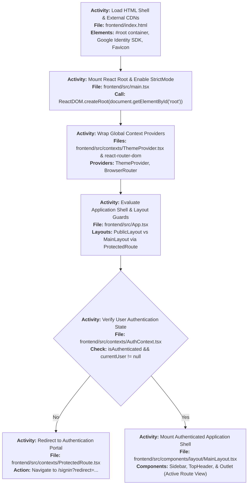
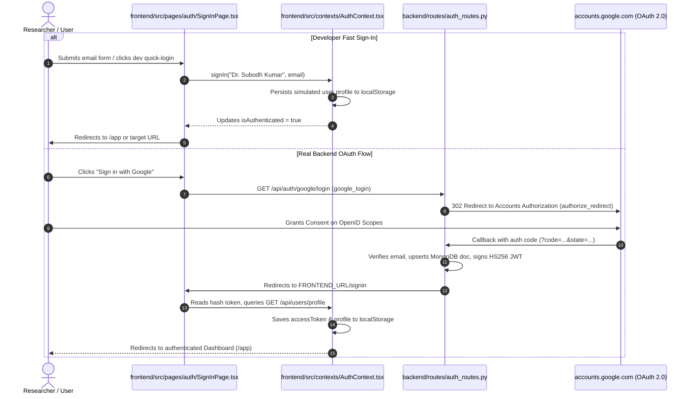

# IndianMatter — Frontend Architecture & File Guide

> **Scope:** `E:\IndianMatter\src\`, `index.html`, `public/`, config files (`vite.config.ts`, `tailwind.config.js`, `tsconfig.json`).  
> **Tech Stack:** React 18 · TypeScript · Vite 4 · Tailwind CSS 3 · React Router v6 · framer-motion · Three.js · 3Dmol.js (CDN) · Supabase JS.

---

## Table of Contents

1. [Tech Stack & Build System](#1-tech-stack--build-system)
2. [Application Boot & Lifecycle](#2-application-boot--lifecycle)
3. [Full Route Tree (`src/App.tsx`)](#3-full-route-tree-srcapptsx)
4. [Authentication & Session Flow](#4-authentication--session-flow)
5. [Layout Architecture](#5-layout-architecture)
6. [API Service Layer (`src/lib/`)](#6-api-service-layer-srclib)
7. [Core Pages Deep Dive](#7-core-pages-deep-dive)
8. [Crystallographic Visualization Components](#8-crystallographic-visualization-components)
9. [Inter-Page Data Flow & Navigation Handoffs](#9-inter-page-data-flow--navigation-handoffs)
10. [Known Issues, Dead Code & Technical Debt](#10-known-issues-dead-code--technical-debt)

---

## 1. Tech Stack & Build System

### 1.1 Core Dependencies & Libraries

| Dependency | Version | Role in Project |
|---|---|---|
| `react` / `react-dom` | `^18.2.0` | UI component tree, virtual DOM rendering, state hooks. |
| `react-router-dom` | `^6.15.0` | Client-side routing, route-level code splitting, state passing via `navigate(..., { state })`. |
| `vite` | `^4.4.5` | Fast ESM development server, asset bundling, build pipeline. |
| `tailwindcss` | `^3.3.3` | Utility-first styling with custom palette (`#F1641D`, `#1E2227`, `#FAF4EE`). |
| `framer-motion` | `^10.16.4` | Carousel transitions, dashboard animation springs, interactive feedback. |
| `lucide-react` | `^0.268.0` | SVG icons used across navigation, telemetry badges, and buttons. |
| `three` | `^0.155.0` | WebGL canvas rendering for 3D crystal unit cell and atomic sphere models. |
| `@supabase/supabase-js` | `^2.39.0` | Cloud database client querying published solid-state research literature. |

### 1.2 Configuration Files

* **[`vite.config.ts`](file:///e:/IndianMatter/vite.config.ts)**:
  * Configures dev server port (`5173`) and local API reverse proxy to prevent CORS issues in dev.
  * Proxies `/api` and `/cif` calls directly to `http://localhost:8000`.
  * Implements SPA fallback history rewrite rules.
* **[`tailwind.config.js`](file:///e:/IndianMatter/tailwind.config.js)**:
  * Extends theme colors (`primary`, `surface`, `accent-orange`, `dark-slate`).
  * Custom font families (`headline`, `body`, `mono`).
* **[`tsconfig.json`](file:///e:/IndianMatter/tsconfig.json)**:
  * Strict mode TypeScript configuration, path aliases (`@/*` $\rightarrow$ `./src/*`).

---

## 2. Application Boot & Lifecycle

---

## 3. Full Route Tree (`src/App.tsx`)

```mermaid
flowchart LR
    ROOT["<b>Activity:</b> Master Route Controller<br/><b>File:</b> frontend/src/App.tsx<br/><b>Component:</b> App()"]

    subgraph PUBLIC["Public Routes (frontend/src/layouts/PublicLayout.tsx)"]
        PUB_L["<b>Activity:</b> Render Landing Page<br/><b>File:</b> frontend/src/pages/LandingPage.tsx<br/><b>Route:</b> /"]
        PUB_RP["<b>Activity:</b> Render Literature Papers Browser<br/><b>File:</b> frontend/src/pages/ResearchPapersPage.tsx<br/><b>Route:</b> /research-papers"]
        PUB_SI["<b>Activity:</b> Render Sign In / Sign Up Portal<br/><b>File:</b> frontend/src/pages/auth/SignInPage.tsx<br/><b>Route:</b> /signin & /signup"]
    end

    subgraph PROTECTED["Protected Application Routes (frontend/src/layouts/MainLayout.tsx)"]
        PROT_DASH["<b>Activity:</b> Materials Science Dashboard<br/><b>File:</b> frontend/src/pages/DashboardPage.tsx<br/><b>Route:</b> /app"]
        PROT_MAT["<b>Activity:</b> Multi-Database Materials Search<br/><b>File:</b> frontend/src/pages/materials/MaterialsSearchPage.tsx<br/><b>Route:</b> /app/materials"]
        PROT_CIF["<b>Activity:</b> Crystallographic CIF Synthesis Studio<br/><b>File:</b> frontend/src/pages/cif/CIFGenerationPage.tsx<br/><b>Route:</b> /app/cif-gen"]
        PROT_PRED["<b>Activity:</b> Multi-Model Property Prediction Studio<br/><b>File:</b> frontend/src/pages/prediction/PropertyPredictionPage.tsx<br/><b>Route:</b> /app/predict"]
        PROT_BATCH["<b>Activity:</b> Batch Prediction Queue & CSV Download<br/><b>File:</b> frontend/src/pages/batch/BatchPredictionPage.tsx<br/><b>Route:</b> /app/batch"]
        PROT_VIZ["<b>Activity:</b> 3D Crystal Structure Visualizer<br/><b>File:</b> frontend/src/pages/structure/StructureVizPage.tsx<br/><b>Route:</b> /app/structure"]
        PROT_LIT["<b>Activity:</b> AI-Assisted Literature Synthesis<br/><b>File:</b> frontend/src/pages/LiteraturePage.tsx<br/><b>Route:</b> /app/literature"]
        PROT_DFT["<b>Activity:</b> DFT Validation Hub<br/><b>File:</b> frontend/src/pages/dft/DFTValidationPage.tsx<br/><b>Route:</b> /app/dft"]
        PROT_SAV["<b>Activity:</b> Saved Materials Repository<br/><b>File:</b> frontend/src/pages/SavedResultsPage.tsx<br/><b>Route:</b> /app/saved"]
        PROT_SET["<b>Activity:</b> User Profile & Settings<br/><b>File:</b> frontend/src/pages/SettingsPage.tsx<br/><b>Route:</b> /app/settings"]
        PROT_HLP["<b>Activity:</b> Platform Help & Docs<br/><b>File:</b> frontend/src/pages/HelpPage.tsx<br/><b>Route:</b> /app/help"]
        PROT_ADV["<b>Activity:</b> Advanced Filter Query Builder<br/><b>File:</b> frontend/src/pages/AdvanceSearchPage.tsx<br/><b>Route:</b> /app/advance-search"]
    end

    subgraph REDIRECTS["Canonical Path Redirects (frontend/src/App.tsx)"]
        R1["<b>Route:</b> /predict -> /app/predict"]
        R2["<b>Route:</b> /dashboard -> /app"]
        R3["<b>Route:</b> /materials-search -> /app/materials"]
        R4["<b>Route:</b> * (Catch-all) -> /"]
    end

    ROOT --> PUBLIC
    ROOT --> PROTECTED
    ROOT --> REDIRECTS
```

---

## 4. Authentication & Session Flow

**Files:** [`src/contexts/AuthContext.tsx`](file:///e:/IndianMatter/src/contexts/AuthContext.tsx), [`src/contexts/ProtectedRoute.tsx`](file:///e:/IndianMatter/src/contexts/ProtectedRoute.tsx), [`src/pages/auth/SignInPage.tsx`](file:///e:/IndianMatter/src/pages/auth/SignInPage.tsx).

The frontend supports **two auth modes**:
1. **Developer Quick Login**: Local storage simulation bypassing backend network dependencies.
2. **Backend OAuth Gateway**: Real redirect to Google/GitHub OAuth with JWT extraction.

---

## 5. Layout Architecture

### 5.1 Main Layout (`src/layouts/MainLayout.tsx`)
* Houses the authenticated workspace.
* Persistent **[`Sidebar.tsx`](file:///e:/IndianMatter/src/components/Sidebar.tsx)** on the left with active-route highlights:
  * *Explore*: Dashboard (`/app`), Materials Search (`/app/materials`).
  * *Synthesis & ML*: CIF Generation (`/app/cif-gen`), Property Prediction (`/app/predict`), Batch Predict (`/app/batch`), 3D Visualizer (`/app/structure`).
  * *Knowledge*: Literature (`/app/literature`), Research Papers (`/research-papers`).
* Persistent **[`TopHeader.tsx`](file:///e:/IndianMatter/src/components/TopHeader.tsx)**:
  * Global query search box (pressing Enter redirects to `/app/materials?q=...`).
  * System connectivity status badge.
  * User profile dropdown and sign-out handler.
* Dynamic `<Outlet />` renders page components with scroll containers.

---

## 6. API Service Layer (`src/lib/`)

The frontend groups server communication into modular client utilities:

| File | Primary Functions | Target Backend Endpoint | Notes |
|---|---|---|---|
| [`src/lib/api.ts`](file:///e:/IndianMatter/src/lib/api.ts) | `request()`, `predictFromTrial()` | `POST /trial/predict` (⛔ dead route), `VITE_API_BASE_URL` | Handles global fetch headers, Bearer tokens from localStorage. |
| [`src/lib/datasetapi.ts`](file:///e:/IndianMatter/src/lib/datasetapi.ts) | `searchDatasetMaterials()` | `/api/indianmatter/explore` `/api/materials/explore` `/api/oqmd/explore` `/api/jarvis/explore` `/api/aflow/explore` | Dispatches dataset tab queries and formats response rows into normalized tables. |
| [`src/lib/materialsPredictionApi.ts`](file:///e:/IndianMatter/src/lib/materialsPredictionApi.ts) | `predictFromCifFile()` `startBatchCifPrediction()` `getBatchJobStatus()` `getBatchJobResults()` | `POST /api/calculations/predict-properties` `POST /api/calculations/batch-predict` `GET /batch-predict/status/{id}` | Multipart form-data packaging for live ML evaluation. No mock data. |
| [`src/lib/cifApi.ts`](file:///e:/IndianMatter/src/lib/cifApi.ts) | `parseCifFile()` | Client-side only (no HTTP request) | Parses `loop_`, `_atom_site_*`, and `_cell_length_*` into `ParsedStructure` for WebGL 3D viewers. |
| [`src/lib/supabase.ts`](file:///e:/IndianMatter/src/lib/supabase.ts) | `getPublishedPapers()` | Supabase cloud REST | Reads peer-reviewed literature records from `papers` table. |

---

## 7. Core Pages Deep Dive

### 7.1 CIF Generation Page ([`src/pages/cif/CIFGenerationPage.tsx`](file:///e:/IndianMatter/src/pages/cif/CIFGenerationPage.tsx))
* **Primary Role**: The main visual front for the crystallographic synthesis pipeline.
* **State Management**:
  * `formula`: User formula input (e.g. `Na3Zr2Si2PO12`, `NiFe2O4`).
  * `dopingElement`, `dopingRatio`, `hostSite`: Substitution configuration.
  * `cifString`, `spaceGroup`, `totalTime`: Execution response state.
* **Network Call**: Submits JSON payload to `POST /cif/api/generate`.
* **User Actions**:
  * "Copy CIF" / "Download .cif" (client Blob).
  * "Open in 3D Viewer" $\rightarrow$ passes structure to `/app/structure`.
  * "Predict Properties for Structure" $\rightarrow$ passes `{ cifString, formula }` directly to `/app/predict`.

### 7.2 Property Prediction Page ([`src/pages/prediction/PropertyPredictionPage.tsx`](file:///e:/IndianMatter/src/pages/prediction/PropertyPredictionPage.tsx))
* **Primary Role**: Evaluation of physical, mechanical, thermal, electronic, and transport properties.
* **Inputs**: Accepts an uploaded `.cif` file or picks up `cifString` received via route state navigation.
* **Network Call**: Dispatches `POST /api/calculations/predict-properties` with selected property keys:
  * *Mechanical*: `bulk_modulus`, `shear_modulus`, `youngs_modulus`, `poisson_ratio`.
  * *Thermodynamic*: `formation_energy`.
  * *Electronic*: `band_gap`.
  * *Thermal*: `thermal_conductivity`, `phonon_frequency_proxy_cm_inv`.
  * *Transport*: `ionic_conductivity`, `activation_energy` at user temperature $T$.
* **Rendering**: Color-coded metric cards with standard scientific units ($\text{GPa}$, $\text{eV}$, $\text{S/cm}$).

### 7.3 Batch Prediction Page ([`src/pages/prediction/BatchPredictionPage.tsx`](file:///e:/IndianMatter/src/pages/prediction/BatchPredictionPage.tsx))
* **Primary Role**: High-throughput screening for multi-file CIF archives (`.zip` or multi-file selection).
* **Execution Flow**:
  1. User selects target properties checklist.
  2. Submits files via `startBatchCifPrediction()`.
  3. Launches a 1-second interval polling loop querying `GET /api/calculations/batch-predict/status/{job_id}`.
  4. Renders live progress bar ($0 \rightarrow 100\%$) and active filename.
  5. On completion, retrieves `results` array and activates CSV download streaming.

### 7.4 Materials Search Page ([`src/pages/materials/MaterialsSearchPage.tsx`](file:///e:/IndianMatter/src/pages/materials/MaterialsSearchPage.tsx))
* **Primary Role**: Unified search engine querying 5 materials databases.
* **Tabs**: IndianMatter (local 38,510 dataset), Materials Project, OQMD, JARVIS-DFT, AFLOW.
* **Components**: Integrated interactive [`PeriodicTable.tsx`](file:///e:/IndianMatter/src/components/PeriodicTable.tsx) for chemical element filtering, range sliders for band gap and formation energy, client-side table sorting and CSV export.

---

## 8. Crystallographic Visualization Components

### 8.1 3Dmol.js Viewer ([`src/components/StructureViewer.tsx`](file:///e:/IndianMatter/src/components/StructureViewer.tsx))
* Injects the `3Dmol.js` library dynamically from CDN (`https://3Dmol.org/build/3Dmol-min.js`) upon mounting.
* Ingests a raw CIF text string, initializes WebGL viewport, applies stick & sphere atom representations, and renders unit cell boundary boxes.

### 8.2 Custom Three.js Canvas ([`src/components/CrystalViewerCanvas.tsx`](file:///e:/IndianMatter/src/components/CrystalViewerCanvas.tsx))
* Pure Three.js WebGL canvas.
* Reads parsed atomic fractional coordinates ($x, y, z$) from [`cifApi.ts`](file:///e:/IndianMatter/src/lib/cifApi.ts).
* Colors atoms according to standard CPK crystallographic conventions via `elementConfig`.
* Implements mouse orbit controls, zoom damping, and auto-rotation toggles.

### 8.3 Chemical Formula Component ([`src/components/ChemicalFormula.tsx`](file:///e:/IndianMatter/src/components/ChemicalFormula.tsx))
* Parses raw alphanumeric chemical formulas (e.g. `Li7La3Zr2O12`) using regex `([A-Z][a-z]*)(\d*\.?\d*)`.
* Renders stoichiometric numbers automatically as formatted `` subscripts.

---

## 9. Inter-Page Data Flow & Navigation Handoffs

```mermaid
flowchart LR
    subgraph S1["CIF Generation Studio (frontend/src/pages/cif/CIFGenerationPage.tsx)"]
        IN1["<b>Activity:</b> Ingest Chemical Formula Query<br/><b>Input:</b> User enters 'Na3Zr2Si2PO12'"] --> ACT1["<b>Activity:</b> Dispatch Synthesis API Call<br/><b>File:</b> frontend/src/lib/cifApi.ts<br/><b>Function:</b> generateCif(formula, options)<br/><b>Endpoint:</b> POST /cif/api/generate"]
        ACT1 --> RES1["<b>Activity:</b> Parse Synthesis Response<br/><b>File:</b> frontend/src/pages/cif/CIFGenerationPage.tsx<br/><b>Component:</b> CifViewer.tsx (3D WebGL render)"]
    end

    subgraph S2["Client Router State Handoff (react-router-dom)"]
        NAV["<b>Activity:</b> Transition Page with Route State<br/><b>File:</b> frontend/src/pages/cif/CIFGenerationPage.tsx<br/><b>Call:</b> navigate('/app/predict', { state: { cifString, formula } })"]
    end

    subgraph S3["Property Prediction Studio (frontend/src/pages/prediction/PropertyPredictionPage.tsx)"]
        STATE_IN["<b>Activity:</b> Autofill Input from Location State<br/><b>File:</b> frontend/src/pages/prediction/PropertyPredictionPage.tsx<br/><b>Hook:</b> useLocation().state?.cifString"]
        STATE_IN --> PRED_ACT["<b>Activity:</b> Dispatch Multi-Property Prediction<br/><b>File:</b> frontend/src/lib/materialsPredictionApi.ts<br/><b>Function:</b> predictProperties(cifData, selectedProperties)<br/><b>Endpoint:</b> POST /api/calculations/predict-properties"]
        PRED_ACT --> CARDS["<b>Activity:</b> Render Multi-Tier Diagnostic UI<br/><b>File:</b> frontend/src/components/prediction/PredictionResults.tsx<br/><b>Widgets:</b> Elastic Moduli, Bandgap State, Ionic Conduction sigma(T)"]
    end

    RES1 --> NAV --> STATE_IN
```

---

## 10. Known Issues, Dead Code & Technical Debt

| Item | File Location | Issue Details | Recommended Fix |
|---|---|---|---|
| **Dead Endpoint** | `src/lib/api.ts` | `predictFromTrial()` calls `/trial/predict` which does not exist on the backend. | Remove or rewire to `/api/calculations/predict-properties`. |
| **Unused Utility** | `src/lib/topath.ts` | `askToPath()` utility function is defined but never imported or called in any component. | Safely delete or archive. |
| **Unused Mock Data** | `src/data/researchPapers.ts` | Static mock array of papers superseded by dynamic Supabase query in `LiteraturePage.tsx`. | Remove file to clean build bundle. |
| **Simulated DFT Page** | `src/pages/dft/DFTValidationPage.tsx` | Uses `setInterval` to fake calculation progress with hardcoded results. | Add disclaimer banner or connect to real DFT backend worker. |
| **Hardcoded Details** | `src/pages/structure/MaterialsDetailsPage.tsx` | Hardcoded preview values specifically for $\text{LiCoO}_2$. | Replace static props with dynamic route params `:id`. |
