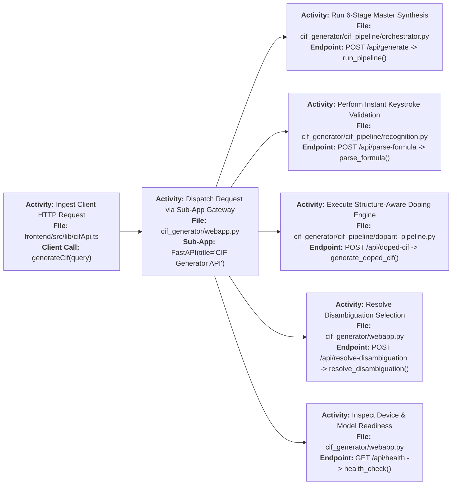
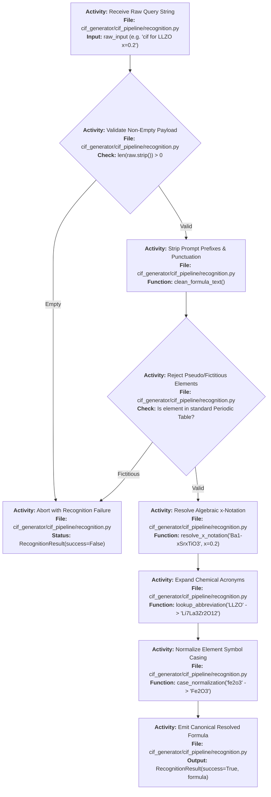
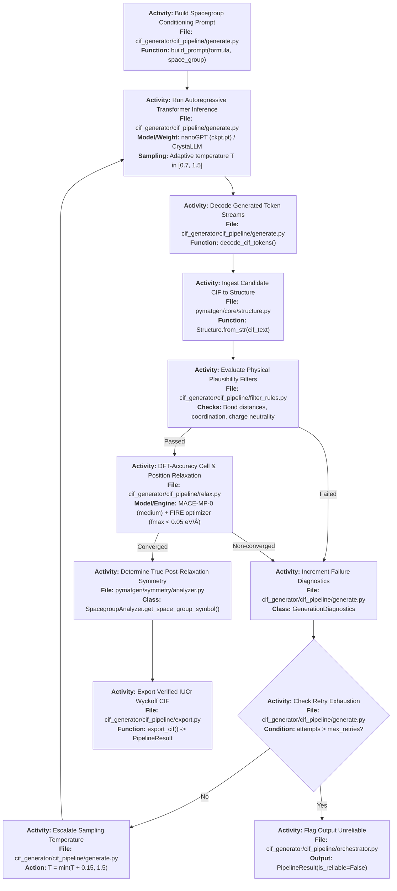
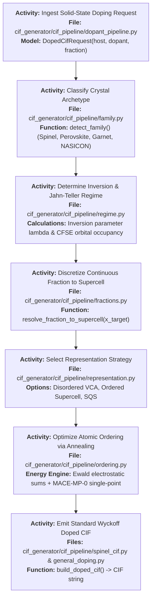

# IndianMatter — CIF Generator Pipeline: Complete Architecture & File Guide

> **Scope:** `backend/webapp.py` (mounted FastAPI sub-app at `/cif`) + `backend/cif_pipeline/` package (40 modules).  
> **Entry Point:** `backend/cif_pipeline/orchestrator.py` (`run_pipeline()`) or `backend/webapp.py` (`POST /cif/api/generate`).

---

## Table of Contents

1. [Executive Summary & Purpose](#1-executive-summary--purpose)
2. [`webapp.py` — The HTTP Gateway](#2-webapppy--the-http-gateway)
3. [Core Data Contracts (`models.py`)](#3-core-data-contracts-modelspy)
4. [Stage 0: Input Cleaning & Formula Recognition (`recognition.py`)](#4-stage-0-input-cleaning--formula-recognition-recognitionpy)
5. [Stage 1: Doping Classification (`classify.py`)](#5-stage-1-doping-classification-classifypy)
6. [Stage 2: Canonical Normalization & Matching Rules (`matching.py`)](#6-stage-2-canonical-normalization--matching-rules-matchingpy)
7. [Stage 3: Multi-Database Retrieval (`search_external.py`, `search_internal.py`)](#7-stage-3-multi-database-retrieval-search_externalpy-search_internalpy)
8. [Stage 4a: Generative AI Feedback Loop (`generate.py`, `filter_rules.py`)](#8-stage-4a-generative-ai-feedback-loop-generatepy-filter_rulespy)
9. [Stage 4b: Solid-State Doping Transformation Engine](#9-stage-4b-solid-state-doping-transformation-engine)
10. [Crystallography Physics, Supercells & Ordering](#10-crystallography-physics-supercells--ordering)
11. [Inorganic Chemistry Knowledge Bank](#11-inorganic-chemistry-knowledge-bank)
12. [Stage 5: Physics Relaxation (`relax.py`) & Validation](#12-stage-5-physics-relaxation-relaxpy--validation)
13. [Stage 6: Formatting, Provenance & Export](#13-stage-6-formatting-provenance--export)
14. [Full File Import Dependency Map](#14-full-file-import-dependency-map)
15. [Safety Guard Rails & Failure Recovery Matrix](#15-safety-guard-rails--failure-recovery-matrix)

---

## 1. Executive Summary & Purpose

In computational materials science, researchers often explore novel compositions that do not yet exist in crystallographic databases (e.g. doping a known host like $\text{LaMnO}_3$ with $30\%$ $\text{Sr}$ to form $\text{La}_{0.7}\text{Sr}_{0.3}\text{MnO}_3$, or synthesizing unknown solid electrolytes).

The **`cif_pipeline`** solves this by establishing an automated bridge from a chemical formula string to an **IUCr-compliant, structurally relaxed `.cif` (Crystallographic Information File)**:
1. It first queries four global crystallographic databases (Materials Project, OQMD, JARVIS, COD) for existing entries.
2. If the compound is **undoped and unknown**, it invokes a **CrystaLLM generative language model** in an iterative feedback loop to sample and filter viable crystal configurations.
3. If the compound is **doped**, it retrieves the parent structure, builds supercells, evaluates site-preference energetics (CFSE, Shannon radii), applies fractional substitutions, and optimizes atomic ordering using Monte Carlo simulation.
4. Finally, all candidate structures undergo density functional theory-level **forcefield relaxation using MACE-MP-0** until atomic forces converge below $0.05\text{ eV/\AA}$.

---

## 2. `webapp.py` — The HTTP Gateway

**File:** [`backend/webapp.py`](file:///e:/IndianMatter/backend/webapp.py)

Mounted in [`backend/main.py`](file:///e:/IndianMatter/backend/main.py#L125) at `/cif`. It translates web client JSON payloads into strong typed pipeline requests and serves the standalone frontend.



### 2.1 Endpoint Specification Table

| HTTP Route | Request Model | Handler Function | Purpose |
|---|---|---|---|
| `POST /cif/api/generate` | `GenerationRequest` | `run_pipeline()` | Master 6-stage pipeline. Resolves formula, searches DBs, runs CrystaLLM or doping, executes MACE relaxation, and returns refined Wyckoff CIF. |
| `POST /cif/api/parse-formula` | `ParseFormulaRequest` | `parse_formula()` | Lightweight keystroke parser: returns element breakdown, weight percentages, oxidation state balance, and family hints without triggering expensive structural generation. |
| `POST /cif/api/doped-cif` | `DopedCifRequest` | `generate_doped_cif()` | Dedicated structure-aware doping controller for Spinels, Perovskites, Garnets, etc. |
| `POST /cif/api/resolve-disambiguation` | `DisambiguationRequest` | `resolve_disambiguation()` | Submits user's choice when multiple distinct polymorph space groups are discovered. |
| `GET /cif/api/health` | None | `health_check()` | Reports availability of `MP_API_KEY`, MACE device (CPU/CUDA), and CrystaLLM `ckpt.pt` existence. |

> [!NOTE]
> **Non-Interactive Web Contract (`_web_ask_handler`)**: Web HTTP requests cannot pause for terminal prompts. Therefore, `_web_ask_handler` in `webapp.py` deliberately returns `None`. When ambiguous polymorphs exist, the pipeline never guesses silently; it tags the response with `source='ambiguous_polymorphs'` and returns all candidate matches so the frontend can display a polymorph picker dialog.

---

## 3. Core Data Contracts (`models.py`)

**File:** [`backend/cif_pipeline/models.py`](file:///e:/IndianMatter/backend/cif_pipeline/models.py)

All stages communicate through standardized dataclasses:

* **`CompoundQuery`**: The raw client query containing `raw_input`, optional `space_group`, `dopant_element`, `dopant_fraction`, `host_site_species`, and `co_dopants`.
* **`DopingSpec`**: Fully resolved doping instructions. Holds `host_formula`, `host_site_species`, `dopant_species`, `dopant_fraction`, `doping_type` (`substitutional` vs `interstitial`), and `sublattice_spec` (for multi-sublattice materials like spinels).
* **`SearchMatch`**: Encapsulates a database hit: `source` (`MP`, `OQMD`, `JARVIS`, `COD`, `internal`), `record_id`, `structure` (`pymatgen.core.Structure`), `match_confidence`, and `source_url`.
* **`NormalizationTrace`**: Full transparency trail detailing how the input string was canonicalized (formula unit multiplier, electronegativity ordering, doped tolerance rule).
* **`GenerationDiagnostics`**: Per-iteration bookkeeping tracking failure counters: `n_generated`, `n_parse_failed`, `n_bond_length_failed`, `n_symmetry_failed`, `n_relax_nonconverged`, `n_survived`.
* **`PipelineResult`**: The final return object: `cif_string`, `final_space_group`, `energy`, `max_force`, `is_reliable`, `relaxation_status`, and `provenance`.

---

## 4. Stage 0: Input Cleaning & Formula Recognition (`recognition.py`)

**File:** [`backend/cif_pipeline/recognition.py`](file:///e:/IndianMatter/backend/cif_pipeline/recognition.py)

Before running expensive database or AI tasks, `recognize_compound_formula()` cleans noise and extracts valid stoichiometry:



---

## 5. Stage 1: Doping Classification (`classify.py`)

**File:** [`backend/cif_pipeline/classify.py`](file:///e:/IndianMatter/backend/cif_pipeline/classify.py)

Determines whether the compound represents an undoped single-phase crystal or a solid solution:

* **Level 1 (Explicit Hint)**: Honors `query.is_doped_hint` if set in the frontend UI.
* **Level 2 (Phrasing Detection)**: Regex parsing for keywords like `"doped with"`, `"substituted on"`, `"wt%"`.
* **Level 3 (Algebraic Stoichiometry)**: Recognizes formulas with split sites like $\text{La}_{0.7}\text{Sr}_{0.3}\text{MnO}_3$. Identifies that $\text{La}$ and $\text{Sr}$ sum to $1.0$ on the A-site, assigning $\text{Sr}$ as dopant and $\text{La}$ as host site.
* **Level 4 (Spinel Sublattice Analyzer)**: For Spinel ferrites ($AB_2O_4$), evaluates tetrahedral vs. octahedral site preferences via [`intent.py`](file:///e:/IndianMatter/backend/cif_pipeline/intent.py) and builds a `sublattice_spec` (e.g. `{"A": {"Zn": 0.2, "Fe": 0.8}, "B": {"Ni": 0.8, "Fe": 1.2}}`).

---

## 6. Stage 2: Canonical Normalization & Matching Rules (`matching.py`)

**File:** [`backend/cif_pipeline/matching.py`](file:///e:/IndianMatter/backend/cif_pipeline/matching.py)

1. **Undoped Canonicalization**: Undoped formulas are reduced to primitive formula units ($\text{Fe}_4\text{O}_6 \rightarrow \text{Fe}_2\text{O}_3$, multiplier $Z=2$).
2. **Doped Non-Reduction Rule**: Doped formulas are **never** reduced. Fractional ratios describe exact chemical site populations ($\text{La}_{0.7}\text{Sr}_{0.3}$ vs. $\text{La}_7\text{Sr}_3$ describe different supercell sizes).
3. **Polymorph Disambiguation (`disambiguate_polymorphs`)**: When external databases return multiple crystal structures for the same formula (e.g. rutile vs. anatase for $\text{TiO}_2$):
   * If a target space group was requested, it matches strictly.
   * If no space group was specified, it surfaces the entire candidate list to the UI rather than silently selecting the first hit.

---

## 7. Stage 3: Multi-Database Retrieval (`search_external.py`, `search_internal.py`)

**Files:** [`backend/cif_pipeline/search_external.py`](file:///e:/IndianMatter/backend/cif_pipeline/search_external.py), [`backend/cif_pipeline/search_internal.py`](file:///e:/IndianMatter/backend/cif_pipeline/search_internal.py)

Queries four international repositories concurrently:
* **Materials Project (MP)**: Queries via `mp-api` `MPRester.materials.summary.search(formula=...)`.
* **OQMD**: REST queries against `oqmd.org/static/api` using filter grammars (`composition=...`).
* **JARVIS-DFT**: OPTIMADE API queries against NIST databases.
* **Crystallography Open Database (COD)**: Queries `crystallography.net` via Hill-formula indices. Implements **mandatory composition re-verification** to eliminate misannotated experimental entries.
* **Internal Database (`search_internal.py`)**: Local fallback querying proprietary company CIF directories.

---

## 8. Stage 4a: Generative AI Feedback Loop (`generate.py`, `filter_rules.py`)

**Files:** [`backend/cif_pipeline/generate.py`](file:///e:/IndianMatter/backend/cif_pipeline/generate.py), [`backend/cif_pipeline/filter_rules.py`](file:///e:/IndianMatter/backend/cif_pipeline/filter_rules.py)

When an undoped compound is not found in any database, the system invokes the generative AI loop:



---

## 9. Stage 4b: Solid-State Doping Transformation Engine

### 9.1 Standard Doping ([`doping.py`](file:///e:/IndianMatter/backend/cif_pipeline/doping.py))
1. **Parent Retrieval**: Queries external databases for the undoped host matrix (e.g. $\text{BaTiO}_3$).
2. **Site Selection**: Uses `CrystalNN` nearest-neighbor coordination and [`site_preference.py`](file:///e:/IndianMatter/backend/cif_pipeline/site_preference.py) to rank candidate substitution sites based on Shannon ionic radius compatibility and charge balance.
3. **Disordered Occupancy Check**: If generating a fractional site CIF (disordered Virtual Crystal Approximation), **MACE relaxation is intentionally skipped** to preserve exact fractional site coordinates.

### 9.2 Dedicated Structure-Aware Pipeline ([`dopant_pipeline.py`](file:///e:/IndianMatter/backend/cif_pipeline/dopant_pipeline.py))
For complex families (Spinels, Perovskites, Garnets), `POST /cif/api/doped-cif` invokes a specialized pipeline:



---

## 10. Crystallography Physics, Supercells & Ordering

* **[`supercell.py`](file:///e:/IndianMatter/backend/cif_pipeline/supercell.py)**: Implements **Hermite Normal Form (HNF)** matrix searches to discover isotropic, near-cubic supercells that maximize unit cell face width.
* **[`symmetry_matrix.py`](file:///e:/IndianMatter/backend/cif_pipeline/symmetry_matrix.py)**: Calculates transformation matrices enforcing a **minimum periodic image distance $\ge 10\text{ \AA}$** to avoid unphysical self-interactions between dopant defect images.
* **[`symmetry_paths.py`](file:///e:/IndianMatter/backend/cif_pipeline/symmetry_paths.py)**: Simulates cooperative **Jahn-Teller strain paths** (e.g. cubic $Fd\bar{3}m \rightarrow$ tetragonal $I4_1/amd$ distortions for $\text{Cu}^{2+}$ or $\text{Mn}^{3+}$ cations).
* **[`spinel_build.py`](file:///e:/IndianMatter/backend/cif_pipeline/spinel_build.py)** & **[`spinel_cif.py`](file:///e:/IndianMatter/backend/cif_pipeline/spinel_cif.py)**: Direct structural population of tetrahedral $8a$, octahedral $16d$, and anion $32e$ Wyckoff positions.
* **[`geometry.py`](file:///e:/IndianMatter/backend/cif_pipeline/geometry.py)**: Applies **Vegard's Law** across end-member solid solutions to predict lattice parameters $a(x)$ and oxygen coordinate $u(x)$.

---

## 11. Inorganic Chemistry Knowledge Bank

* **[`site_preference.py`](file:///e:/IndianMatter/backend/cif_pipeline/site_preference.py)**:
  * Complete **Shannon Ionic Radii** lookup tables across all oxidation states and coordination numbers (IV, VI, VIII, XII).
  * **Crystal Field Stabilization Energy (CFSE)** tables for high-spin and low-spin $3d$ transition metal cations ($d^0$ through $d^{10}$).
  * **Goldschmidt Tolerance Factor ($t$)** calculator for perovskite stability:
    $$t = \frac{r_A + r_O}{\sqrt{2}(r_B + r_O)}$$
  * Empirical site-preference tables for Spinels (A-site tetrahedral vs. B-site octahedral preference energies).
* **[`parents.py`](file:///e:/IndianMatter/backend/cif_pipeline/parents.py)**: Offline cache of prototype unit cells for Perovskite ($\text{SrTiO}_3$), Garnet ($\text{Li}_7\text{La}_3\text{Zr}_2\text{O}_{12}$), Rocksalt ($\text{NaCl}$), and Fluorite ($\text{CaF}_2$).

---

## 12. Stage 5: Physics Relaxation (`relax.py`) & Validation

**File:** [`backend/cif_pipeline/relax.py`](file:///e:/IndianMatter/backend/cif_pipeline/relax.py)

Machine Learning Interatomic Potential (MLIP) relaxation wrapper:
* Loads **MACE-MP-0** (`model='medium'`, `dtype='float64'`) cached on CPU/CUDA.
* Converts `pymatgen.core.Structure` $\rightarrow$ `ase.Atoms` using `AseAtomsAdaptor`.
* Applies `ase.filters.ExpCellFilter` to simultaneously optimize internal atomic coordinates and external unit cell vectors.
* Uses the **FIRE optimizer** with convergence threshold $F_{\text{max}} < 0.05\text{ eV/\AA}$ (max 200 steps).
* Post-relaxation space group determination is executed by `pymatgen.symmetry.analyzer.SpacegroupAnalyzer` (`symprec=0.1`).
* **Validation Modules**:
  * [`validation.py`](file:///e:/IndianMatter/backend/cif_pipeline/validation.py): Verifies that interatomic bonds do not overlap ($d_{ij} > 0.8\text{ \AA}$).
  * [`site_analysis.py`](file:///e:/IndianMatter/backend/cif_pipeline/site_analysis.py): Simulates Powder X-ray Diffraction (PXRD) patterns and audits site occupancies.
  * [`mesp_check.py`](file:///e:/IndianMatter/backend/cif_pipeline/mesp_check.py): Molecular Electrostatic Potential sanity verification.

---

## 13. Stage 6: Formatting, Provenance & Export

* **[`formatting.py`](file:///e:/IndianMatter/backend/cif_pipeline/formatting.py)**: Enforces the **2-Decimal Display Rule** for user interfaces using `Decimal` with `ROUND_HALF_UP` (e.g. $0.025 \rightarrow 0.03$). Full `float64` precision is strictly preserved for internal physics computations.
* **[`provenance.py`](file:///e:/IndianMatter/backend/cif_pipeline/provenance.py)**: Generates a complete audit log recording why each site substitution, symmetry constraint, and supercell matrix was selected.
* **[`orchestrator.py`](file:///e:/IndianMatter/backend/cif_pipeline/orchestrator.py)**: Formats the final structure using `pymatgen.io.cif.CifWriter(refine_struct=True)` to ensure compliant Wyckoff labels and symmetry operations.
* **[`batch_processor.py`](file:///e:/IndianMatter/backend/cif_pipeline/batch_processor.py)**: Test harness executing synthesis across batch benchmark datasets.

---

## 14. Full File Import Dependency Map

```
cif_pipeline/
├── orchestrator.py (Master Controller)
│   ├──→ recognition.py
│   ├──→ classify.py
│   │    └──→ site_preference.py, intent.py
│   ├──→ matching.py
│   ├──→ search_external.py
│   ├──→ search_internal.py
│   ├──→ generate.py (CrystaLLM Feedback Loop)
│   │    ├──→ filter_rules.py
│   │    └──→ relax.py (MACE-MP-0)
│   ├──→ doping.py
│   │    ├──→ parents.py
│   │    └──→ filter_rules.py
│   ├──→ user_interaction.py
│   └──→ formatting.py
├── dopant_pipeline.py (Dedicated Doping Gateway)
│   ├──→ family.py
│   ├──→ regime.py
│   ├──→ fractions.py
│   ├──→ representation.py
│   ├──→ ordering.py
│   │    └──→ mlip.py
│   ├──→ supercell.py
│   ├──→ symmetry_matrix.py
│   ├──→ symmetry_paths.py
│   ├──→ spinel_build.py
│   ├──→ spinel_cif.py
│   └──→ general_doping.py
├── validation.py
├── site_analysis.py
└── mesp_check.py
```

---

## 15. Safety Guard Rails & Failure Recovery Matrix

| Trigger / Condition | Detected In | System Action & Safeguard |
|---|---|---|
| **Empty / Blank Input** | `orchestrator.py` | Immediate exit; returns `PipelineResult(source='failed')`. |
| **Unsupported Notation (`@`, `wt%`)** | `webapp.py` | Rejection before generation; returns clean 400 error. |
| **Fictitious Chemical Element** | `recognition.py` | Rejects non-existent symbols during Stage 0. |
| **COD Structure Mismatch** | `search_external.py` | Re-checks elemental composition from CIF sites; discards invalid COD entries. |
| **NaN / Inf Forces** | `relax.py` | Trapped by numerical guards; invalidates candidate and increments retry counter. |
| **Disordered Fractional Sites** | `doping.py` | **Skips MACE relaxation** to prevent collapsing fractional occupancies into unphysical local geometries. |
| **Polymorph Ambiguity** | `matching.py` | Prevents auto-selection; sets `source='ambiguous_polymorphs'` and returns full candidate array for UI picker. |
| **Symmetry Header Spoofing** | `generate.py` | Never trusts CIF space group header generated by language model; recalculates space group via `SpacegroupAnalyzer` after relaxation. |
