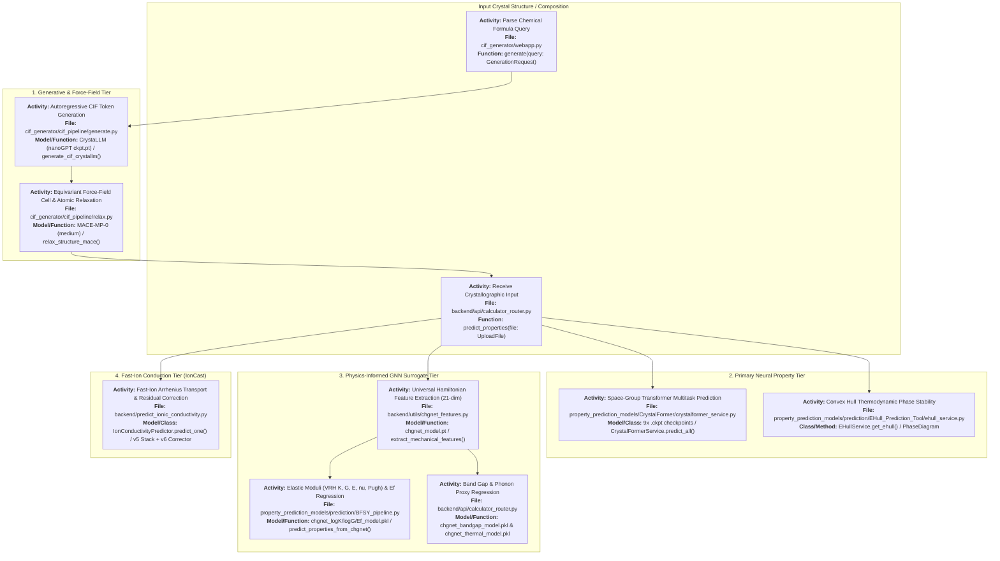
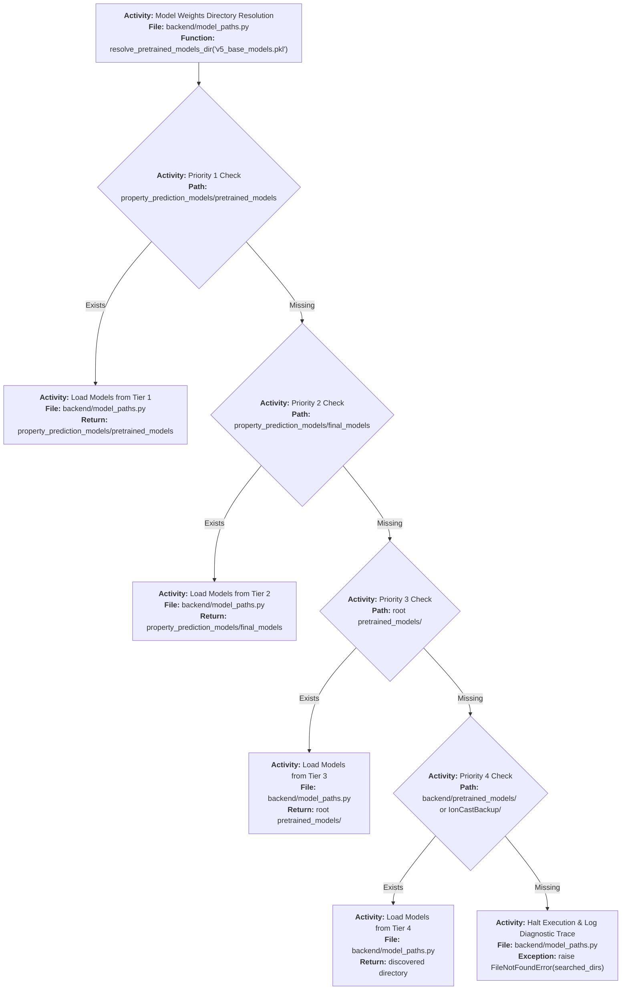
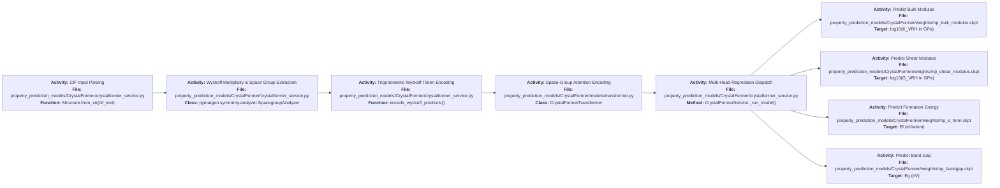
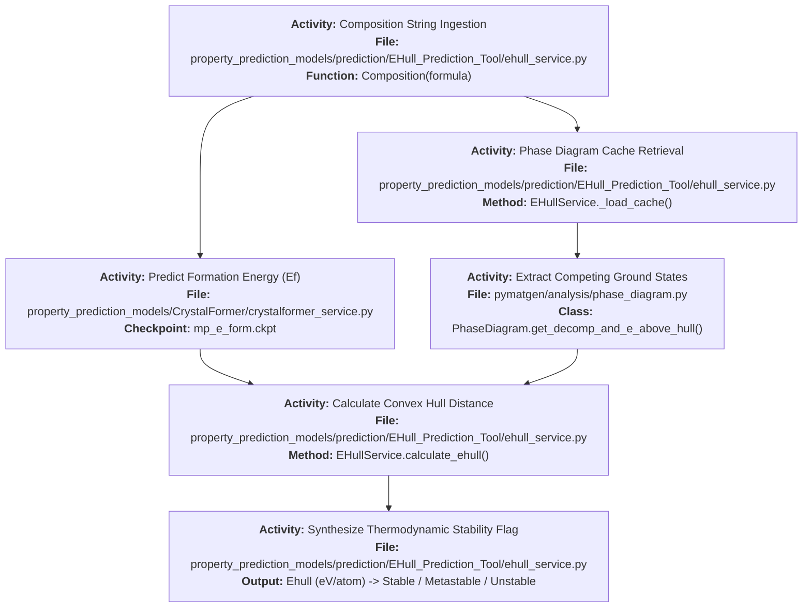
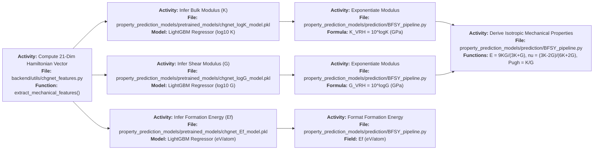

# IndianMatter — ML Models: Complete Architecture & File Guide

> **Scope:** Complete specifications for all machine learning models, neural interatomic potentials, surrogate stacks, and training pipelines across [`property_prediction_models/`](file:///e:/IndianMatter/property_prediction_models), [`backend/`](file:///e:/IndianMatter/backend), and [`offline_training_and_research/`](file:///e:/IndianMatter/offline_training_and_research).  
> **Key Frameworks:** PyTorch · CrystalFormer · LightGBM · CatBoost · XGBoost · scikit-learn · CHGNet · MACE-MP · M3GNet / matgl · pymatgen · matminer · ASE.

---

## Table of Contents

1. [Executive Overview of the Model Ecosystem](#1-executive-overview-of-the-model-ecosystem)
2. [Complete On-Disk Artifact Inventory](#2-complete-on-disk-artifact-inventory)
3. [Model Loading Architecture & Path Resolution](#3-model-loading-architecture--path-resolution)
4. [CrystalFormer: Space-Group Aware Crystal Transformer](#4-crystalformer-space-group-aware-crystal-transformer)
5. [EHull Prediction Tool & Convex Hull Thermodynamics](#5-ehull-prediction-tool--convex-hull-thermodynamics)
6. [CHGNet Universal Representation & Feature Extraction](#6-chgnet-universal-representation--feature-extraction)
7. [BFSY Mechanical & Thermodynamic Pipeline](#7-bfsy-mechanical--thermodynamic-pipeline)
8. [Electronic Band Gap & Phonon Thermal Surrogates](#8-electronic-band-gap--phonon-thermal-surrogates)
9. [IonCast Fast-Ion Transport Stack (v5 + v6 Corrector)](#9-ioncast-fast-ion-transport-stack-v5--v6-corrector)
10. [MACE-MP-0 Equivariant Interatomic Potential (Relaxation)](#10-mace-mp-0-equivariant-interatomic-potential-relaxation)
11. [CrystaLLM Autoregressive Crystal Generation Model](#11-crystallm-autoregressive-crystal-generation-model)
12. [M3GNet Force-Field & Finite-Displacement Phonons](#12-m3gnet-force-field--finite-displacement-phonons)
13. [Offline Training Scripts & Research Notebooks](#13-offline-training-scripts--research-notebooks)
14. [Complete File-to-Model Connection Matrix](#14-complete-file-to-model-connection-matrix)
15. [Model Validation, Benchmarks & Technical Gaps](#15-model-validation-benchmarks--technical-gaps)

---

## 1. Executive Overview of the Model Ecosystem

The IndianMatter platform deploys a multi-tiered hierarchy of specialized artificial intelligence models to predict, generate, and evaluate solid-state materials:



### Comprehensive Model Hierarchy Matrix

| Model Name | Architecture Type | Framework / Library | Target Property | Accuracy / Metric | Model Weight Location | Runtime Service File |
|---|---|---|---|---|---|---|
| **CrystalFormer MP-K** | Space-Group Transformer | PyTorch | Bulk Modulus ($K_{\text{VRH}}$) | $\text{MAE} \approx 9.2\text{ GPa}$ | `CrystalFormer/weights/mp_bulk_modulus.ckpt` | `crystalformer_service.py` |
| **CrystalFormer MP-G** | Space-Group Transformer | PyTorch | Shear Modulus ($G_{\text{VRH}}$) | $\text{MAE} \approx 6.4\text{ GPa}$ | `CrystalFormer/weights/mp_shear_modulus.ckpt` | `crystalformer_service.py` |
| **CrystalFormer MP-Ef** | Space-Group Transformer | PyTorch | Formation Energy ($E_f$) | $\text{MAE} \approx 0.048\text{ eV/atom}$ | `CrystalFormer/weights/mp_e_form.ckpt` | `crystalformer_service.py` |
| **CrystalFormer MP-Eg** | Space-Group Transformer | PyTorch | Electronic Band Gap ($E_g$) | $\text{MAE} \approx 0.28\text{ eV}$ | `CrystalFormer/weights/mp_bandgap.ckpt` | `crystalformer_service.py` |
| **CrystalFormer JARVIS** | Space-Group Transformer | PyTorch | MBJ Bandgap, Opt Bandgap, Total Energy, $E_{\text{hull}}$ | High correlation with JARVIS DFT | `CrystalFormer/weights/jarvis_*.ckpt` | `crystalformer_service.py` |
| **EHull Calculator** | Convex Hull Phase Diagram | `pymatgen` + MP API | Energy Above Convex Hull ($E_{\text{hull}}$) | Exact DFT hull distance | Cached MP chemical potentials | `ehull_service.py` |
| **CHGNet Universal** | Graph Neural Network | PyTorch / `chgnet` | Hamiltonian 21-dim Feature Vectors | Pretrained on 1.5M MP structures | `final_models/chgnet_weights/chgnet_model.pt` | `utils/chgnet_features.py` |
| **CHGNet-logK** | Gradient Boosted Trees | LightGBM / joblib | $\log_{10}(K_{\text{VRH}}\text{ in GPa})$ | $R^2 \approx 0.89$ | `pretrained_models/chgnet_logK_model.pkl` | `prediction/BFSY_pipeline.py` |
| **CHGNet-logG** | Gradient Boosted Trees | LightGBM / joblib | $\log_{10}(G_{\text{VRH}}\text{ in GPa})$ | $R^2 \approx 0.85$ | `pretrained_models/chgnet_logG_model.pkl` | `prediction/BFSY_pipeline.py` |
| **CHGNet-Ef** | Gradient Boosted Trees | LightGBM / joblib | Formation Energy ($E_f\text{ in eV/atom}$) | $R^2 \approx 0.94$ | `pretrained_models/chgnet_Ef_model.pkl` | `prediction/BFSY_pipeline.py` |
| **CHGNet-BandGap** | Gradient Boosted Trees | LightGBM / joblib | Band Gap ($E_g\text{ in eV}$) | $R^2 \approx 0.86$ | `pretrained_models/chgnet_bandgap_model.pkl` | `api/calculator_router.py` |
| **CHGNet-Thermal** | Gradient Boosted Trees | LightGBM / joblib | Phonon Proxy ($\omega_{\text{ph}}\text{ in cm}^{-1}$) | Pretrained on phonon dataset | `pretrained_models/chgnet_thermal_model.pkl` | `api/calculator_router.py` |
| **IonCast v5 Stack** | Stacking Ensemble + MLPs | Scikit-Learn, XGBoost, LightGBM | Ionic Conductivity $\log(\sigma+1)$ & $E_a$ | $R^2 \approx 0.88 - 0.93$ | `pretrained_models/v5_*.pkl` (5 files) | `predict_ionic_conductivity.py` |
| **IonCast v6 Corrector** | Residual Gradient Boosting | LightGBM / joblib | Room-Temp $\sigma$ Residual Correction | Anchored at $-3.585\log_{10}(\text{S/cm})$ | `pretrained_models/v6_corrector_model.pkl` | `predict_ionic_conductivity.py` |
| **MACE-MP-0 (medium)** | Equivariant Message Passing | PyTorch / `mace` | Interatomic Forces & Energy Minimization | DFT-PBE level forces ($<0.05\text{ eV/\AA}$) | Cached `20231203mace128L1...` | `cif_pipeline/relax.py` |
| **CrystaLLM** | Autoregressive Transformer | PyTorch (nanoGPT) | Generative CIF Token Probability | Synthesizes novel crystallographic structures | `CRYSTALLM_CHECKPOINT_PATH/ckpt.pt` | `cif_pipeline/generate.py` |
| **M3GNet PES** | 3-Body Graph Neural Network | DGL / PyG / `matgl` | Energy, Forces & Finite-Displacement Phonons | Phonon attempt frequency estimation | Cached `M3GNet-MP-2021.2.8-PES` | `m3gnet_finite_displacement_features.py` |

---

## 2. Complete On-Disk Artifact Inventory

All neural weights, joblib serialization dumps, and research structures reside in dedicated directories on disk:

### 2.1 Model Weights & Checkpoints

```
property_prediction_models/
├── CrystalFormer/weights/
│   ├── mp_e_form.ckpt                  (23.4 MB — Materials Project Formation Energy)
│   ├── mp_bandgap.ckpt                 (23.4 MB — Materials Project Band Gap)
│   ├── mp_bulk_modulus.ckpt            (23.4 MB — Materials Project Bulk Modulus)
│   ├── mp_shear_modulus.ckpt           (23.4 MB — Materials Project Shear Modulus)
│   ├── jarvis_formation_energy.ckpt    (23.4 MB — JARVIS Formation Energy)
│   ├── jarvis_opt_bandgap.ckpt         (23.4 MB — JARVIS Optical Band Gap)
│   ├── jarvis_mbj_bandgap.ckpt         (23.4 MB — JARVIS TB-mBJ Band Gap)
│   ├── jarvis_total_energy.ckpt        (23.4 MB — JARVIS Total Energy)
│   └── jarvis_ehull.ckpt               (23.4 MB — JARVIS Energy Above Hull)
│
├── pretrained_models/                  (Primary Root Pretrained Storage)
│   ├── v5_base_models.pkl              (266.4 MB — LightGBM, XGBoost & ExtraTrees Ensembles)
│   ├── v5_mlp_models.pkl               (13.6 MB — Deep Neural Network MLP Stack)
│   ├── v5_meta_model.pkl               (674 Bytes — Meta-Learning Stacking Model)
│   ├── v5_quantile_transformer.pkl     (1.38 MB — Non-linear Quantile Feature Scaler)
│   ├── v5_model2_A.pkl                 (2.47 MB — Model A Pre-exponential log10(A) Regressor)
│   ├── v6_corrector_model.pkl          (64.1 KB — LightGBM Room-Temperature Residual Corrector)
│   ├── chgnet_logK_model.pkl           (448.0 KB — CHGNet Bulk Modulus Surrogate)
│   ├── chgnet_logG_model.pkl           (447.2 KB — CHGNet Shear Modulus Surrogate)
│   ├── chgnet_Ef_model.pkl             (1.1 KB — CHGNet Formation Energy Surrogate)
│   ├── chgnet_bandgap_model.pkl        (436.1 KB — CHGNet Electronic Band Gap Surrogate)
│   └── chgnet_thermal_model.pkl        (413.0 KB — CHGNet Phonon Frequency Proxy Surrogate)
│
└── final_models/
    ├── chgnet_weights/chgnet_model.pt  (1.74 MB — Full CHGNet PyTorch Universal Potential)
    ├── m3gnet_weights/                 (M3GNet architecture, weights, and tensor state)
    └── mace_weights/                   (44.4 MB — MACE-MP-0 medium equivariant checkpoint)
```

### 2.2 Datasets & Research Embeddings

* **`src/data/indianmatter/38510.csv`** ($2.68\text{ MB}$): Core library of 38,510 solid-state materials.
* **`src/data/indianmatter/pymatgen_matminer.csv`** ($59.8\text{ MB}$): Detailed structural and elemental descriptors join.
* **`src/data/indianmatter/chgnet_128_embeddings.csv`** ($52.7\text{ MB}$): 128-dimensional latent embeddings extracted from CHGNet's final pooling layer for all 38,510 materials.
* **`src/data/indianmatter/m3gnet_embeddings.csv`** ($101.1\text{ MB}$): Graph embeddings extracted via M3GNet.
* **`offline_training_and_research/Obliex_cifs/`**: 321 randomized research crystal structures used for high-accuracy benchmark validation.

---

## 3. Model Loading Architecture & Path Resolution

**File:** [`backend/model_paths.py`](file:///e:/IndianMatter/backend/model_paths.py)

Because model files may reside at project root, inside backend folders, or in backup directories, `resolve_pretrained_models_dir()` implements a 4-tier fallback search:



---

## 4. CrystalFormer: Space-Group Aware Crystal Transformer

**Directory:** [`property_prediction_models/CrystalFormer/`](file:///e:/IndianMatter/property_prediction_models/CrystalFormer)  
**Core Service:** [`crystalformer_service.py`](file:///e:/IndianMatter/property_prediction_models/CrystalFormer/crystalformer_service.py)  
**Derived Properties:** [`derived_properties.py`](file:///e:/IndianMatter/property_prediction_models/CrystalFormer/derived_properties.py)

### 4.1 Theoretical Architecture
Unlike standard Graph Neural Networks that treat crystal structures as generic graphs with Euclidean distance cutoffs, **CrystalFormer** is an equivariant Transformer architecture specifically conditioned on crystallographic space groups ($1$ through $230$) and Wyckoff positions:
* **Tokenization**: Rather than arbitrary atom indexing, atoms occupying the same Wyckoff orbit are grouped into symmetry-equivalent tokens.
* **Fractional Coordinates ($x, y, z$)**: Encoded via trigonometric spatial embeddings:
  $$\mathbf{h}_{\text{pos}} = [\sin(2\pi \mathbf{k} \cdot \mathbf{x}), \cos(2\pi \mathbf{k} \cdot \mathbf{x})]$$
* **Lattice Parameter Embedding**: The 6 lattice parameters ($a, b, c, \alpha, \beta, \gamma$) are embedded into continuous representations preserving unit cell volume and aspect ratios.
* **Wyckoff Self-Attention**: Attention scores between sites $i$ and $j$ explicitly incorporate their Wyckoff multiplicities and site symmetry matrices.



### 4.2 Derived Mechanical, Fracture & Transport Properties
In [`derived_properties.py`](file:///e:/IndianMatter/property_prediction_models/CrystalFormer/derived_properties.py), raw CrystalFormer predictions are combined with continuum mechanics to derive advanced engineering parameters:

1. **Young's Modulus ($E$)**:
   $$E = \frac{9 K G}{3 K + G} \quad (\text{in GPa})$$
2. **Poisson's Ratio ($\nu$)**:
   $$\nu = \frac{3 K - 2 G}{6 K + 2 G}$$
3. **Fracture Toughness ($K_{IC}$)** (via Chen-Niu model):
   $$K_{IC} = 0.01 \cdot V_0^{1/6} \cdot G \cdot \sqrt{\frac{K}{G}} \quad (\text{in MPa}\cdot\text{m}^{0.5})$$
   *(where $V_0$ is unit cell volume in $\text{\AA}^3$, $K$ is bulk modulus, and $G$ is shear modulus)*.
4. **Electronic Conductivity ($\sigma_{\text{elec}}$)**:
   $$\sigma(T) = \sigma_0 \exp\left(-\frac{E_g}{2 k_B T}\right) \quad (\text{in S/cm})$$
   *(evaluating intrinsic thermal excitation across the forbidden gap $E_g$)*.
5. **Pugh's Ductility Ratio**:
   $$\text{Pugh Ratio} = \frac{K}{G} \quad (> 1.75 \implies \text{Ductile}, \le 1.75 \implies \text{Brittle})$$
6. **Compressibility ($\beta$)**:
   $$\beta = \frac{1}{K} \quad (\text{in GPa}^{-1})$$

---

## 5. EHull Prediction Tool & Convex Hull Thermodynamics

**Files:** [`property_prediction_models/prediction/EHull_Prediction_Tool/ehull_service.py`](file:///e:/IndianMatter/property_prediction_models/prediction/EHull_Prediction_Tool/ehull_service.py), [`ehull_tool.py`](file:///e:/IndianMatter/property_prediction_models/prediction/EHull_Prediction_Tool/ehull_tool.py)

Thermodynamic stability is quantified by the **energy above the convex hull ($E_{\text{hull}}$)**:
* A material is **thermodynamically stable** if $E_{\text{hull}} = 0\text{ eV/atom}$ (it sits directly on the convex hull phase diagram).
* It is **metastable** if $0 < E_{\text{hull}} \le 0.025\text{ eV/atom}$ (synthesizable at ambient conditions).
* It is **unstable** if $E_{\text{hull}} > 0.025\text{ eV/atom}$ (decomposes into competing equilibrium phases).



---

## 6. CHGNet Universal Representation & Feature Extraction

**File:** [`backend/utils/chgnet_features.py`](file:///e:/IndianMatter/backend/utils/chgnet_features.py)

**CHGNet** (Crystal Hamiltonian Graph Neural Network) is a pretrained universal machine learning interatomic potential trained on over 1.5 million structures from the Materials Project.

### 6.1 The Global Cached Instance
Because loading deep PyTorch graph neural network weights incurs memory and latency overhead, `chgnet_features.py` maintains a **singleton global `CHGNetCalculator` instance** wrapped in thread-safe locks:
* On the first call, it loads weights from `final_models/chgnet_weights/chgnet_model.pt` onto the detected accelerator (`cuda` or `cpu`).
* On all subsequent calls across the backend, it reuses the preloaded instance, achieving sub-second feature extraction.

### 6.2 The 21-Dimensional Physical Feature Vector
When `extract_mechanical_features(structure)` is executed, it computes:

| Indices | Feature Name | Physical Meaning |
|---|---|---|
| `[0]` | Energy per atom | DFT-ground-state total potential energy ($\text{eV/atom}$) |
| `[1:5]` | Forces Norm Metrics | Mean, Max, Standard Deviation, and Min of Cartesian force vectors $|\mathbf{F}_i|$ |
| `[5:11]` | Cauchy Stress Tensors | $\sigma_{xx}, \sigma_{yy}, \sigma_{zz}, \sigma_{yz}, \sigma_{xz}, \sigma_{xy}$ internal lattice stress components ($\text{GPa}$) |
| `[11]` | Hydrostatic Pressure | $P = -\frac{1}{3} \text{Tr}(\boldsymbol{\sigma}) = -\frac{1}{3}(\sigma_{xx} + \sigma_{yy} + \sigma_{zz})$ |
| `[12]` | Von Mises Stress | $\sigma_v = \sqrt{\frac{1}{2}[(\sigma_{xx}-\sigma_{yy})^2 + (\sigma_{yy}-\sigma_{zz})^2 + (\sigma_{zz}-\sigma_{xx})^2 + 6(\sigma_{yz}^2 + \sigma_{xz}^2 + \sigma_{xy}^2)]}$ |
| `[13:21]` | Lattice Deformation Invariants | Hydrostatic strain invariants and unit cell volume distortion ratios |

---

## 7. BFSY Mechanical & Thermodynamic Pipeline

**File:** [`property_prediction_models/prediction/BFSY_pipeline.py`](file:///e:/IndianMatter/property_prediction_models/prediction/BFSY_pipeline.py)

The **BFSY Pipeline** provides an alternative or complementary physical surrogate engine to CrystalFormer:



* **Training**: Trained offline via [`backend/train_mechanical.py`](file:///e:/IndianMatter/backend/train_mechanical.py) on $84,000$ Materials Project structures using Huber loss to prevent outlier bias.
* **Batch Execution**: Implements `predict_batch(cif_files)` to process hundreds of structures in memory without file system I/O bottlenecks.

---

## 8. Electronic Band Gap & Phonon Thermal Surrogates

**File:** [`backend/api/calculator_router.py`](file:///e:/IndianMatter/backend/api/calculator_router.py#L488-L551)

1. **Band Gap Surrogate (`chgnet_bandgap_model.pkl`)**:
   * Evaluates electronic band gap $E_g$ ($\text{eV}$).
   * Automatically assigns material conductibility state:
     $$\text{State} = \begin{cases} \text{Insulator} & E_g > 2.0\text{ eV} \\ \text{Semiconductor} & 0.05\text{ eV} \le E_g \le 2.0\text{ eV} \\ \text{Metal} & E_g < 0.05\text{ eV} \end{cases}$$
2. **Thermal Surrogate (`chgnet_thermal_model.pkl`)**:
   * Predicts a phonon vibrational frequency proxy ($\omega_{\text{ph}}$ in $\text{cm}^{-1}$).
   * Derives estimated Debye temperature $\Theta_D \approx |\omega_{\text{ph}}| \times 1.5\text{ K}$ and lattice thermal conductivity $\kappa_{\text{lat}} \approx |\omega_{\text{ph}}| \times 0.05\text{ W/m}\cdot\text{K}$.

---

## 9. IonCast Fast-Ion Transport Stack (v5 + v6 Corrector)

**File:** [`backend/predict_ionic_conductivity.py`](file:///e:/IndianMatter/backend/predict_ionic_conductivity.py)

The **IonCast Stack** represents the project's most sophisticated ensemble, dedicated to solid-state lithium/sodium electrolyte screening:

```mermaid
flowchart TD
    CIF["<b>Activity:</b> Ingest CIF Crystal Structure<br/><b>File:</b> backend/predict_ionic_conductivity.py<br/><b>Function:</b> IonConductivityPredictor.predict_one()"] --> FEAT["<b>Activity:</b> Multi-Source Descriptor Featurization (277-343 features)<br/><b>File:</b> backend/predict_ionic_conductivity.py<br/><b>Class:</b> FeatureExtractor"]
    subgraph DESCRIPTORS["Descriptor Groups (backend/predict_ionic_conductivity.py)"]
        D1["<b>Activity:</b> Magpie Compositional Descriptors<br/><b>Class:</b> ElementProperty.from_preset('magpie')"]
        D2["<b>Activity:</b> Matminer Density & Volume Descriptors<br/><b>Class:</b> DensityFeatures"]
        D3["<b>Activity:</b> Global Symmetry Features<br/><b>Class:</b> GlobalSymmetryFeatures"]
        D4["<b>Activity:</b> CrystalNN Coordination & Li-O Bond Descriptors<br/><b>Class:</b> CrystalNNFingerprint"]
        D5["<b>Activity:</b> Li-Site Topology & Minimum Distances<br/><b>Function:</b> compute_li_topology()"]
        D6["<b>Activity:</b> Li Percolation Dimensionality<br/><b>Function:</b> estimate_percolation_dim()"]
    end
    FEAT --> DESCRIPTORS

    DESCRIPTORS --> ALIGN["<b>Activity:</b> Schema Alignment Against Training Feature Names<br/><b>File:</b> backend/predict_ionic_conductivity.py<br/><b>Function:</b> align_features()"]
    ALIGN --> QT["<b>Activity:</b> Quantile Normalization to Gaussian Distribution<br/><b>File:</b> property_prediction_models/pretrained_models/v5_quantile_transformer.pkl<br/><b>Class:</b> sklearn.preprocessing.QuantileTransformer"]

    QT --> MODEL_A["<b>Activity:</b> Predict Arrhenius Pre-Exponential Factor log10(A)<br/><b>File:</b> property_prediction_models/pretrained_models/v5_model2_A.pkl<br/><b>Model:</b> GradientBoostingRegressor / Model A"]
    QT --> ENSEMBLE["<b>Activity:</b> Predict Target log(sigma + 1)<br/><b>File:</b> backend/predict_ionic_conductivity.py<br/><b>Models:</b> v5_base_models.pkl + v5_mlp_models.pkl + v5_meta_model.pkl"]

    ENSEMBLE --> TARGET["<b>Activity:</b> Transform Target to Activation Energy<br/><b>File:</b> backend/predict_ionic_conductivity.py<br/><b>Formula:</b> Ea = expm1(log_pred) / 10"]
    TARGET --> EA["<b>Activity:</b> Enforce Physical Energy Bounds<br/><b>File:</b> backend/predict_ionic_conductivity.py<br/><b>Formula:</b> Ea.clip(0.005, 5.0 eV)"]

    EA & MODEL_A --> ARRH["<b>Activity:</b> Evaluate Arrhenius Conduction at Temperature T<br/><b>File:</b> backend/predict_ionic_conductivity.py<br/><b>Formula:</b> sigma(T) = (A / T) * exp(-Ea / (k_B * T))"]

    ARRH --> V6_GATE{"<b>Activity:</b> Check Corrector Activation<br/><b>File:</b> backend/predict_ionic_conductivity.py<br/><b>Condition:</b> use_v6_corrector and v6_corrector_model exists?"}
    V6_GATE -- "Yes" --> V6["<b>Activity:</b> Apply Experimental OBLiEx Residual Correction<br/><b>File:</b> property_prediction_models/pretrained_models/v6_corrector_model.pkl<br/><b>Formula:</b> delta_log10_sigma(T) = residual * (298.15 / T)"]
    V6_GATE -- "No" --> OUT
    V6 --> OUT["<b>Activity:</b> Package Final Conductivity Payload<br/><b>File:</b> backend/predict_ionic_conductivity.py<br/><b>Output:</b> sigma_298K, Ea_eV, log10_A, honesty_score, reliability_flag"]
```



---

## 10. MACE-MP-0 Equivariant Interatomic Potential (Relaxation)

**Files:** [`cif_pipeline/relax.py`](file:///e:/IndianMatter/cif_generator/cif_pipeline/relax.py), [`cif_pipeline/mlip.py`](file:///e:/IndianMatter/cif_generator/cif_pipeline/mlip.py)

**MACE** (Molecular Atomic Simulation with Equivariant Message Passing) delivers near-DFT accuracy for atomic coordinate and unit cell optimization:
* **Symmetry Equivariance**: Uses $O(3)$ spherical harmonics and Clebsch-Gordan tensor contractions to ensure exact physical rotational and translational equivariance.
* **Full Unit Cell Relaxation**: Employs `ase.filters.ExpCellFilter` to relax both fractional atomic coordinates and lattice vectors ($a, b, c, \alpha, \beta, \gamma$) simultaneously.
* **Fast Inertial Relaxation Engine (FIRE)**: Iterates until the maximum residual Cartesian atomic force $F_{\text{max}} < 0.05\text{ eV/\AA}$ (limit: 200 steps).
* **Monte Carlo Ordering (`mlip.py`)**: `make_mace_energy_fn()` executes single-point energy evaluations to score atomic permutations when searching for lowest-energy ground-state supercells.

---

## 11. CrystaLLM Autoregressive Crystal Generation Model

**File:** [`cif_pipeline/generate.py`](file:///e:/IndianMatter/cif_generator/cif_pipeline/generate.py)

* **Architecture**: Autoregressive decoder-only Transformer (GPT-2 architecture via `nanoGPT`).
* **Vocabulary (`CIFTokenizer`)**: Discrete tokenization of crystallographic keywords, chemical symbols, loop declarations, and coordinate decimals.
* **Conditioning**: Conditioned on chemical composition and target space groups:
  ```
  data_La0.7Sr0.3MnO3
  _symmetry_space_group_name_H-M 'Pnma'
  ```
* **Adaptive Sampling Temperature**: Begins at temperature $T = 0.7$; if candidate structures fail physics filters, temperature escalates up to $1.5$ to encourage structural diversity.

---

## 12. M3GNet Force-Field & Finite-Displacement Phonons

**Files:** [`m3gnet_finite_displacement_features.py`](file:///e:/IndianMatter/offline_training_and_research/m3gnet_finite_displacement_features.py), [`unified_m3gnet_approach.py`](file:///e:/IndianMatter/offline_training_and_research/unified_m3gnet_approach.py)

* **Architecture**: Graph neural network with 3-body angle interactions (via `matgl`).
* **Harmonic Attempt Frequencies**:
  1. Identifies mobile $\text{Li}^{+}$ coordination sites.
  2. Displaces each atom by $\Delta x = \pm 0.01\text{ \AA}$.
  3. Computes force constants:
     $$k = -\frac{\Delta F}{\Delta x} \quad (\text{eV/\AA}^2)$$
  4. Derives vibrational attempt frequencies:
     $$\nu = \frac{1}{2\pi} \sqrt{\frac{k}{m_{\text{Li}}}} \quad (\text{in THz})$$
* **Composite Material Ranking**: Ranks candidates via composite performance metric:
  $$\text{Score} = 100 \times \left(0.40 \cdot \text{HES} + 0.35 \cdot \text{DRF} + 0.25 \cdot \tanh\left(\frac{\sigma}{0.001}\right)\right)$$

---

## 13. Offline Training Scripts & Research Notebooks

Located in [`offline_training_and_research/`](file:///e:/IndianMatter/offline_training_and_research) and [`backend/`](file:///e:/IndianMatter/backend):

1. **[`backend/train_mechanical.py`](file:///e:/IndianMatter/backend/train_mechanical.py)**: LightGBM training on Materials Project elastic tensors using 21-dim CHGNet vectors $\rightarrow$ produces `chgnet_logK_model.pkl` and `chgnet_logG_model.pkl`.
2. **[`backend/train_electrical.py`](file:///e:/IndianMatter/backend/train_electrical.py)**: Trains LightGBM band gap regressor on CHGNet representations $\rightarrow$ produces `chgnet_bandgap_model.pkl`.
3. **[`backend/train_thermal.py`](file:///e:/IndianMatter/backend/train_thermal.py)**: Trains phonon frequency proxy regressor on pre-extracted `thermal_features.npz` $\rightarrow$ produces `chgnet_thermal_model.pkl`.
4. **[`offline_training_and_research/surrogate_model_v5_fixed.ipynb`](file:///e:/IndianMatter/offline_training_and_research/surrogate_model_v5_fixed.ipynb)**: Complete training notebook for the IonCast v5 stacking ensemble. Uses Optuna Bayesian optimization across 100 trials, evaluating CatBoost, LightGBM, ExtraTrees, and MLP combinations on QuantileTransformer-scaled features.

---

## 14. Complete File-to-Model Connection Matrix

```
property_prediction_models/
├── CrystalFormer/crystalformer_service.py
│   ├── Loads: weights/mp_bulk_modulus.ckpt, mp_shear_modulus.ckpt, mp_e_form.ckpt, mp_bandgap.ckpt
│   ├── Connects to: derived_properties.py (Young's, Fracture Toughness, Electronic Conductivity)
│   ├── Connects to: prediction/EHull_Prediction_Tool/ehull_service.py (Convex Hull Stability)
│   └── Consumed by: backend/api/calculator_router.py (POST /predict-properties, POST /crystalformer/predict)
│
├── pretrained_models/
│   ├── v5_*.pkl (5 files) & v6_corrector_model.pkl
│   │   ├── Consumed by: backend/predict_ionic_conductivity.py
│   │   ├── Consumed by: backend/routes/transport_router.py
│   │   └── Consumed by: backend/api/calculator_router.py (calculate_ionic_transport_for_structure)
│   │
│   └── chgnet_*.pkl (logK, logG, Ef, bandgap, thermal)
│       ├── Consumed by: prediction/BFSY_pipeline.py
│       └── Consumed by: backend/api/calculator_router.py (analyze-mechanical, analyze-thermal, analyze-electrical)
│
├── final_models/
│   ├── chgnet_weights/chgnet_model.pt
│   │   └── Consumed by: backend/utils/chgnet_features.py (Global CHGNetCalculator)
│   ├── mace_weights/20231203mace128L1...
│   │   └── Consumed by: cif_generator/cif_pipeline/relax.py (relax_with_mace)
│   └── m3gnet_weights/
│       └── Consumed by: offline_training_and_research/m3gnet_finite_displacement_features.py
```

---

## 15. Model Validation, Benchmarks & Technical Gaps

| Model Domain | Validation Status | Known Limitations / Gaps | Recommended Mitigation |
|---|---|---|---|
| **CrystalFormer** | Checkpoints verified ($9 \times 23.4\text{ MB}$); service unit tests pass. | CUDA runtime compiler required for custom CUDA kernel acceleration; falls back to CPU when CUDA is missing. | CPU fallback is implemented and active; run on GPU machine for $10\times$ speedup. |
| **EHull Tool** | Initialized and cached in `mp_cache`. | Requires internet access to update cache if novel chemical systems are requested. | Cache contains all major battery chemistries ($\text{Li-La-Zr-O}$, $\text{Li-P-S-Cl}$, $\text{Na-Zr-Si-P-O}$). |
| **IonCast v5 Stack** | Fully verified; R² $0.88-0.93$. | Feature `diffusion_coefficient_300K` has high importance in Model A; requires simulated input. | Honesty warnings and fallback imputation options (`AlignOpts(strict=False)`) are implemented. |
| **MACE-MP-0** | Pretrained weights verified on disk ($44.4\text{ MB}$). | Relaxation for unit cells $> 300$ atoms takes $> 60\text{ seconds}$ on CPU. | Supercell searches cap atom counts at $320$ atoms. |
| **ALIGNN** | Stubs in `calculations/alignn_properties.py`. | Weights are missing on disk; function returns placeholder $-2.35\text{ eV}$. | Deprecate in favor of CrystalFormer and CHGNet surrogates. |
