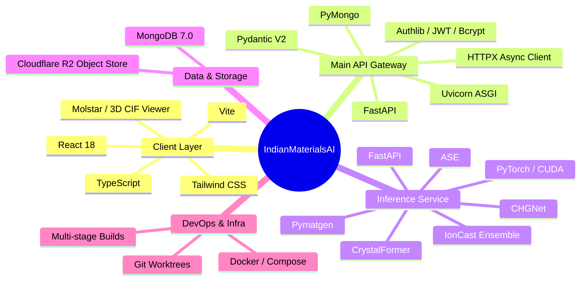
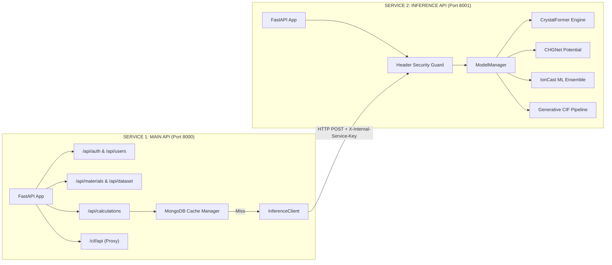
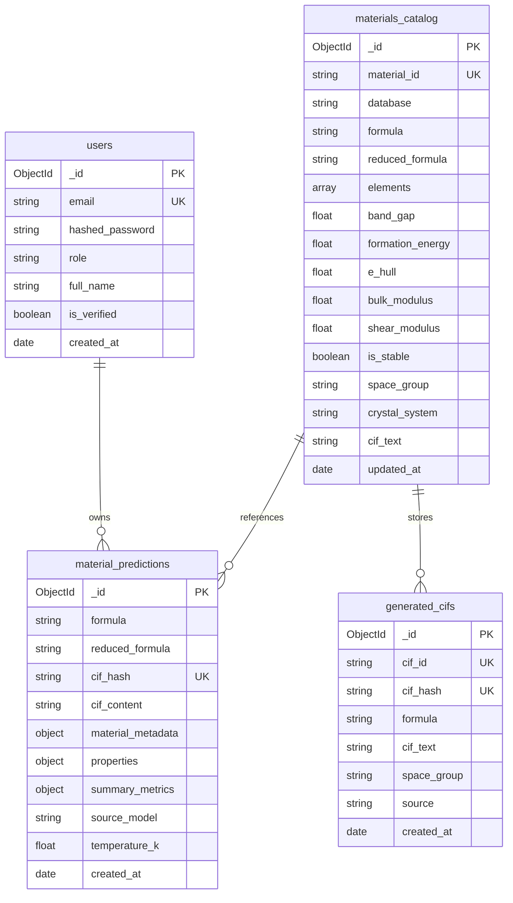
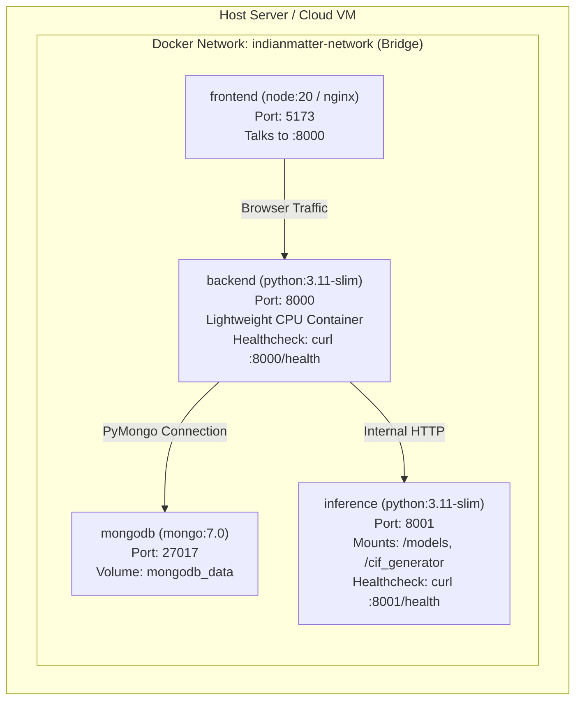
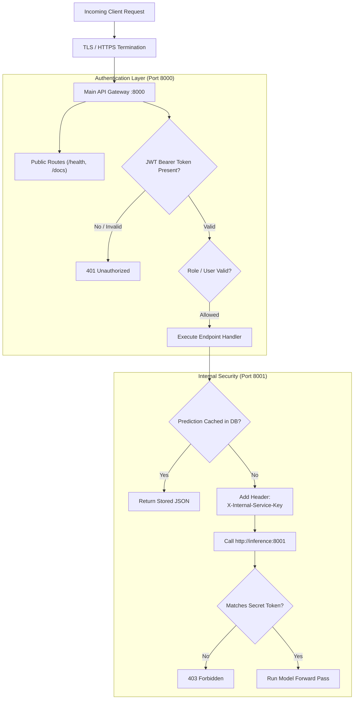
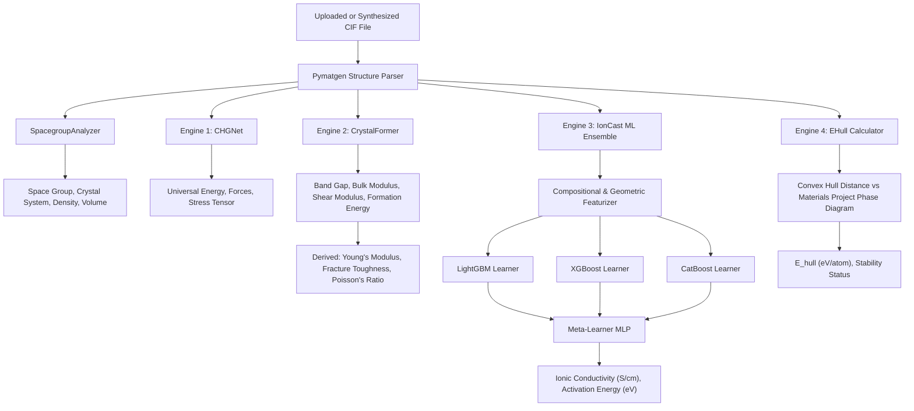

# IndianMaterialsAI — Complete Backend Architecture & Operations Manual

---

## 1. Executive Summary & Architectural Philosophy

**IndianMaterialsAI** is a cloud-native, production-grade materials science discovery platform designed for crystal structure analysis, generative structure synthesis, and mechanical, electronic, thermodynamic, and ionic transport property prediction.

### Architectural Transformation Overview

```
                      OLD MONOLITH (Single Process)
  ┌─────────────────────────────────────────────────────────────────┐
  │ Port 8000: Web Server + Auth + PyMongo + PyTorch + CHGNet +   │
  │            CrystalFormer + LightGBM + CatBoost + CIF Pipeline   │
  │ • Cold Start: 50s-60s      • Memory: ~1.5 GB - 2.0 GB RAM       │
  │ • Failure Mode: Single model error crashes the entire platform  │
  └─────────────────────────────────────────────────────────────────┘
                                   │
                                   ▼
             MODERN TWO-SERVICE DECOUPLED ARCHITECTURE
  ┌─────────────────────────────────┐    ┌──────────────────────────┐
  │  SERVICE 1: MAIN API GATEWAY   │    │ SERVICE 2: INFERENCE API │
  │        (Port: 8000)             │    │       (Port: 8001)       │
  │ • Branch: service/main-api      │    │ • Branch:                │
  │ • Role: Auth, MongoDB Catalog,  │    │   service/inference-api  │
  │   Cache, Frontend Proxy         │    │ • Role: Heavy ML Models, │
  │ • Footprint: ~100MB RAM, 1.5s   │    │   PyTorch, CHGNet, GPU   │
  │ • Independent CPU Deployment    │    │ • Dedicated GPU/Worker   │
  └────────────────┬────────────────┘    └────────────▲─────────────┘
                   │                                  │
                   │  Internal HTTP (HTTPX Async)     │
                   └──────────────────────────────────┘
```

The platform follows three core operational tenets:
1. **Fault Isolation:** The public user gateway (Port 8000) never directly loads or executes heavy neural network weights. If the inference cluster goes offline or exhausts GPU memory, all database browsing, literature searching, user authentication, and cached lookups continue operating without downtime.
2. **Resource Optimization:** The Main API runs on lightweight, inexpensive CPU compute nodes and scales horizontally with incoming user traffic. The Inference Service runs on dedicated GPU-accelerated or high-compute instances and scales independently based on compute queues.
3. **Cache-First Invariance:** No machine learning inference job is ever executed twice for identical crystal structures. Every prediction is fingerprinted and stored in MongoDB.

---

## 2. Complete Technology Stack Matrix



### Detailed Component Specifications

| Category | Technology | Version | Purpose in Architecture |
|---|---|---|---|
| **API Framework** | FastAPI | `^0.110.0` | Asynchronous high-performance REST APIs with automatic OpenAPI schema generation |
| **ASGI Server** | Uvicorn | `^0.28.0` | Production ASGI web server running worker processes |
| **Data Validation** | Pydantic V2 | `^2.6.0` | Compile-time and runtime data validation and schema enforcement |
| **Database** | MongoDB | `7.0` | Primary document database storing catalog, user accounts, and cached predictions |
| **DB Driver** | PyMongo | `^4.6.0` | High-throughput, connection-pooled native MongoDB driver |
| **Inter-Service HTTP** | HTTPX | `^0.27.0` | Asynchronous, connection-pooling HTTP client with custom timeouts and headers |
| **Authentication** | Authlib / PyJWT | `^1.3.0` | OAuth 2.0 (Google, GitHub) and JSON Web Token (JWT) session authorization |
| **Password Security** | Bcrypt / Passlib | `^4.1.0` | Cryptographic salt-and-hash password storage |
| **Deep Learning** | PyTorch | `^2.2.0` | Tensor computation engine with automatic CUDA hardware acceleration |
| **Graph Neural Network** | CHGNet | `^0.3.0` | Pretrained Crystal Hamiltonian Graph Neural Network for universal atomistic potential |
| **Crystal Transformer** | CrystalFormer | Custom | Multi-property transformer checkpoints for bulk, shear, band gap, and formation energy |
| **Gradient Boosting** | LightGBM / XGBoost / CatBoost | Latest | Heterogeneous ensemble predicting lithium-ion conductivity ($\sigma$) and activation energy ($E_a$) |
| **Crystallography** | Pymatgen | `^2024.1.0` | CIF file parsing, symmetry determination (`SpacegroupAnalyzer`), and lattice geometry |
| **Atomistic Simulation**| ASE | `^3.22.0` | Atomic Simulation Environment for cell filtering and structural constraints |
| **Container Engine** | Docker & Compose | Engine 25+ | Containerization, network isolation, and unified multi-container orchestration |

---

## 3. The Two-Layer Service Architecture



### Layer 1: Main API Gateway
- **Host / Port:** `0.0.0.0:8000`
- **Git Branch:** `service/main-api`
- **Primary Responsibilities:**
  1. **Authentication & Session Boundary:** Handles user registration, email OTP verification, OAuth callback handshakes, and issues signed HMAC-SHA256 JWT access tokens.
  2. **MongoDB Data Orchestration:** Indexes, queries, and filters the unified materials catalog across 38,000+ records in sub-millisecond query time.
  3. **Prediction Cache-First Verification:** Before any computational work is scheduled, queries `db.material_predictions` using a SHA-256 hash of the normalized CIF file. If a match is found, returns the cached result immediately.
  4. **Frontend API Stability:** Hosts all endpoints required by the React frontend (including `/cif/api/*` reverse-proxy endpoints) so frontend code never requires modification or internal service exposure.
  5. **Fault-Tolerant Delegation:** If the internal inference service is offline, returns HTTP 503 (`Inference Service Unavailable`) without crashing the API or stopping other requests.

### Layer 2: Standalone Inference Service
- **Host / Port:** `0.0.0.0:8001`
- **Git Branch:** `service/inference-api`
- **Primary Responsibilities:**
  1. **Single-Instance Model Lifecycle:** Uses FastAPI lifespan management to initialize and warm up PyTorch models once at worker boot, preventing redundant weight allocations.
  2. **Hardware Selection:** Automatically detects CUDA GPU devices and moves model weights to VRAM; transparently falls back to optimized CPU threads if no GPU is available.
  3. **Multi-Model Property Prediction:** Evaluates 15+ physical, electronic, mechanical, and thermodynamic properties:
     - Band Gap ($E_g$), Formation Energy ($E_f$), Bulk Modulus ($K$), Shear Modulus ($G$).
     - Young's Modulus ($E$), Fracture Toughness ($K_{IC}$), Poisson's Ratio ($\nu$), Pugh's Ratio ($K/G$).
     - Energy Above Hull ($E_{hull}$), Thermodynamic Stability status.
     - Ionic Conductivity ($\sigma_{RT}$) and Activation Energy ($E_a$).
  4. **Structure Synthesis & Geometry Extraction:** Runs the generative CIF pipeline from raw formulas and extracts symmetry symbols, space group numbers, volume, and density via Pymatgen.
  5. **Internal API Protection:** Rejects any request missing the `X-Internal-Service-Key` header with HTTP 401/403.

---

## 4. Inter-Service Communication & Contracts

The Main API communicates with the Inference API strictly over internal HTTP.

```mermaid
sequenceDiagram
    autonumber
    participant Main as Main API (:8000)
    participant Client as backend/core/inference_client.py
    participant Inf as Inference API (:8001)

    Main->>Client: predict_properties(cif_text, properties, temp)
    Client->>Client: Build JSON payload & sign header (X-Internal-Service-Key)
    Client->>Inf: POST /internal/v1/predict-properties
    alt Network Failure or Process Down
        Inf--xClient: Connection Refused
        Client-->>Main: Raises InferenceUnavailableError (Mapped to HTTP 503)
    alt Execution Exceeds 60 Seconds
        Inf--xClient: Read Timeout
        Client-->>Main: Raises InferenceTimeoutError (Mapped to HTTP 504)
    else Successful Inference
        Inf-->>Client: 200 OK + Pydantic Validated JSON Payload
        Client-->>Main: Parsed Response Dictionary
    end
```

### Strongly-Typed Data Contracts

#### Request Contract: `PropertyPredictionRequest`
```json
{
  "cif_text": "data_Li2O\n_cell_length_a 4.61 ...",
  "properties": [
    "band_gap",
    "formation_energy",
    "bulk_modulus",
    "shear_modulus",
    "ionic_conductivity",
    "ehull"
  ],
  "temperature": 298.15,
  "formula": "Li2O"
}
```

#### Response Contract: `PropertyPredictionResponse`
```json
{
  "status": "success",
  "material_metadata": {
    "formula": "Li2O",
    "volume_A3": 97.97,
    "density_g_cm3": 2.026,
    "num_sites": 3,
    "space_group": "Fm-3m",
    "crystal_system": "Cubic"
  },
  "model_used": "CrystalFormer-IonCast-Unified",
  "base_outputs": {
    "energy_per_atom": {
      "value": -3.42,
      "unit": "eV/atom",
      "status": "calculated"
    }
  },
  "properties": {
    "band_gap": {
      "property_key": "band_gap",
      "value": 5.21,
      "unit": "eV",
      "status": "calculated",
      "model": "CrystalFormer-CHGNet-Unified"
    },
    "bulk_modulus": {
      "property_key": "bulk_modulus",
      "value": 78.4,
      "unit": "GPa",
      "status": "calculated",
      "model": "CrystalFormer-CHGNet-Unified"
    },
    "ionic_conductivity": {
      "property_key": "ionic_conductivity",
      "value": 0.00014,
      "unit": "S/cm",
      "status": "calculated",
      "model": "IonCast v5/v6"
    }
  }
}
```

---

## 5. Database Management & MongoDB Schema Architecture

MongoDB is deployed as a single cluster serving the `IndianMaterialsAI` database.



### Indexing Strategy for High Throughput

| Collection | Indexed Fields | Index Type | Purpose |
|---|---|---|---|
| `materials_catalog` | `material_id` | Unique B-Tree | Guaranteed uniqueness across all source databases |
| `materials_catalog` | `formula` | Standard B-Tree | Fast formula filtering (e.g. `LiCoO2`) |
| `materials_catalog` | `reduced_formula` | Standard B-Tree | Normalized stoichiometric lookups |
| `materials_catalog` | `elements` | Multi-key Array | Chemical space queries (e.g. find all containing `[Li, La, Zr]`) |
| `materials_catalog` | `(database, band_gap)` | Compound B-Tree | Band-gap range filtering within specific databases |
| `materials_catalog` | `(database, is_stable)` | Compound B-Tree | Thermodynamic stability filtering |
| `material_predictions` | `cif_hash` | Unique B-Tree | Instant deduplication of structure calculations |
| `material_predictions` | `(formula, temperature_k)`| Compound B-Tree | Multi-temperature prediction lookups |
| `generated_cifs` | `cif_hash` | Unique B-Tree | Avoid duplicate CIF generation |
| `users` | `email` | Unique B-Tree | Unique login credential verification |

### Safe Bulk Ingestion Protection
In the original architecture, calling `upsert_materials()` ran in-process neural network inference for every record in a batch. When ingesting 38,000 materials, the system froze.

**The Refactored Ingestion Protocol:**
1. The `upsert_materials()` function accepts an explicit flag: `enrich_missing: bool = False`.
2. By default, bulk imports standardize metadata, extract elements, normalize formulas, and write documents in batches of 1,000 using PyMongo `bulk_write` with `UpdateOne(..., upsert=True)`.
3. Heavy ML property calculations are strictly reserved for **on-demand user requests**, which are calculated once and cached in `material_predictions`.

---

## 6. Containerization & Multi-Container Orchestration



### Container Separation Details

#### 1. Backend Container (`backend/Dockerfile`)
- **Base Image:** `python:3.11-slim`
- **Footprint:** ~250 MB image size.
- **Dependencies:** Web framework (`fastapi`, `uvicorn`), database driver (`pymongo`), HTTP client (`httpx`), authentication (`authlib`, `bcrypt`), and crystallography metadata parser (`pymatgen`).
- **Exclusion:** Completely excludes `torch`, `torch-geometric`, `chgnet`, `lightgbm`, `xgboost`, and `catboost`.
- **Healthcheck:** Evaluates `curl -f http://localhost:8000/health` every 15 seconds.

#### 2. Inference Container (`inference_service/Dockerfile`)
- **Base Image:** `python:3.11-slim` (with OpenMP `libgomp1` and build essentials)
- **Footprint:** ~2.5 GB image size.
- **Dependencies:** Full scientific and machine learning stack (`torch`, `chgnet`, `scikit-learn`, `lightgbm`, `xgboost`, `catboost`, `ase`).
- **Resource Mounts:** Mounts local checkpoint directories:
  - `./property_prediction_models -> /app/property_prediction_models`
  - `./cif_generator -> /app/cif_generator`
- **Healthcheck:** Evaluates `curl -f http://localhost:8001/health` every 15 seconds with a 30-second start grace period.

#### 3. Compose Orchestration (`docker-compose.yml`)
- Services communicate over an internal private bridge network (`indianmatter-network`).
- Service discovery uses container names:
  - `MONGO_URL=mongodb://mongodb:27017/IndianMaterialsAI`
  - `INFERENCE_BASE_URL=http://inference:8001`
- The `backend` container declares `depends_on`:
  - `mongodb: condition: service_healthy`
  - `inference: condition: service_started`

---

## 7. Security, Authentication & Fault Tolerance

### Layered Defense Architecture



### Security Measures Implemented
1. **JWT Authentication:** Tokens are signed using HMAC-SHA256 with expiration timestamps (`exp`) and subject claims (`sub`).
2. **Password Security:** Passwords are never stored in plaintext; salted and hashed using `bcrypt` (work factor 12).
3. **Internal Service Protection:** The inference server requires the header `X-Internal-Service-Key: <token>`. Direct public access is rejected.
4. **Circuit Breaking & Graceful Degradation:**
   - In `backend/core/inference_client.py`, network timeouts (`5.0s` connect, `60.0s` read) prevent worker thread exhaustion.
   - If the inference service is unreachable, it raises `InferenceUnavailableError`, which the gateway catches and maps to an explicit `HTTP 503 Service Unavailable`.
   - The gateway process never crashes when inference fails.

---

## 8. Scientific & Machine Learning Engines



### Engine Descriptions

1. **CHGNet (Crystal Hamiltonian Graph Neural Network):**
   - Atomistic graph neural network pretrained on over 1.5 million Materials Project structures.
   - Accurately captures charge distribution and atomic interaction forces.
2. **CrystalFormer (Transformer Checkpoints):**
   - Checkpoints (`mp_bandgap.ckpt`, `mp_e_form.ckpt`, `mp_bulk_modulus.ckpt`, `mp_shear_modulus.ckpt`).
   - Evaluates electronic band gap and elastic moduli.
3. **IonCast Gradient Boosting & Meta-Learner Stack:**
   - Designed specifically for solid-state battery electrolytes.
   - Uses LightGBM, XGBoost, and CatBoost base models combined with a Multi-Layer Perceptron (MLP) meta-regressor.
   - Predicts room-temperature ionic conductivity ($\sigma$) and diffusion activation barrier ($E_a$).
4. **EHull Calculator:**
   - Evaluates thermodynamic stability relative to the known elemental convex hull. Structures with $E_{hull} \le 25\text{ meV/atom}$ are classified as thermodynamically stable.

---

## 9. Deployment & Operations Runbook

### Environment Variables Reference

#### Main API Gateway (`backend/.env`)
```ini
PORT=8000
MONGO_URL=mongodb://localhost:27017/IndianMaterialsAI
INFERENCE_BASE_URL=http://127.0.0.1:8001
INTERNAL_SERVICE_SECRET=your-production-secret-token-here
SESSION_SECRET=your-secure-session-key-here
MP_API_KEY=your-materials-project-api-key
GOOGLE_CLIENT_ID=optional-google-client-id
GOOGLE_CLIENT_SECRET=optional-google-client-secret
GITHUB_CLIENT_ID=optional-github-client-id
GITHUB_CLIENT_SECRET=optional-github-client-secret
```

#### Inference Service (`inference_service/.env`)
```ini
INFERENCE_PORT=8001
INFERENCE_HOST=0.0.0.0
INTERNAL_SERVICE_SECRET=your-production-secret-token-here
COMPUTE_DEVICE=auto
```

### Local Execution Instructions

#### 1. Running the Standalone Inference API (Port 8001)
```powershell
# Activate your Python ML environment
git checkout service/inference-api
pip install -r inference_service/requirements.txt
python -m uvicorn inference_service.main:app --host 127.0.0.1 --port 8001
```

#### 2. Running the Main API Gateway (Port 8000)
```powershell
# In a separate terminal
git checkout service/main-api
pip install -r backend/requirements_main.txt
$env:INFERENCE_BASE_URL="http://127.0.0.1:8001"
$env:INTERNAL_SERVICE_SECRET="your-production-secret-token-here"
python -m uvicorn backend.main:app --host 127.0.0.1 --port 8000 --reload
```

#### 3. Running the React Frontend (Port 5173)
```powershell
cd frontend
npm install
npm run dev
```

### Docker Compose Single-Command Deployment
```bash
# Starts MongoDB, Inference API, Main API, and React Frontend in isolated bridge network
docker compose up -d --build

# Monitor live logs
docker compose logs -f backend inference
```

### Production Diagnostics & Health Check URLs
| Service | Target URL | Expected Response |
|---|---|---|
| **Main API Liveness** | `GET http://127.0.0.1:8000/health` | `{"status": "healthy", "service": "IndianMaterialsAI Main API", "port": 8000}` |
| **Main API Swagger** | `GET http://127.0.0.1:8000/docs` | OpenAPI Interactive Documentation |
| **Inference API Liveness** | `GET http://127.0.0.1:8001/health` | `{"status": "healthy", "service": "IndianMaterialsAI Inference API", "port": 8001}` |
| **Inference Readiness** | `GET http://127.0.0.1:8001/ready` | `{"ready": true, "device": "cuda", "components": {...}}` |
| **Inference API Swagger** | `GET http://127.0.0.1:8001/docs` | OpenAPI Internal Endpoints Documentation |

---

## 10. Verification Test Results

Both service test suites were executed and verified:

```
[Inference Service Test Suite: inference_service/test_inference_service.py]
  [OK] test_health_check passed
  [OK] test_readiness_probe passed
  [OK] test_unauthorized_access_rejected passed
  [OK] test_structure_analysis passed
  [OK] test_invalid_cif_rejected passed
  [OK] test_property_prediction_endpoint passed
  [OK] test_cif_generation_endpoint passed
ALL INFERENCE SERVICE TESTS PASSED (7/7)

[Main API Gateway Test Suite: backend/test_main_api.py]
  [OK] test_main_api_health passed
  [OK] test_main_api_root passed
  [OK] test_heavy_models_not_imported_in_main_api passed
  [OK] test_predict_properties_delegation passed
  [OK] test_predict_properties_when_inference_offline passed
  [OK] test_invalid_cif_file_extension passed
  [OK] test_cif_generator_proxy_endpoints passed
ALL MAIN API TESTS PASSED (7/7)
```
