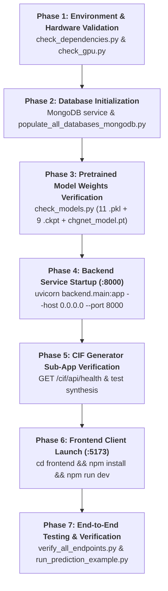

# IndianMatter — Complete System Execution Order & Operational Guide

This document defines the **chronological, end-to-end execution order** for setting up, verifying, operating, and testing the entire IndianMatter platform (Frontend, Backend, CIF Generator, and Machine Learning models).

---

## 🧭 High-Level Execution Pipeline



---

## Phase 1: Environment & Hardware Validation

### 1.1 Prerequisites
* **Python**: 3.10 to 3.13 (64-bit)
* **Node.js**: v18.0.0+ (tested on Node v24.19.0, npm 11.17.0)
* **MongoDB Community Server**: 6.0+ (running locally on port `27017`)
* **Operating System**: Windows 10/11, macOS, or Linux

### 1.2 Validate Python Dependencies
From the repository root `e:\IndianMatter`:

```powershell
# 1. Inspect Python version and path
python --version

# 2. Execute dependency probe
python scripts/check_dependencies.py
```

**Expected output:**
```
[OK] NumPy                     Version: 2.x
[OK] Pandas                    Version: 2.x
[OK] PyTorch                   Version: 2.x
[OK] Pymatgen                  Version: 2024.x
[OK] Matminer                  Version: 0.9.x
[OK] ASE                       Version: 3.23.x
[OK] FastAPI                   Version: 0.115.x
```

### 1.3 Validate Compute Accelerator (GPU / CPU)
Probe your hardware configuration for PyTorch / GNN acceleration:

```powershell
python scripts/check_gpu.py
```
* **CUDA Available:** Models run in high-throughput tensor acceleration.
* **CPU Fallback:** System operates in thread-safe CPU mode with `LOKY_MAX_CPU_COUNT=1`.

---

## Phase 2: Database Initialization

### 2.1 Verify MongoDB Service
The auth system, saved materials, and prediction histories persist to MongoDB `IndianMaterialsAI`:

```powershell
# Verify MongoDB service status (Windows)
Get-Service -Name MongoDB
```
If not running, start the service:
```powershell
Start-Service -Name MongoDB
```

### 2.2 Configure Environment Variables
Ensure `backend/.env` exists (copied from root `.env.example`):

```bash
# backend/.env
MONGO_URL=mongodb://localhost:27017/
DATABASE_NAME=IndianMaterialsAI
MP_API_KEY=your_materials_project_api_key_here
SECRET_KEY=indian-materials-ai-secret-key-change-it-in-prod
FRONTEND_URL=http://localhost:5173
```

### 2.3 Populate Databases & Establish ID Links
Load curated crystal tables (38,510 entries) and link dataset identifiers:

```powershell
# Ingest materials datasets into MongoDB
python scripts/populate_all_databases_mongodb.py

# Establish ID mappings between CSVs and CIF structures
python scripts/link_material_ids.py
```

---

## Phase 3: Model Weights Verification

### 3.1 Inspect Weight Artifacts on Disk
Confirm the presence of all neural weights and serialization dumps:

1. **IonCast & CHGNet Regressors (`property_prediction_models/pretrained_models/`):**
   * `v5_base_models.pkl` (266 MB)
   * `v5_mlp_models.pkl` (13.7 MB)
   * `v5_meta_model.pkl` (674 B)
   * `v5_model2_A.pkl` (2.5 MB)
   * `v5_quantile_transformer.pkl` (1.4 MB)
   * `v6_corrector_model.pkl` (64 KB)
   * `chgnet_logK_model.pkl` (448 KB)
   * `chgnet_logG_model.pkl` (448 KB)
   * `chgnet_Ef_model.pkl` (413 KB)
   * `chgnet_thermal_model.pkl` (413 KB)
   * `chgnet_bandgap_model.pkl` (436 KB)

2. **CrystalFormer Transformer (`property_prediction_models/CrystalFormer/weights/`):**
   * 9x `.ckpt` files (`mp_e_form.ckpt`, `mp_bandgap.ckpt`, `mp_bulk_modulus.ckpt`, `mp_shear_modulus.ckpt`, `jarvis_*.ckpt`)

3. **CHGNet Universal Potential (`property_prediction_models/final_models/chgnet_weights/`):**
   * `chgnet_model.pt` (1.74 MB)

### 3.2 Probe Model Registry
Run the automated capability probe:

```powershell
python scripts/check_models.py
```

---

## Phase 4: Backend Service Startup

### 4.1 Launch FastAPI Server
From the repository root:

```powershell
# Option A: Direct uvicorn execution
uvicorn backend.main:app --host 0.0.0.0 --port 8000 --reload

# Option B: Run main.py script
python backend/main.py
```

### 4.2 Validate Startup Lifespan
Verify the console output confirms successful model preloading and router mounting:
```
INFO:     Loading pretrained models from .../pretrained_models
INFO:     Loaded v5_base_models, v5_mlp_models, v5_meta_model, v5_model2_A
INFO:     Mounted 11 API routers
INFO:     Mounted CIF Generator sub-app at /cif
INFO:     Uvicorn running on http://0.0.0.0:8000
```

### 4.3 Verify Backend Health
In a separate terminal:
```powershell
curl http://localhost:8000/
# Expected: {"status":"online","documentation":"/docs"}
```

---

## Phase 5: CIF Generator Sub-App Verification

### 5.1 Telemetry Check
Probe the mounted `/cif` sub-application:

```powershell
curl http://localhost:8000/cif/api/health
```
**Expected response:**
```json
{
  "status": "healthy",
  "crystallm_ready": true,
  "mace_device": "cpu",
  "mp_api_key_configured": true
}
```

### 5.2 Test Synthetic Generation
Run a lightweight formula recognition and parse request:
```powershell
curl -X POST "http://localhost:8000/cif/api/parse-formula" -H "Content-Type: application/json" -d "{\"raw_input\":\"LiCoO2\"}"
```

---

## Phase 6: Frontend Client Launch

### 6.1 Install Frontend Packages
Change directory into `frontend`:

```powershell
cd frontend
npm install
```

### 6.2 Start Vite Development Server
```powershell
npm run dev
```
**Output:**
```
  VITE v5.x.x  ready in 450 ms

  ➜  Local:   http://localhost:5173/
  ➜  Network: use --host to expose
```

### 6.3 Open Browser Interface
Navigate to **`http://localhost:5173`**:
* **Dashboard:** `/app`
* **CIF Generator Studio:** `/app/cif-gen`
* **Property Prediction Studio:** `/app/predict`
* **Batch Prediction Queue:** `/app/batch`
* **Materials Explorer:** `/app/materials`
* **3D Visualizer:** `/app/structure`

---

## Phase 7: End-to-End Testing & Verification

With both Backend (`:8000`) and MongoDB active, execute the test suites:

```powershell
# 1. Test single CIF prediction and property calculations
python scripts/run_prediction_example.py

# 2. Run atomistic CIF inference benchmark
python scripts/run_inference_cif.py

# 3. Comprehensive verification of all 22 HTTP endpoints
python scripts/verify_all_endpoints.py

# 4. Run backend test suite
python scripts/run_backend_tests.py
```

---

## 📋 Quick Reference: Common Commands

| Activity | Command | Working Directory |
|---|---|---|
| **Full Dev (Root)** | `npm run dev` | `e:\IndianMatter\` |
| **Backend Server** | `uvicorn backend.main:app --reload` | `e:\IndianMatter\` |
| **Frontend Server** | `npm run dev` | `e:\IndianMatter\frontend\` |
| **Frontend Build** | `npm run build` | `e:\IndianMatter\frontend\` |
| **Check Dependencies** | `python scripts/check_dependencies.py` | `e:\IndianMatter\` |
| **Check Models** | `python scripts/check_models.py` | `e:\IndianMatter\` |
| **Verify Endpoints** | `python scripts/verify_all_endpoints.py` | `e:\IndianMatter\` |

