# IndianMatter — Master Architecture: Complete Flowchart & File Guide

> **Coverage**: Frontend (React/Vite) → Backend (FastAPI) → CIF Generator Pipeline → ML Models  
> **Entry Point**: `backend/main.py` on port **8000** | Frontend: `src/main.tsx` (Vite)

---

## Part 0: 30,000-Foot System View

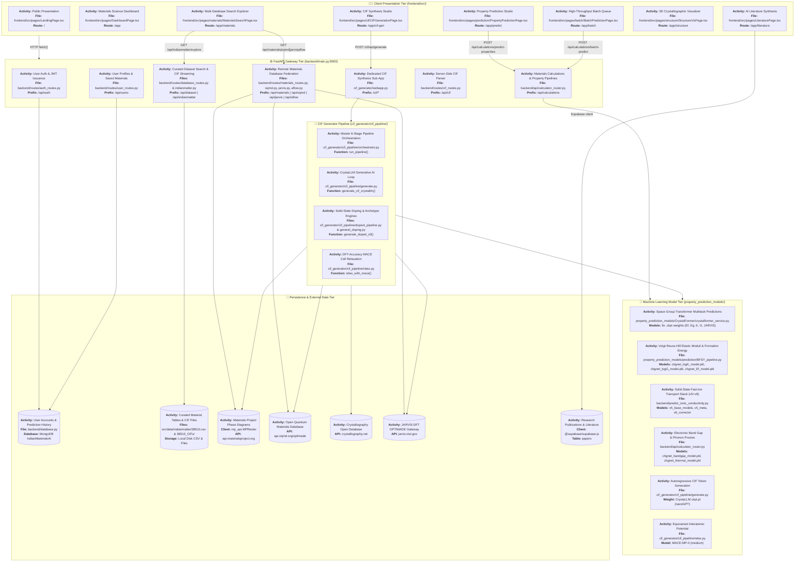

---

## Part 1: Frontend in Detail

### 1.1 Boot & Route Tree

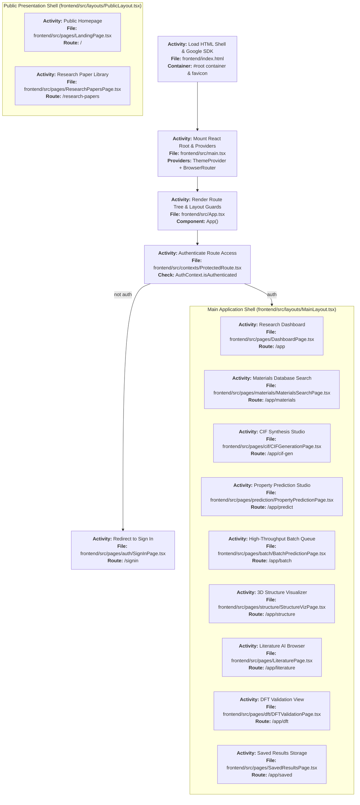

### 1.2 Auth Flow

| File | What it does |
|---|---|
| `src/contexts/AuthContext.tsx` | Holds `isAuthenticated`, `signIn()`, `signOut()`. Dev mode auto-fills 'Dr. Subodh Kumar'. Token stored in **localStorage** only — no server verification. |
| `src/contexts/ProtectedRoute.tsx` | Checks AuthContext. Remembers the attempted route in `?redirect=` and restores it after login. |
| `src/pages/auth/SignInPage.tsx` | Email input → fake `signIn()` OR real OAuth via backend. |
| `src/layouts/MainLayout.tsx` | App shell rendering Sidebar + TopHeader + page Outlet. |

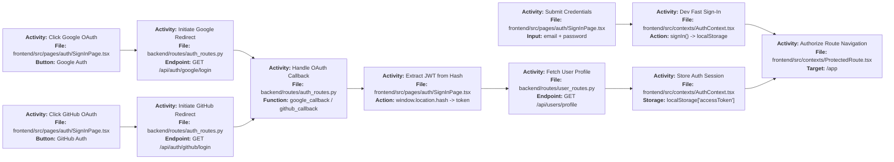

### 1.3 Frontend API Layer — `src/lib/*`

| File | Role | Backend Endpoint(s) |
|---|---|---|
| `src/lib/api.ts` | Base URL resolution (`VITE_API_BASE_URL \|\| localhost:8000`). `predictFromTrial()` — ⛔ **dead route** `/trial/predict` | ❌ no matching backend route |
| `src/lib/datasetapi.ts` | `searchDatasetMaterials()` for all 5 dataset tabs | `/api/indianmatter/explore`, `/api/materials/explore`, `/api/oqmd/explore`, `/api/jarvis/explore`, `/api/aflow/explore` |
| `src/lib/materialsPredictionApi.ts` | `predictFromCifFile()`, batch prediction helpers | `/api/calculations/predict-properties`, `batch-predict`, `batch-predict-bfsy` |
| `src/lib/cifApi.ts` | **Client-side** CIF parser — no server call. Reads `loop_` blocks, extracts fractional coords, lattice params | Internal → feeds 3D viewers |
| `src/lib/supabase.ts` | `getPublishedPapers()` | Supabase cloud table `papers` |

### 1.4 Key Page Files & Their Connections

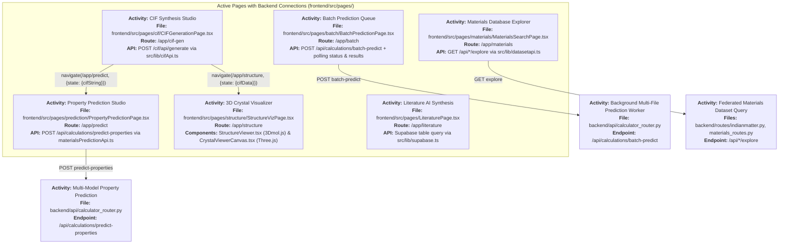

### 1.5 Visualization Components

| Component | Technology | Input |
|---|---|---|
| `StructureViewer.tsx` | **3Dmol.js** injected via CDN `<script>` at runtime | CIF text string |
| `CrystalViewerCanvas.tsx` | **three.js** bundled WebGL — custom sphere/bond renderer | Parsed `ParsedStructure` from cifApi.ts |
| `PeriodicTable.tsx` | Pure React interactive element grid | Fires element selection callbacks → MaterialsSearchPage filters |
| `ChemicalFormula.tsx` | Renders subscript-formatted formulas (e.g. Li₇La₃Zr₂O₁₂) | Formula string prop |

---

## Part 2: Backend in Detail

### 2.1 Application Startup Flow

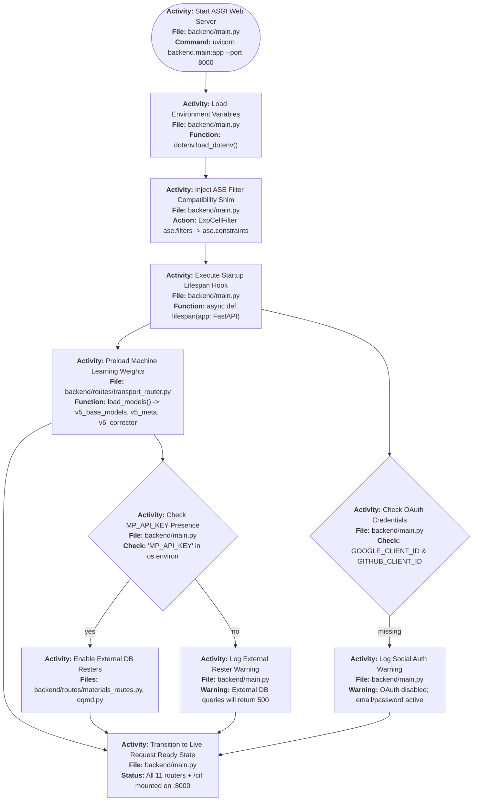

### 2.2 Router Mount Map (`backend/main.py`)

| Mount Prefix | Router File | What it Does |
|---|---|---|
| `/api/auth` | `routes/auth_routes.py` | Register, login, Google OAuth, GitHub OAuth, JWT issuance |
| `/api/users` | `routes/user_routes.py` | Profile, dashboard, mock predict, save-material |
| `/api/cif` | `routes/cif_routes.py` | Server-side pymatgen CIF parse → JSON |
| `/api/materials` | `routes/materials_routes.py` | MPRester explore query |
| `/api/oqmd` | `routes/oqmd.py` | OQMD REST filter= query |
| `/api/aflow` | `routes/aflow.py` | AFLUX matchbook query |
| `/api/jarvis` | `routes/jarvis.py` | OPTIMADE query + Python post-filters |
| `/api/indianmatter` | `routes/indianmatter.py` | Cached 38510.csv + pymatgen_matminer.csv; CIF serve |
| `/api/dataset` | `routes/database_routes.py` | Paginated 38510.csv periodic-table search |
| `/api/calculations` | `api/calculator_router.py` | CIF → CHGNet feats → BFSY/thermal/bandgap/IonCast |
| `/api/calculations` | `routes/transport_router.py` | Ionic conductivity predict (IonCast stack) |
| `/cif` | `webapp.py` (mounted sub-app) | Full CIF generator pipeline |

### 2.3 Auth System

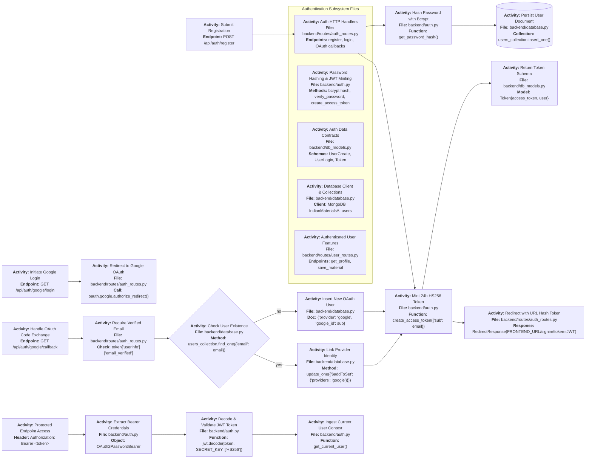

### 2.4 Property Prediction Flow (`calculator_router.py`)

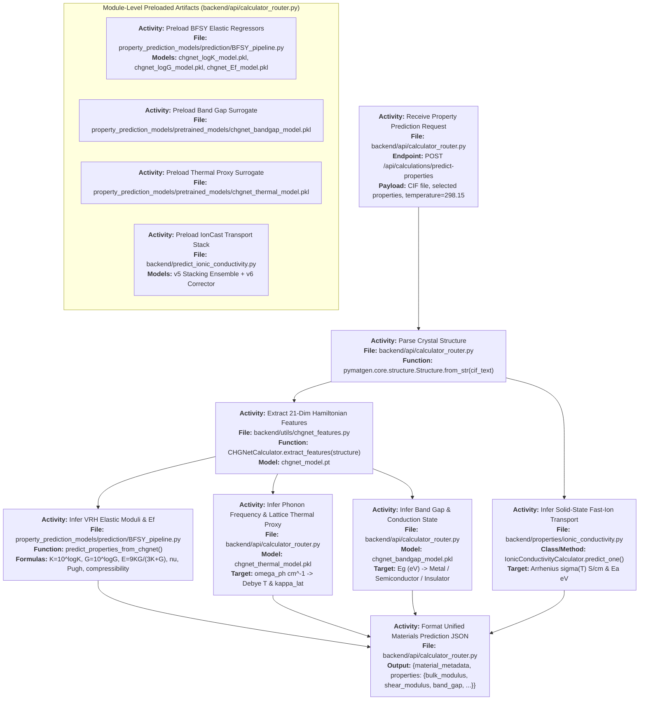

### 2.5 Batch Prediction System

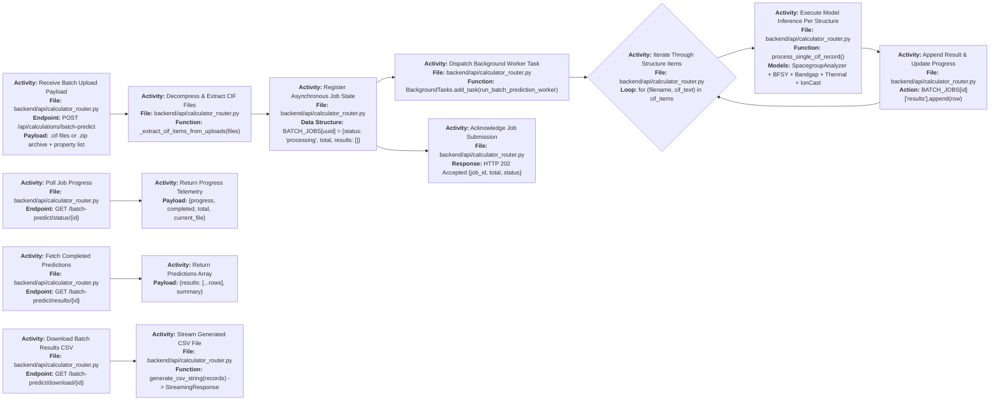

### 2.6 IonCast Ionic Conductivity Predictor

**File**: `backend/predict_ionic_conductivity.py`

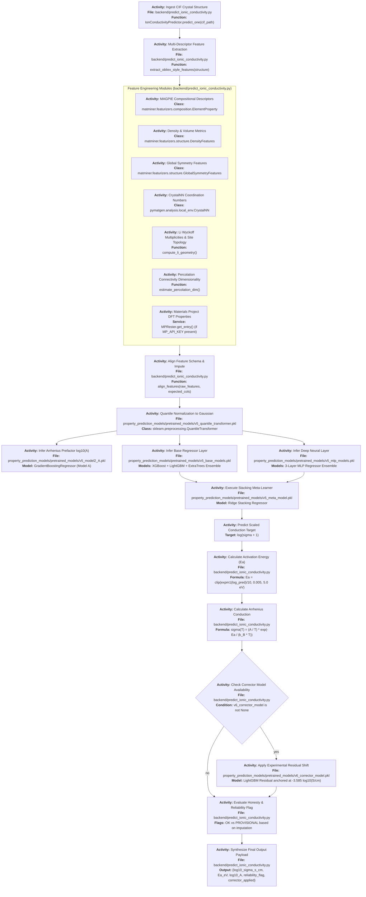

### 2.7 Dataset Explorer Flow

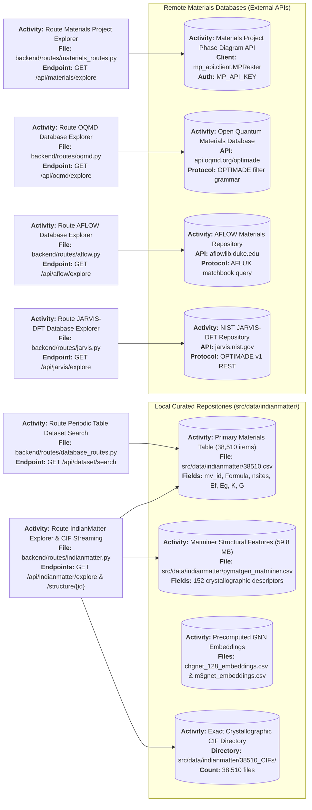

---

## Part 3: CIF Generator Pipeline in Detail

### 3.1 Overview — What `webapp.py` Exposes

| Endpoint | Handler | Purpose |
|---|---|---|
| `POST /cif/api/generate` | `orchestrator.run_pipeline()` | Full 6-stage pipeline: recognize → classify → search → generate/dope → relax → return CIF |
| `POST /cif/api/parse-formula` | inline | Fast, no-generation: recognition + composition breakdown + doping classification + site recommendations |
| `POST /cif/api/doped-cif` | `dopant_pipeline.generate_doped_cif()` | Dedicated structure-aware doping engine |
| `POST /cif/api/resolve-disambiguation` | `user_interaction.pick_option_index` | User picks a polymorph from candidates list |
| `POST /cif/api/symmetry-matrix` | `symmetry_matrix.compute_symmetry_matrix` | Returns optimal supercell transformation matrix |
| `POST /cif/api/mesp-check` | `mesp_check.check_mesp_and_relaxation` | Electrostatic plausibility check of given CIF |
| `POST /cif/api/batch-process` | `batch_processor.run_batch_pipeline(cases)` | Bulk pipeline over list of test cases |
| `GET /cif/api/health` | inline | Reports CrystaLLM ready, MACE device, MP key status |

> **Design rule**: `_web_ask_handler` always returns `None` — pipeline never silently guesses on ambiguity. Unresolved polymorphs are surfaced as `source='ambiguous_polymorphs'` for the UI to present a picker.

### 3.2 Master Generation Flow

```mermaid
flowchart TD
    REQ["<b>Activity:</b> Ingest Synthesis Request<br/><b>File:</b> cif_generator/webapp.py<br/><b>Endpoint:</b> POST /cif/api/generate<br/><b>Model:</b> GenerationRequest(formula, doping_spec)"]
    REQ --> EMPTY{"<b>Activity:</b> Validate Non-Empty Input<br/><b>File:</b> cif_generator/cif_pipeline/orchestrator.py<br/><b>Check:</b> formula.strip() != ''"}
    EMPTY -- "yes" --> FAIL1["<b>Activity:</b> Abort Pipeline Run<br/><b>File:</b> cif_generator/cif_pipeline/orchestrator.py<br/><b>Output:</b> PipelineResult(source='failed', message='Empty formula')"]
    EMPTY -- "no" --> S0

    S0["<b>Activity:</b> Stage 0 Recognition Gateway<br/><b>File:</b> cif_generator/cif_pipeline/recognition.py<br/><b>Function:</b> recognize_compound_formula()"]
    subgraph RECOG_STEPS["Recognition Sub-Steps (cif_generator/cif_pipeline/recognition.py)"]
        R1["<b>Activity:</b> Clean Text Noise<br/><b>Function:</b> clean_formula_text()"]
        R2["<b>Activity:</b> Fictitious Element Filter<br/><b>Function:</b> reject_pseudo_elements()"]
        R3["<b>Activity:</b> Extract Formula Candidates<br/><b>Function:</b> extract_formula_candidates()"]
        R4["<b>Activity:</b> Resolve Algebraic x-Notation<br/><b>Function:</b> resolve_x_notation()"]
        R5["<b>Activity:</b> Expand Chemical Acronyms<br/><b>Function:</b> lookup_abbreviation()"]
        R6["<b>Activity:</b> Mineral Common Name Lookup<br/><b>Function:</b> lookup_common_name()"]
        R7["<b>Activity:</b> Case Normalization<br/><b>Function:</b> _try_case_normalization()"]
    end
    S0 --> RECOG_STEPS --> RR["<b>Activity:</b> Return Recognition Result<br/><b>File:</b> cif_generator/cif_pipeline/models.py<br/><b>Schema:</b> RecognitionResult(resolved_formula)"]

    RR --> S1["<b>Activity:</b> Stage 1 Doping Classification<br/><b>File:</b> cif_generator/cif_pipeline/classify.py<br/><b>Function:</b> classify_compound()"]
    subgraph CLASS_STEPS["Classification Hierarchy (cif_generator/cif_pipeline/classify.py)"]
        C1["<b>Activity:</b> Inspect Request Doping Hints<br/><b>Check:</b> is_doped_hint in payload"]
        C2["<b>Activity:</b> NLP Doping Phrasing Match<br/><b>Match:</b> 'doped with', 'substituted by'"]
        C3["<b>Activity:</b> Parse Fractional Stoichiometry<br/><b>Check:</b> Non-integer atomic counts"]
        C4["<b>Activity:</b> Site Substitution Analysis<br/><b>Check:</b> Isovalent / Aliovalent replacement"]
        C5["<b>Activity:</b> Disambiguation Surfacing<br/><b>Action:</b> Returns None in web mode -> polymorph picker"]
        C6["<b>Activity:</b> Spinel Sublattice Construction<br/><b>Files:</b> site_preference.py & intent.py"]
    end
    S1 --> CLASS_STEPS --> DS["<b>Activity:</b> Produce Doping Specification<br/><b>File:</b> cif_generator/cif_pipeline/models.py<br/><b>Result:</b> (is_doped: bool, DopingSpec)"]

    DS --> S2["<b>Activity:</b> Stage 2 Stoichiometric Normalization<br/><b>File:</b> cif_generator/cif_pipeline/matching.py<br/><b>Function:</b> normalize_formula_with_trace() -> NormalizationTrace"]

    S2 --> S3["<b>Activity:</b> Stage 3 External Database Retrieval<br/><b>File:</b> cif_generator/cif_pipeline/search_external.py<br/><b>Function:</b> search_external_databases()"]
    subgraph EXT_QUERIES["Concurrent Multi-Database Queries (cif_generator/cif_pipeline/search_external.py)"]
        E1["<b>Activity:</b> Query Materials Project API<br/><b>Client:</b> mp_api.MPRester.materials.summary.search()"]
        E2["<b>Activity:</b> Query OQMD REST Gateway<br/><b>API:</b> api.oqmd.org/static REST"]
        E3["<b>Activity:</b> Query JARVIS-DFT Repository<br/><b>API:</b> jarvis.nist.gov OPTIMADE"]
        E4["<b>Activity:</b> Query Crystallography Open Database<br/><b>API:</b> crystallography.net HTTP + CSV"]
    end
    S3 --> EXT_QUERIES --> MATCH_R{"<b>Activity:</b> Evaluate Database Hits<br/><b>File:</b> cif_generator/cif_pipeline/orchestrator.py<br/><b>Check:</b> len(matches) > 0"}

    MATCH_R -- "undoped exact" --> POLY["<b>Activity:</b> Collect Distinct Polymorphs<br/><b>File:</b> cif_generator/cif_pipeline/matching.py<br/><b>Function:</b> disambiguate_polymorphs()"]
    POLY -- "one" --> CIFDB["<b>Activity:</b> Return Discovered Experimental CIF<br/><b>File:</b> cif_generator/cif_pipeline/models.py<br/><b>Status:</b> source='existing_DB', relaxation_status='EXPERIMENTAL'"]
    POLY -- "multiple" --> AMB["<b>Activity:</b> Surface Polymorph Disambiguation<br/><b>File:</b> cif_generator/webapp.py<br/><b>Status:</b> source='ambiguous_polymorphs' -> UI Dialog"]

    MATCH_R -- "doped hit" --> DFILT["<b>Activity:</b> Match Doped Stoichiometry<br/><b>File:</b> cif_generator/cif_pipeline/matching.py<br/><b>Function:</b> doped_formulas_match(tol=0.03)"]
    DFILT -- "match" --> CIFDB

    MATCH_R -- "none" --> S4["<b>Activity:</b> Stage 4 Internal DB Lookup<br/><b>File:</b> cif_generator/cif_pipeline/search_internal.py<br/><b>Function:</b> _query_internal_db()"]
    S4 -- "none" --> BRANCH

    DS -- "UNDOPED" --> BRANCH
    DS -- "DOPED" --> BRANCH
    BRANCH{"<b>Activity:</b> Route Synthesis Strategy<br/><b>File:</b> cif_generator/cif_pipeline/orchestrator.py<br/><b>Check:</b> is_doped?"}
    BRANCH -- "undoped" --> GEN_PATH["<b>Activity:</b> Stage 5a CrystaLLM Generative AI Loop<br/><b>File:</b> cif_generator/cif_pipeline/generate.py<br/><b>Function:</b> generate_cif_crystallm()"]
    BRANCH -- "doped" --> DOPE_PATH["<b>Activity:</b> Stage 5b Solid-State Doping Engine<br/><b>File:</b> cif_generator/cif_pipeline/doping.py<br/><b>Function:</b> apply_doping()"]

    GEN_PATH & DOPE_PATH & CIFDB --> FINAL["<b>Activity:</b> Format IUCr-Compliant Wyckoff CIF<br/><b>File:</b> cif_generator/cif_pipeline/export.py<br/><b>Function:</b> structure_to_cif(symprec=0.1)"]

    FINAL --> RESP_FINAL["<b>Activity:</b> Dispatch Comprehensive Synthesis Payload<br/><b>File:</b> cif_generator/webapp.py<br/><b>Response:</b> PipelineResult(cif_string, space_group, energy, diagnostics)"]
```

### 3.3 Undoped Generation — CrystaLLM Feedback Loop (`generate.py`)

```mermaid
flowchart TD
    COMP["<b>Activity:</b> Receive Normalized Formula String<br/><b>File:</b> cif_generator/cif_pipeline/generate.py<br/><b>Input:</b> Electronegativity-sorted formula or space-group prompt"]
    COMP --> PROMPT["<b>Activity:</b> Construct Conditioning Prompt<br/><b>File:</b> cif_generator/cif_pipeline/generate.py<br/><b>Function:</b> build_prompt(formula, space_group)"]

    PROMPT --> LLM["<b>Activity:</b> Execute Autoregressive nanoGPT Inference<br/><b>File:</b> cif_generator/cif_pipeline/generate.py<br/><b>Model:</b> CrystaLLM ckpt.pt (GPT-2 nanoGPT architecture)<br/><b>Device:</b> CUDA bfloat16 or CPU"]

    LLM --> SAMPLE["<b>Activity:</b> Sample Candidate CIF Token Streams<br/><b>File:</b> cif_generator/cif_pipeline/generate.py<br/><b>Function:</b> model.generate(temperature=0.7..1.5, top_k=10)"]

    SAMPLE --> PARSE_CIF["<b>Activity:</b> Parse Candidate CIF Text to Structure<br/><b>File:</b> pymatgen/core/structure.py<br/><b>Function:</b> Structure.from_str(cif_text)"]

    PARSE_CIF --> FILT["<b>Activity:</b> Evaluate Physical Plausibility Filters<br/><b>File:</b> cif_generator/cif_pipeline/filter_rules.py<br/><b>Checks:</b> Bond lengths, coordination polyhedra, charge balance"]

    FILT --> RELAX_STEP["<b>Activity:</b> Relax Atomic Coordinates & Cell Vectors<br/><b>File:</b> cif_generator/cif_pipeline/relax.py<br/><b>Model/Optimizer:</b> MACE-MP-0 (medium) + FIRE optimizer (fmax &lt; 0.05 eV/Å)"]

    RELAX_STEP --> CONV{"<b>Activity:</b> Check Relaxation Convergence<br/><b>File:</b> cif_generator/cif_pipeline/relax.py<br/><b>Guard:</b> Check finite energies and forces"}
    CONV -- "NaN/inf" --> REJECT["<b>Activity:</b> Discard Unstable Candidate<br/><b>File:</b> cif_generator/cif_pipeline/generate.py<br/><b>Action:</b> Reject sample"]
    CONV -- "bond fail dominant" --> TEMP_UP["<b>Activity:</b> Escalate Sampling Temperature<br/><b>File:</b> cif_generator/cif_pipeline/generate.py<br/><b>Action:</b> T = min(T + 0.15, 1.5)"]
    CONV -- "ok" --> SG_COMP["<b>Activity:</b> Recompute Post-Relaxation Space Group<br/><b>File:</b> pymatgen/symmetry/analyzer.py<br/><b>Class:</b> SpacegroupAnalyzer(symprec=0.1)"]

    REJECT & TEMP_UP --> DIAG["<b>Activity:</b> Log Iteration Diagnostics<br/><b>File:</b> cif_generator/cif_pipeline/models.py<br/><b>Class:</b> GenerationDiagnostics"]
    DIAG --> ITER_LOOP(["<b>Activity:</b> Evaluate Retry Loop Condition<br/><b>File:</b> cif_generator/cif_pipeline/generate.py<br/><b>Loop:</b> until max_iterations reached"])
    ITER_LOOP --> SAMPLE

    SG_COMP --> PICK["<b>Activity:</b> Select Lowest Ground-State Energy Candidate<br/><b>File:</b> cif_generator/cif_pipeline/generate.py<br/><b>Action:</b> Sort candidates by MACE final energy"]
    SG_MULT{"<b>Activity:</b> Check for Competing Distinct SGs<br/><b>File:</b> cif_generator/cif_pipeline/generate.py<br/><b>Check:</b> Multiple space groups in top 5?"}
    PICK --> SG_MULT
    SG_MULT -- "yes" --> ASK_U["<b>Activity:</b> Surface Disambiguation Picker<br/><b>File:</b> cif_generator/webapp.py<br/><b>Status:</b> source='ambiguous_polymorphs'"]
    SG_MULT -- "no" --> RESULT["<b>Activity:</b> Package Successful Synthesis Result<br/><b>File:</b> cif_generator/cif_pipeline/models.py<br/><b>Output:</b> PipelineResult(source='generated_undoped')"]
    ASK_U --> RESV["<b>Activity:</b> User Resolves Polymorph<br/><b>File:</b> cif_generator/webapp.py<br/><b>Endpoint:</b> POST /cif/api/resolve-disambiguation"] --> RESULT
```

### 3.4 Doped Path — Two Sub-Engines

#### Path A — `doping.py` (standard orchestrator path)

```mermaid
flowchart LR
    DSPEC["<b>Activity:</b> Ingest Standard Doping Specification<br/><b>File:</b> cif_generator/cif_pipeline/models.py<br/><b>Object:</b> DopingSpec(host, dopant, site, fraction)"]
    DSPEC --> PARENT["<b>Activity:</b> Retrieve Undoped Host Structure<br/><b>File:</b> cif_generator/cif_pipeline/doping.py<br/><b>Function:</b> resolve_parent_structure() (DB search or CrystaLLM)"]
    PARENT --> SITES["<b>Activity:</b> Identify & Rank Candidate Sites<br/><b>File:</b> cif_generator/cif_pipeline/site_preference.py<br/><b>Functions:</b> CrystalNN + recommend_site_for_dopant() (Shannon radii & CFSE)"]
    SITES --> CHG["<b>Activity:</b> Assess Charge Neutrality & Compensation<br/><b>File:</b> cif_generator/cif_pipeline/doping.py<br/><b>Function:</b> _check_charge_compensation()"]
    CHG --> SUB["<b>Activity:</b> Execute Site Substitution<br/><b>File:</b> cif_generator/cif_pipeline/doping.py<br/><b>Function:</b> apply_doping()"]
    SUB --> DISORD{"<b>Activity:</b> Check Disordered / Fractional Occupancy<br/><b>File:</b> cif_generator/cif_pipeline/doping.py<br/><b>Check:</b> Is structure fractional VCA?"}
    DISORD -- "yes" --> SKIP["<b>Activity:</b> Deliberately Bypass MACE Relaxation<br/><b>File:</b> cif_generator/cif_pipeline/doping.py<br/><b>Action:</b> Preserve fractional occupancies as-is"]
    DISORD -- "no" --> MACE_D["<b>Activity:</b> Relax Doped Supercell with MACE-MP-0<br/><b>File:</b> cif_generator/cif_pipeline/relax.py<br/><b>Function:</b> relax_with_mace()"]
    MACE_D --> VAL["<b>Activity:</b> Validate Interatomic Distances & Charges<br/><b>File:</b> cif_generator/cif_pipeline/filter_rules.py<br/><b>Function:</b> validate_doped_structure()"]
    SKIP --> VAL
    VAL --> OUT["<b>Activity:</b> Export Validated Doped CIF<br/><b>File:</b> cif_generator/cif_pipeline/export.py<br/><b>Output:</b> CIF string + DopedStructureValidation report"]
```

#### Path B — `dopant_pipeline.py` (`POST /cif/api/doped-cif`)

```mermaid
flowchart TD
    DRQ["<b>Activity:</b> Ingest Dedicated Doping Request<br/><b>File:</b> cif_generator/webapp.py<br/><b>Endpoint:</b> POST /cif/api/doped-cif<br/><b>Model:</b> DopantRequest(host, dopant, fraction, family, technique)"]
    DRQ --> FAM["<b>Activity:</b> Classify Crystal Archetype Family<br/><b>File:</b> cif_generator/cif_pipeline/family.py<br/><b>Function:</b> classify_family() (Spinel, Perovskite, Garnet, NASICON)"]
    FAM --> REG["<b>Activity:</b> Calculate Inversion & Jahn-Teller Regime<br/><b>File:</b> cif_generator/cif_pipeline/regime.py<br/><b>Calculations:</b> Inversion lambda parameter & orbital degeneracy"]
    REG --> FRN["<b>Activity:</b> Discretize Continuous Fraction into Supercell<br/><b>File:</b> cif_generator/cif_pipeline/fractions.py<br/><b>Function:</b> resolve_neat_fraction(x_target) -> (x_real, supercell_multiplier)"]
    FRN --> REP["<b>Activity:</b> Select Supercell Representation Strategy<br/><b>File:</b> cif_generator/cif_pipeline/representation.py<br/><b>Options:</b> VCA, Ordered Supercell, SQS, Enumeration"]
    REP --> APPLY["<b>Activity:</b> Assign Oxidation States & Sublattice Species<br/><b>File:</b> cif_generator/cif_pipeline/dopant_pipeline.py<br/><b>Function:</b> _apply_substitution()"]
    APPLY --> ORD["<b>Activity:</b> Ground-State Monte Carlo Ordering<br/><b>File:</b> cif_generator/cif_pipeline/ordering.py<br/><b>Energy:</b> Ewald pair-Coulomb potential + MACE single-point evaluation (mlip.py)"]
    ORD --> RT["<b>Activity:</b> Stoichiometry Roundtrip Verification<br/><b>File:</b> cif_generator/cif_pipeline/dopant_pipeline.py<br/><b>Function:</b> _roundtrip_ok()"]
    RT --> ROPT{"<b>Activity:</b> Check Relaxation Request Flag<br/><b>File:</b> cif_generator/cif_pipeline/dopant_pipeline.py<br/><b>Check:</b> relax=True in payload?"}
    ROPT -- "yes" --> RELAX_D["<b>Activity:</b> DFT-Accuracy Supercell Relaxation<br/><b>File:</b> cif_generator/cif_pipeline/relax.py<br/><b>Model:</b> MACE-MP-0 (medium) + FIRE optimizer"]
    ROPT -- "no" --> CHECKS
    RELAX_D --> CHECKS
    CHECKS["<b>Activity:</b> Execute Multi-Check Validation<br/><b>File:</b> cif_generator/cif_pipeline/filter_rules.py<br/><b>Checks:</b> Charge balance, minimum bond lengths, space group verified"]
    CHECKS --> RESP2["<b>Activity:</b> Return Doped Structure Result<br/><b>File:</b> cif_generator/webapp.py<br/><b>Output:</b> DopedCifResult(family, regime, representations, provenance)"]

    subgraph SPINEL_SPEC["Spinel-Specific Specialized Subsystem"]
        SB["<b>Activity:</b> Populate Spinel Sublattices<br/><b>File:</b> cif_generator/cif_pipeline/spinel_build.py<br/><b>Sites:</b> Tetrahedral 8a, Octahedral 16d, Anion 32e"]
        SC["<b>Activity:</b> Format Spinel Wyckoff CIF<br/><b>File:</b> cif_generator/cif_pipeline/spinel_cif.py<br/><b>Function:</b> write_spinel_cif()"]
        GD["<b>Activity:</b> 11-Stage Universal Non-Spinel Engine<br/><b>File:</b> cif_generator/cif_pipeline/general_doping.py<br/><b>Capabilities:</b> Wyckoff orbits, electrostatic ranking, neutral vacancies"]
    end
    FAM -.->|"spinel family"| SPINEL_SPEC
```

### 3.5 Guard Rails & Failure Modes

| Guard | Where | Effect |
|---|---|---|
| Empty/blank input | `orchestrator.py` start | `source='failed'` immediately |
| `@` endohedral syntax | `webapp.py parse-formula` | Clean error, no pipeline run |
| `wt%` weight percent | `webapp.py parse-formula` | Clean error — out of scope |
| Fictitious elements | `recognition.py` | Rejected before classify |
| COD CIF mismatch | `search_external.py` | Mandatory composition re-verification |
| NaN/inf in MACE output | `generate.py` | Sample rejected, count logged |
| No convergence after N iterations | `generate.py` | `is_reliable=False` flagged |
| Distinct final SGs | `generate.py` | Never auto-picked → `ambiguous_polymorphs` |
| Disordered occupancy | `doping.py` | MACE relaxation deliberately skipped |
| SG from generated sample | `generate.py` | NEVER trusted — always recomputed post-relax |

---

## Part 4: ML Models in Detail

### 4.1 Model Artifact Inventory

| Artifact | Size | Used By | What It Does |
|---|---|---|---|
| `pretrained_models/v5_base_models.pkl` | 266 MB | `model_service.py`, `predict_ionic_conductivity.py` | XGB + LightGBM + Extra Trees ensemble for ionic conductivity |
| `pretrained_models/v5_mlp_models.pkl` | 13.7 MB | same | MLP members of the v5 stack |
| `pretrained_models/v5_meta_model.pkl` | 674 B | same | Stacking meta-learner |
| `pretrained_models/v5_quantile_transformer.pkl` | 1.4 MB | same | Feature scaler |
| `pretrained_models/v5_model2_A.pkl` | 2.5 MB | same | "Model A" log10 prefactor predictor |
| `pretrained_models/v6_corrector_model.pkl` | 64 KB | same | LightGBM residual corrector |
| `pretrained_models/chgnet_logK_model.pkl` | ~448 KB | `calculator_router.py` | Predicts log10(K_VRH) from 21-dim CHGNet vector |
| `pretrained_models/chgnet_logG_model.pkl` | ~448 KB | `calculator_router.py` | Predicts log10(G_VRH) |
| `pretrained_models/chgnet_Ef_model.pkl` | ~413 KB | `BFSY_pipeline.py` | Predicts formation energy per atom |
| `pretrained_models/chgnet_thermal_model.pkl` | ~413 KB | `calculator_router.py` | Phonon frequency proxy |
| `pretrained_models/chgnet_bandgap_model.pkl` | 436 KB | `calculator_router.py` | Electronic band gap |
| `final_models/chgnet_weights/chgnet_model.pt` | 1.74 MB | `utils/chgnet_features.py` | Full CHGNet universal IaP (feature extraction only) |
| `final_models/mace_weights/20231203mace128L1...` | 44.4 MB | `cif_pipeline/relax.py` | MACE-MP-0 medium MLIP (structure relaxation) |
| `final_models/m3gnet_weights/` | ~5 MB total | adapters | M3GNet-MP PES (via matgl cache) |

> **Key rule**: `model_paths.resolve_pretrained_models_dir()` searches `root/pretrained_models/` first, then `backend/pretrained_models/`, then legacy paths. MACE and M3GNet are loaded via library cache names, NOT from `final_models/`.

### 4.2 BFSY (Mechanical) Surrogate Stack

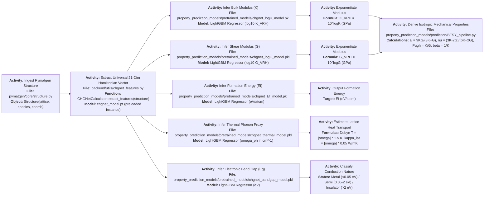

### 4.3 Model Path Resolution

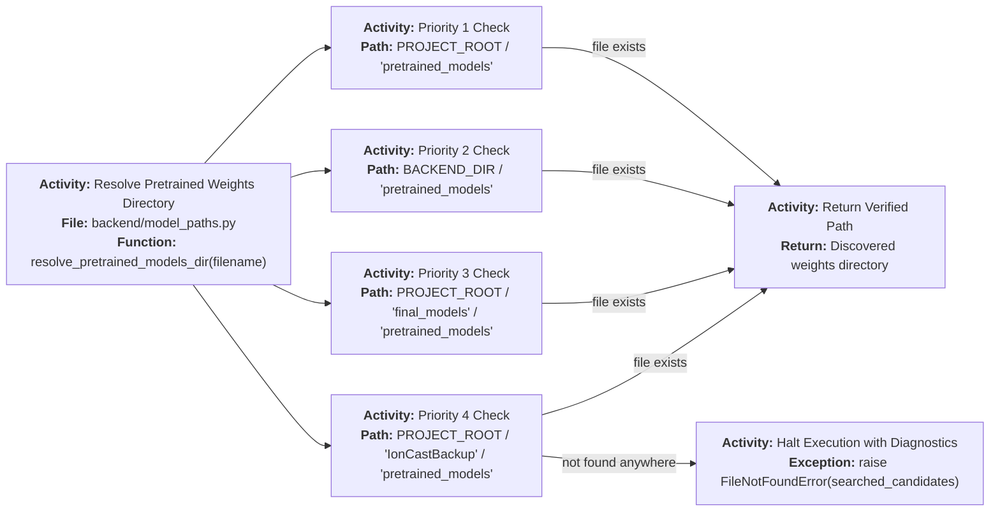

### 4.4 Surrogate Training Origins

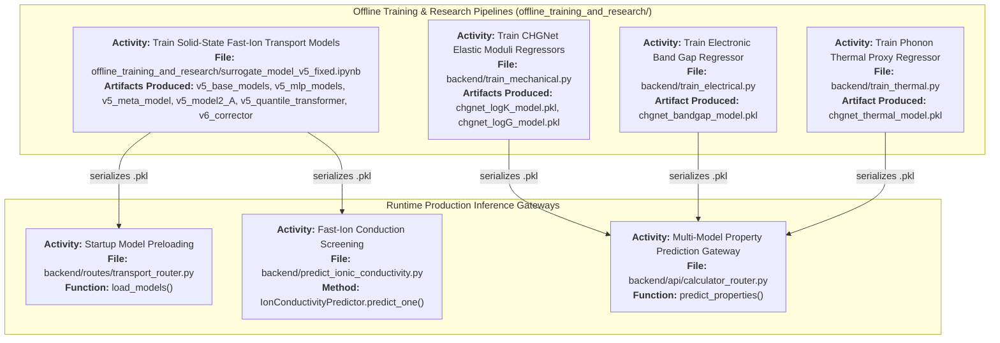

### 4.5 CrystaLLM Model (`generate.py`)

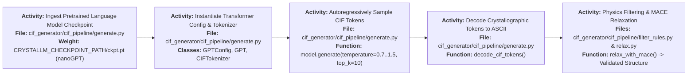

---

## Part 5: Known Gaps & Dead Code

### Backend Gaps

| # | Issue | File(s) |
|---|---|---|
| 1 | `/api/materials-prediction/*` router **missing** from `main.py` | `tests/test_api_routes.py` expects it |
| 2 | `/trial/predict` route **does not exist** on backend | `src/lib/api.ts` calls it |
| 3 | `auth.py` `SECRET_KEY` **hardcoded** string (not from env) | `auth.py` |
| 4 | OQMD/AFLOW/JARVIS structure+CIF download endpoints are **501 stubs** | `routes/oqmd.py` etc. |
| 5 | `indianmatter.py` crystal-system is **lattice-metric heuristic** not real symmetry | `routes/indianmatter.py` |
| 6 | `services/prediction_service.py` + `workers/prediction_worker.py` — **not routed** | legacy code |

### Frontend Gaps

| # | Issue |
|---|---|
| 1 | `src/lib/topath.ts` — `askToPath()` **never imported** anywhere |
| 2 | `src/data/researchPapers.ts` — static array **never used** (Supabase replaced it) |
| 3 | `src/pages/structure/MaterialsDetailsPage.tsx` — **hardcoded LiCoO₂ only** |
| 4 | OAuth Google Client ID **hardcoded** in `index.html` |
| 5 | DFT Validation page — **fake setInterval progress bar**, hardcoded results |
| 6 | `src/Home.tsx` — legacy home component, **unreachable** from any route |

### Model/Config Gaps

| # | Issue |
|---|---|
| 1 | `configs/paths.json` → `final_models/pretrained_models/` — **STALE**, real path is root `pretrained_models/` |
| 2 | HF model name `M3GNet-MP-2021.2.8-PES` — **no longer on HuggingFace** |
| 3 | `final_models/alignn_weights/` — **referenced but absent** on disk (ALIGNN returns placeholder −2.35 eV) |
| 4 | Model A `diffusion_coefficient_300K` feature ~82% importance — **simulation-only**, honesty warning hardcoded |
