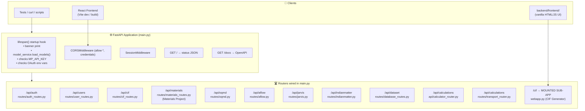
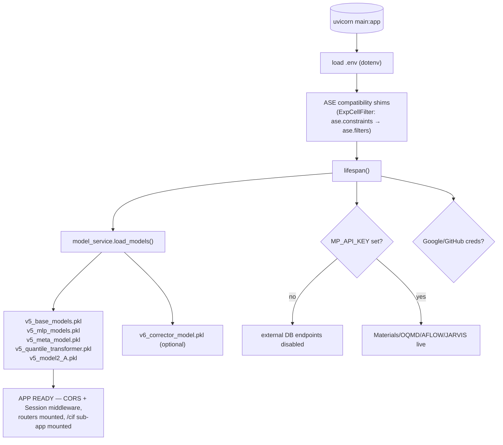
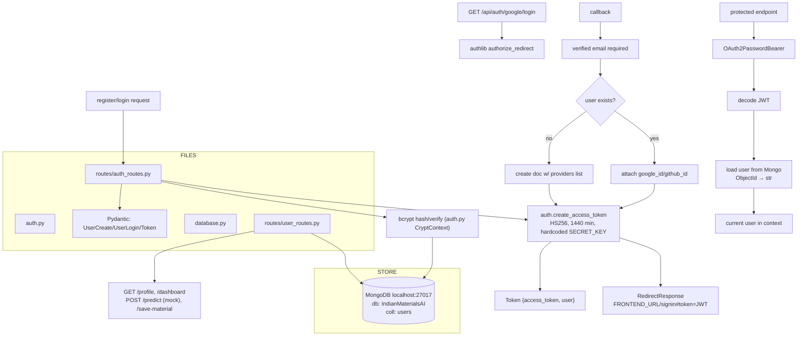
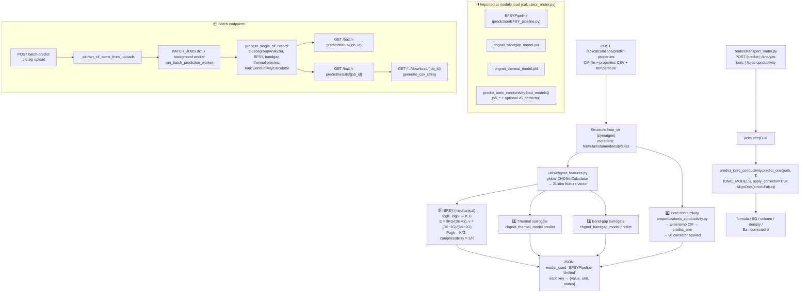
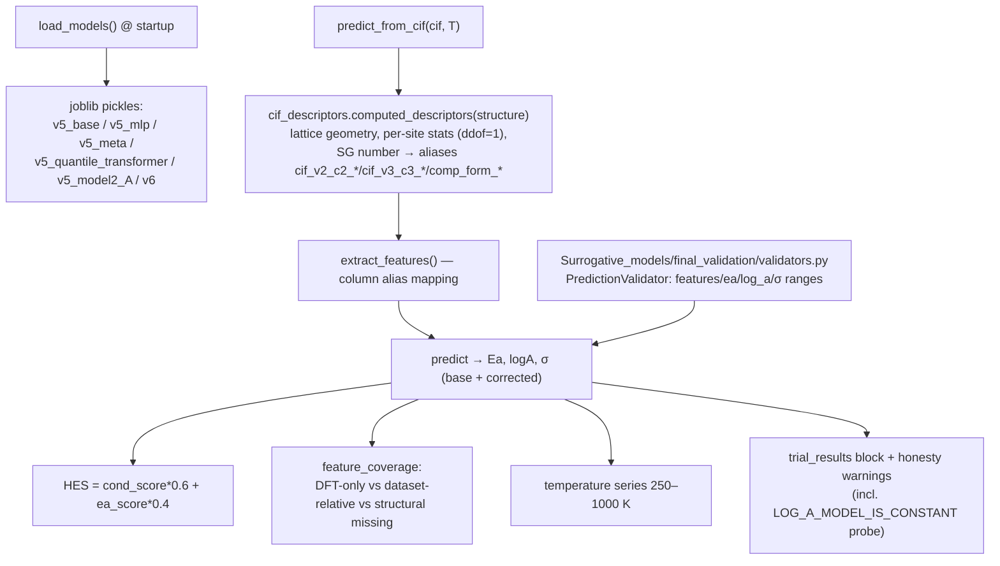
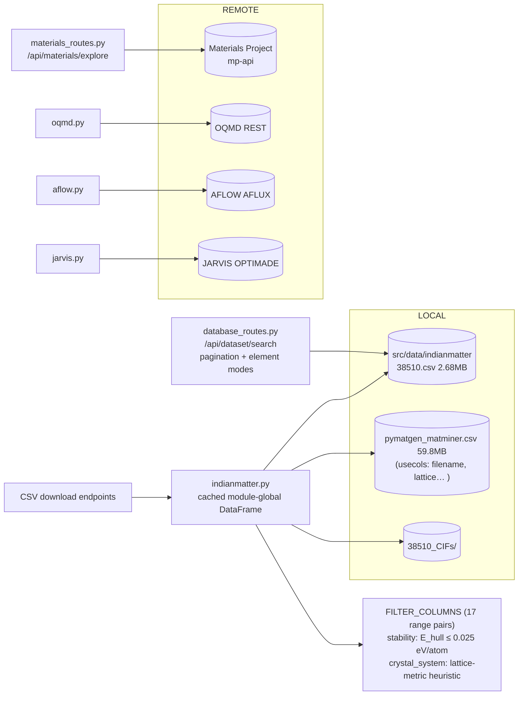
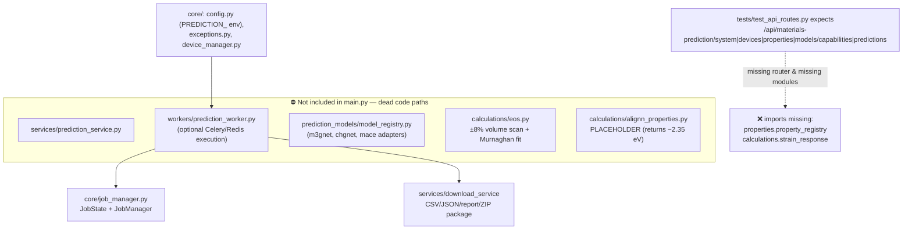

# IndianMatter — BACKEND Flow Chart (Artifact)

> Scope: `E:\IndianMatter\backend\` — FastAPI server, routers, auth, prediction stack, service layers.
> Entry point: `backend/main.py`. Default port: **8000**.

---

## 1. High-Level Architecture Flow



---

## 2. Request Routing Map (file → endpoint → action)

| HTTP Route | File | What it does |
|---|---|---|
| `POST /api/auth/register` | `backend/routes/auth_routes.py` | bcrypt-hash password → insert Mongo user → issue JWT |
| `POST /api/auth/login` | `backend/routes/auth_routes.py` | verify email+bcrypt → update `last_login` → JWT |
| `GET /api/auth/google/login` | `backend/routes/auth_routes.py` | authlib `authorize_redirect` → Google |
| `GET /api/auth/google/callback` | `backend/routes/auth_routes.py` | fetch userinfo → create/link user → redirect `FRONTEND_URL/signin#token=JWT` |
| `GET /api/auth/github/login` / `callback` | `backend/routes/auth_routes.py` | GitHub OAuth, email via `user/emails` fallback |
| `GET /api/users/profile` | `backend/routes/user_routes.py` | `get_current_user` dep → public profile |
| `GET /api/users/dashboard` | `backend/routes/user_routes.py` | last 5 predictions + saved materials |
| `POST /api/users/predict` | `backend/routes/user_routes.py` | **MOCK** prediction (Ea=0.46, σ=1.3e-3) → history |
| `POST /api/users/save-material` | `backend/routes/user_routes.py` | push `SavedMaterial` to Mongo |
| `POST /api/cif/parse` | `backend/routes/cif_routes.py` | CifParser → lattice params, atoms, SG info |
| `GET /api/materials/explore` | `backend/routes/materials_routes.py` | MPRester query → normalized rows |
| `GET /api/oqmd/explore` | `backend/routes/oqmd.py` | OQMD REST `filter=` grammar → rows |
| `GET /api/aflow/explore` | `backend/routes/aflow.py` | AFLUX matchbook query → rows |
| `GET /api/jarvis/explore` | `backend/routes/jarvis.py` | OPTIMADE query + python post-filters |
| `GET /api/indianmatter/explore` | `backend/routes/indianmatter.py` | local CSV (38510 + matminer) filtering |
| `GET /api/indianmatter/structure/{id}` | `backend/routes/indianmatter.py` | serve `38510_CIFs/{id}.cif` |
| `GET /api/dataset/search` | `backend/routes/database_routes.py` | 38510.csv periodic-table/formula search + pagination |
| `POST /api/calculations/predict-properties` | `backend/api/calculator_router.py` | CIF → CHGNet feats → BFSY/thermal/bandgap/IonCast |
| `POST /api/calculations/analyze-cif` | `backend/api/calculator_router.py` | structure + SpacegroupAnalyzer + Magpie |
| `POST /api/calculations/batch-predict` | `background` job + `status/results/download` | background worker per CIF |
| `POST /api/calculations/batch-predict-bfsy` | `backend/api/calculator_router.py` | BFSY batch → CSV |
| `POST /api/calculations/ionic-conductivity` | `backend/routes/transport_router.py` | temp CIF → IonCast `predict_one` |
| `POST /cif/api/generate` etc. | `backend/webapp.py` | see CIF artifact |

---

## 3. Startup / Lifespan Flow



---

## 4. Auth Flow (JWT + OAuth + MongoDB)



---

## 5. Property Prediction Flow (`/api/calculations/*`)



---

## 6. IonCast Ionic-Conductivity Predictor Flow (`backend/predict_ionic_conductivity.py`)

```mermaid
flowchart LR
    CIF["CIF file"] --> FEAT["extract_obliex_style_features"]
    subgraph FEATGROUP["Feature engineering"]
        F1["MAGPIE/stoichiometry/valence/ion props (matminer)"]
        F2["DensityFeatures"]
        F3["GlobalSymmetryFeatures"]
        F4["CrystalNN bond lengths + coordination numbers"]
        F5["Li-site geometry + Wyckoff multiplicities"]
        F6["Li percolation dimensionality"]
        F7["optional MP DFT fields (if API key)"]
    end
    FEAT --> FEATGROUP
    FEATGROUP --> ALIGN["align_features — schema-safe alignment,<br/>per-model default-fraction diagnostics"]
    ALIGN --> M2A["Model A: log10 prefactor"]
    ALIGN --> BASE["LightGBM/XGB base models"]
    ALIGN --> QTF["QuantileTransformer → MLPs"]
    BASE & QTF --> META["meta learner"]
    META --> EA["Ea = clip(expm1(log_pred)/10, 0.005–5.0 eV)"]
    EA --> ARR["σ = A·exp(−Ea/kT)"]
    ARR --> CORR{"v6 OBLiEx<br/>corrector?"}
    CORR -- yes --> RESCORR["LightGBM residual<br/>anchored −3.585 log10(S/cm)@298.15<br/>+ temperature shift"]
    CORR -- no --> OUT
    RESCORR --> OUT["final log10 σ(S/cm) + reliability<br/>(PROVISIONAL if imputation > AlignOpts limit)"]
```



---

## 7. M3GNet-like Service Flow (`backend/model_service.py`)



---

## 8. Dataset Exploration Data Flow



---

## 9. Unwired / Legacy Pipeline (present, NOT routed)



---

## 10. File-to-File Connection Matrix

```
backend/main.py
 ├─→ routes/auth_routes.py ──→ auth.py ──→ database.py ──→ MongoDB
 │                        └──→ db_models.py
 ├─→ routes/user_routes.py ──→ auth.py, database.py
 ├─→ routes/cif_routes.py (pymatgen CifParser)
 ├─→ routes/materials_routes.py (mp_api.MPRester)
 ├─→ routes/oqmd.py, aflow.py, jarvis.py (remote REST)
 ├─→ routes/indianmatter.py, database_routes.py (local CSVs)
 ├─→ api/calculator_router.py
 │     ├─→ prediction/BFSY_pipeline.py (chgnet_logK/logG/Ef .pkl)
 │     ├─→ chgnet_bandgap_model.pkl, chgnet_thermal_model.pkl
 │     ├─→ predict_ionic_conductivity.load_models() (v5_*.pkl, v6_*.pkl)
 │     ├─→ utils/chgnet_features.py (global CHGNetCalculator)
 │     └─→ properties/ionic_conductivity.py
 ├─→ routes/transport_router.py ──→ predict_ionic_conductivity.predict_one
 └─→ webapp.py (mounted sub-app) ──→ cif_pipeline/* — see CIF artifact

Support modules:
 • model_paths.py — resolves pretrained_models dir (used by calculator_router, transport_router, model_service)
 • megnet_patch.py — pymatgen local_env NN-class shims so MEGNet imports work
 • train_mechanical.py / train_electrical.py / train_thermal.py — offline trainers → chgnet_*.pkl in pretrained_models/
 • cif_analyzer/cif_analyzer/backend.py — standalone demo backend, NOT mounted
 • scripts/check_models.py, run_inference_cif.py — exercise prediction paths
```

---

## 11. Known Gaps / Notes

| # | Gap |
|---|---|
| 1 | `/api/materials-prediction/*` router exists in tests but **not included** in `main.py`; backing modules import missing `properties.property_registry`, `calculations.strain_response` |
| 2 | `/trial/predict` route doesn't exist — frontend `src/lib/api.ts` calls a dead endpoint |
| 3 | `auth.py` SECRET_KEY & Mongo URL hardcoded (should be env) |
| 4 | OQMD/AFLOW/JARVIS structure+CIF download endpoints are 501 stubs |
| 5 | `indianmatter.py` crystal-system detection is a lattice-metric heuristic, not real symmetry analysis |
