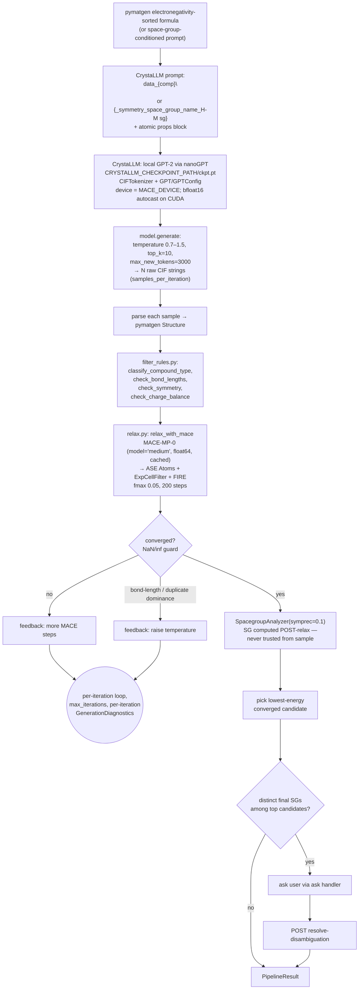
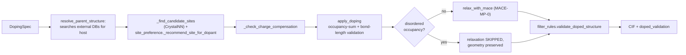
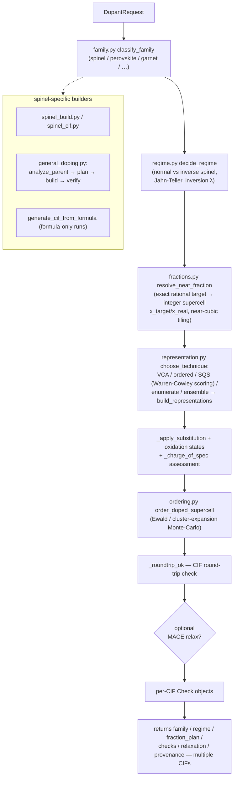
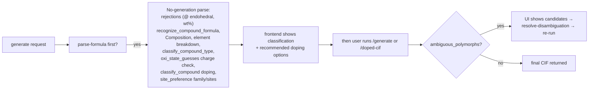

# IndianMatter — CIF FILE GENERATOR Flow Chart (Artifact)

> Scope: `backend/webapp.py` (mounted FastAPI sub-app at `/cif`) + `backend/cif_pipeline/` package.
> Used by frontend `CIFGenerationPage.tsx` via `POST /cif/api/generate`.

---

## 1. Endpoint Map (`backend/webapp.py`)

| Endpoint | Handler purpose |
|---|---|
| `POST /cif/api/generate` | Main 5-stage pipeline via `cif_pipeline.orchestrator.run_pipeline()` |
| `POST /cif/api/parse-formula` | Fast parse: no generation — recognition, composition, type classification, charge balance, doping classification, site recommendation |
| `POST /cif/api/doped-cif` | Dedicated doping pipeline → `dopant_pipeline.generate_doped_cif()` |
| `POST /cif/api/resolve-disambiguation` | user polymorph/site choice via `user_interaction.pick_option_index` |
| `POST /cif/api/symmetry-matrix` | `symmetry_matrix.compute_symmetry_matrix` — min-image-legal supercell |
| `POST /cif/api/mesp-check` | `mesp_check.check_mesp_and_relaxation` — MESP plausibility of given CIF |
| `POST /cif/api/batch-process` | `batch_processor.run_batch_pipeline(cases)` |
| `GET /cif/api/health` | MP key present, MACE model/device, CrystaLLM ckpt existence |
| `POST /cif/api/auth/login` | lightweight token (off unless `CIF_AUTH_ENABLED=true`) |
| `GET /cif/api/data-files[/{filename}]` | list/download `backend/data/*.dat` benchmark cases |

Important design rule: `_web_ask_handler` always returns `None` → the pipeline never silently guesses; ambiguity is surfaced as `ambiguous_polymorphs` to the UI.

---

## 2. MASTER Flow — `POST /cif/api/generate`

```mermaid
flowchart TD
    REQ["GenerationRequest:<br/>formula/text, is_doped_hint, space_group,<br/>host_formula, dopant_element, host_site_species,<br/>dopant_fraction, co_dopants, max_iterations,<br/>samples_per_iteration"] --> ORCH["cif_pipeline/orchestrator.py<br/>run_pipeline(query, ask_user,<br/>max_iterations, samples_per_iteration)"]

    ORCH --> G0{"Stage 0<br/>empty/blank?"}
    G0 -- yes --> FAIL["PipelineResult source='failed'"]

    G0 -- no --> S0["STAGE 0 — RECOGNITION<br/>recognition.py: recognize_compound_formula"]
    subgraph RECOG
        R1["clean_formula_text (noise cleanup)"]
        R2["fictitious-element rejection"]
        R3["extract_formula_candidates (conversational text)"]
        R4["resolve_x_notation"]
        R5["lookup_abbreviation / lookup_common_name<br/>(LLM-free tables)"]
        R6["_try_case_normalization<br/>(fe2o3 → Fe2O3)"]
    end
    S0 --> RECOG --> RR["RecognitionResult{method, resolved_formula}"]

    RR --> S1["STAGE 1 — CLASSIFY<br/>classify.py: classify_compound"]
    subgraph CLASS
        C1["explicit doped hint"]
        C2["doping phrasing detection"]
        C3["algebraic La0.7Sr0.3MnO3"]
        C4["fractional site-occupancy heuristics"]
        C5["ambiguous → ask user"]
        C6["spinels → sublattice_spec (A/B-site)<br/>via site_preference.py / intent.py"]
    end
    S1 --> CLASS --> DS["(is_doped, DopingSpec):<br/>host / replaced species / dopant / fraction / co-dopants"]

    DS --> S2["STAGE 2 — NORMALIZE<br/>matching.py: normalize_formula_with_trace<br/>→ search_key + Hill/electronegativity ordering,<br/>doped tolerance rule"]

    S2 --> S3["STAGE 3 — EXTERNAL DATABASES<br/>search_external.py: search_external_databases"]
    subgraph EXT
        E1["_query_materials_project (MP_API_KEY)"]
        E2["_query_oqmd (oqmd.org REST)"]
        E3["_query_jarvis (NIST OPTIMADE)"]
        E4["_query_cod (crystallography.net,<br/>Hill formula CSV + text fallback,<br/>fetch ≤6 CIFs, mandatory composition re-verification)"]
    end
    S3 --> EXT

    EXT --> MATCH2{"match?"}
    MATCH2 -- "doped hits" --> DFILT["doped_formulas_match (tol 0.03)"]
    MATCH2 -- "undoped exact" --> POLY["matching.disambiguate_polymorphs"]
    POLY -- "≥1 exact" --> CIFDB["structure.to(fmt='cif')<br/>source='existing_{MP|OQMD|JARVIS|COD}'<br/>relaxation_status='EXPERIMENTAL (database entry)'"]
    POLY -- "candidates but no choice" --> AMB["ambiguous_polymorphs → UI"]

    MATCH2 -- none --> S4["STAGE 4a — INTERNAL DB<br/>search_internal.py<br/>(currently a stub _query_internal_db)"]
    S4 -- none --> S5

    DS -- "UNDOPED" --> S5["STAGE 4a — GENERATE<br/>generate.py: generate_with_feedback_loop<br/>(see §3)"]
    DS -- "DOPED" --> S6["STAGE 4b — DOPING PIPELINE<br/>doping.py (see §4)"]

    S5 --> FINAL["FINAL: structure_to_cif(structure, symprec=0.1)<br/>pymatgen CifWriter(refine_struct=True)<br/>→ IUCr-compliant refined Wyckoff CIF<br/>fallback: plain structure.to('cif')"]
    S6 --> FINAL
    CIFDB --> FINAL

    FINAL --> RESP["Response payload:<br/>cif_string, final_space_group, energy, max_force,<br/>timeline, tools_used, parsed elements,<br/>matched_record, candidate_matches (CIFs for 3D viz),<br/>normalization_trace, recognition_result,<br/>doped_validation, diagnostics_history,<br/>is_reliable, relaxation_status"]
```



---

## 3. Undoped Generation — Feedback Loop (`cif_pipeline/generate.py`)



---

## 4. Doped Pipeline Paths

### 4a. Standard doping (`cif_pipeline/doping.py`)



### 4b. Dedicated pipeline (`POST /cif/api/doped-cif` → `dopant_pipeline.py`)



---

## 5. System Skip-Chain Short-Circuit Flow



---

## 6. cif_pipeline File Map (module → role → connections)

```
cif_pipeline/
├─ orchestrator.py        ← run_pipeline(): stage sequencing, PipelineResult assembly
│   ├─→ recognition.py    ← formula cleanup, abbreviations, X-notation, case fix
│   ├─→ classify.py      ← doping classification + DopingSpec
│   │    ├─→ site_preference.py, intent.py (sublattice specs)
│   ├─→ matching.py      ← normalize_formula_with_trace, disambiguate_polymorphs
│   ├─→ search_external.py ← MP / OQMD / JARVIS / COD queries (+ deadline wraps)
│   ├─→ search_internal.py ← stub internal DB
│   ├─→ generate.py      ← CrystaLLM generation loop
│   │    ├─→ relax.py    ← MACE-MP-0 relaxation
│   │    ├─→ filter_rules.py ← bond-length/symmetry/charge validation
│   ├─→ doping.py        ← parent resolution + apply_doping + validation
│   ├─→ user_interaction.py ← pick_option_index for disambiguation
├─ dopant_pipeline.py     ← /doped-cif entry: family→regime→fractions→representation
│   ├─→ family.py, regime.py, fractions.py, representation.py
│   ├─→ ordering.py      ← Ewald/MC ordering
│   ├─→ spinel_build.py / spinel_cif.py / general_doping.py
├─ symmetry_matrix.py     ← POST /symmetry-matrix (min-image supercell)
├─ mesp_check.py          ← POST /mesp-check (MESP plausibility + relaxation)
├─ batch_processor.py     ← POST /batch-process over cases
├─ config.py              ← env vars: MACE_MODEL, MACE_DEVICE, CRYSTALLM_CHECKPOINT_PATH
```

Models consumed: **CrystaLLM** (GPT-2 nanoGPT ckpt), **MACE-MP-0 medium** (float64), **pymatgen + spglib + CrystalNN** (analysis/validation).

---

## 7. ML Models Used — Where & When

| Model | File using it | Trigger point |
|---|---|---|
| CrystaLLM (GPT-2, `ckpt.pt`) | `generate.py` | Stage 4a when DBs miss & undoped |
| MACE-MP-0 (`mace_mp('medium', float64)`) | `relax.py` + doping relax | after generation / after substitution |
| pymatgen CifWriter | orchestrator finalization | every produced CIF |
| spglib (SpacegroupAnalyzer) | `relax.py`, batch workers | post-relax SG determination |
| CrystalNN (pymatgen) | `doping.py`, `filter_rules.py` | site discovery + neighbor checks |
| OBLiEx descriptor stack | `mtg`/feature extraction via descriptors in `cif_descriptors.py` on backend side (property prediction, not CIF gen) | — |

Health check endpoint reports status of all of the above.

---

## 8. Failure & Guard Rails

```mermaid
flowchart TD
    B1["empty/blank input → source='failed'"]
    B2["syntax rejections: @ endohedral, wt% — immediate clean error"]
    B3["fictitious elements → rejected at recognition"]
    B4["COD CIFs → mandatory composition re-verification"]
    B5["NaN/inf in MACE energies/forces → sample rejected"]
    B6["no convergence after max_iterations → unreliable result flagged"]
    B7["distinct final SGs → surfaced to user, never auto-guessed"]
    B8["disordered occupancy → relaxation skipped deliberately"]
    B9["symmetry NOT trusted from generated sample — recomputed post-relax"]
```


