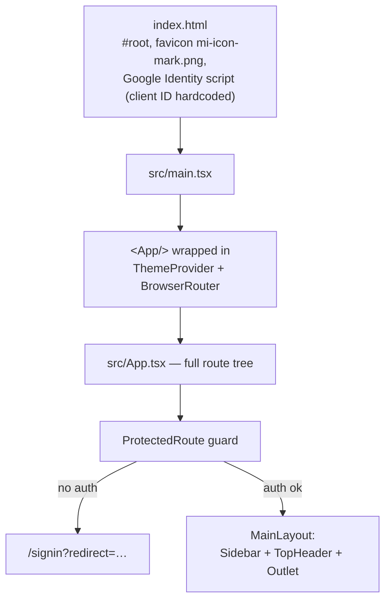
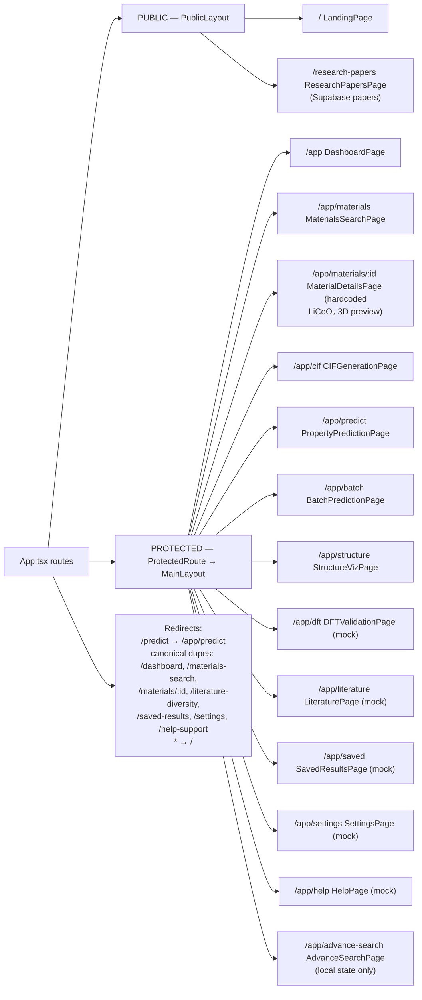
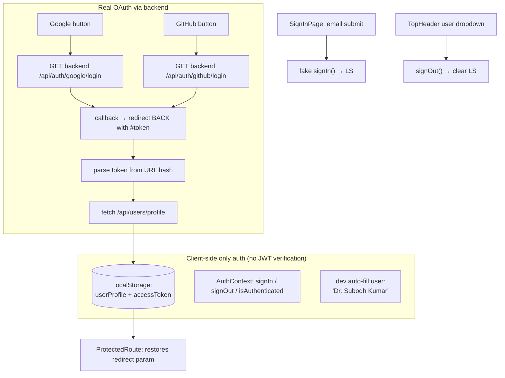
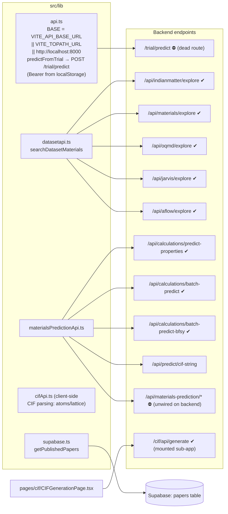
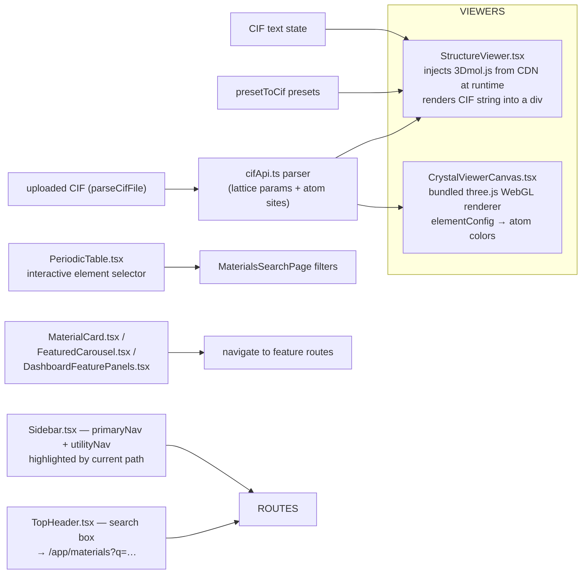

# IndianMatter — FRONTEND Flow Chart (Artifact)

> Scope: `E:\IndianMatter\src\`, `index.html`, `public/`, config files (vite/tailwind/tsconfig).
> Stack: React 18 + react-router-dom v6 + Vite 4 + Tailwind 3, framer-motion, lucide-react, three.js, 3Dmol.js (CDN), Supabase.

---

## 1. Boot Flow

---

## 2. Route Tree (src/App.tsx)

---

## 3. Auth Flow (contexts/AuthContext.tsx)

---

## 4. Frontend ↔ Backend API Layer (src/lib/*)

---

## 5. Primary User Flow (end-to-end)

```mermaid
flowchart TD
    LP["LandingPage (/)<br/>hero, exploreMaterials carousel,<br/>database cards, contact form (local state)"]
    LP --> GATE1{"CTA click"}
    GATE1 -- unauth --> SIGNIN["SignInPage (/signin)"]
    GATE1 -- auth --> DASH

    SIGNIN --> AUTH["email dev-sign-in OR<br/>OAuth redirect to backend"]
    AUTH --> DASH["Dashboard (/app):<br/>cinematic scroll carousel +<br/>5 feature cards → navigate"]

    DASH --> FLOW_A & FLOW_B & FLOW_C & FLOW_D

    subgraph A["A — Materials Search"]
        MS["enter q / click PeriodicTable<br/>elements → state"] --> SEARCH["searchDatasetMaterials<br/>(per dataset)"] --> TBL["table + column filters + sort<br/>+ CSV export (client blob)<br/>+ pagination"]
        TBL --> MD["MaterialDetailsPage"]
    end

    subgraph B["B — CIF → Predict pipeline"]
        CIFY["CIFGenerationPage form"] --> GEN["POST /cif/api/generate"] --> CIFRES["state: cifString"]
        CIFRES --> CPD["Copy / Download buttons"]
        CIFRES --> NAV["navigate('/app/predict',<br/>state {cifString, formula})"]
        NAV --> PP2["PropertyPredictionPage"]
        PP2 --> SEL["PropertyChecklist:<br/>select props of ALL_PROPERTIES"]
        SEL --> PR["handlePredict →<br/>predictFromCifFile (POST<br/>/api/calculations/predict-properties)"]
        PR --> RES["DedicatedResultsPage<br/>getPropertyValue extraction"]
    end

    subgraph C["C — Batch Prediction"]
        BP2["drag & drop .cif/.zip"] --> PRE["presets reduce input set"]
        PRE --> START["startBatchCifPrediction"]
        START --> POLL["1s getBatchJobStatus polling"]
        POLL -- done --> RES2["getBatchJobResults →<br/>summary metrics + CSV download"]
    end

    subgraph D["D — Structure Viz"]
        SV2["3 presets (LiCoO2, LiFePO4, LLZO<br/>via presetToCif) OR upload"]
        SV2 --> PARS["parseCifFile"] --> VIEW["StructureViewer / CrystalViewerCanvas"]
    end

    DFTM["DFTValidationPage:<br/>setInterval fake progress,<br/>hardcoded results"] -.mock.-> DASH
```

---

## 6. Visualization Components Flow

---

## 7. File-by-File Responsibility Matrix

| File | Role | Connects to |
|---|---|---|
| `src/main.tsx` | React root, ThemeProvider, BrowserRouter, Google script | `App.tsx` |
| `src/App.tsx` | Entire route map + layouts | all pages, ProtectedRoute, layouts |
| `src/contexts/AuthContext.tsx` | localStorage auth (dev) | pages, ProtectedRoute |
| `src/contexts/ThemeProvider.tsx` | theme state | MainLayout |
| `src/contexts/ProtectedRoute.tsx` | auth gate + redirect memory | auth context, router |
| `src/layouts/MainLayout.tsx` | `/app` shell | Sidebar, TopHeader, Outlet |
| `src/layouts/PublicLayout.tsx` | public header/footer | LandingPage, ResearchPapersPage |
| `src/lib/api.ts` | base URL + `/trial/predict` (dead) | backend |
| `src/lib/datasetapi.ts` | 5 explore endpoints | backend datasets |
| `src/lib/materialsPredictionApi.ts` | predictions + batch | calculator_router, materials-prediction |
| `src/lib/cifApi.ts` | client CIF parsing | viewers |
| `src/lib/topath.ts` | `askToPath` — ⛔ **UNUSED** | — |
| `src/lib/supabase.ts` | published papers | Supabase |
| `src/pages/cif/CIFGenerationPage.tsx` | generate/download CIF + state handoff | `/cif/api/generate`, `/app/predict` |
| `src/pages/prediction/PropertyPredictionPage.tsx` | CIF upload/props → dedicated results | `predict-properties` |
| `src/pages/prediction/BatchPredictionPage.tsx` | batch upload + polling | `batch-predict/*` |
| `src/pages/materials/MaterialsSearchPage.tsx` | q/periodic-table-driven search + CSV | datasetapi |
| `src/pages/structure/StructureVizPage.tsx` | presets/upload → 3D | StructureViewer |
| `src/pages/auth/SignInPage.tsx` | email + OAuth entry | AuthContext, backend auth |
| `src/pages/public/LandingPage.tsx` | hero/cards/contact + auth gating | navigate, auth |
| `src/pages/public/ResearchPapersPage.tsx` | Supabase papers + filters | supabase.ts |
| `src/components/StructureViewer.tsx` | 3Dmol.js CDN viewer | CIF state |
| `src/components/CrystalViewerCanvas.tsx` | three.js renderer | CIF state |
| `src/components/PeriodicTable.tsx` | element selector | search page |
| `src/pages/dft/*, literature/*, saved/*, settings/*, help/*, advance-search/*` | static/mock, alert-based | none |
| `src/pages/structure/MaterialsDetailsPage.tsx` | ⛔ unused | — |
| `src/data/researchPapers.ts` | ⛔ unused static data | — |
| `src/data/indianmatter/*.csv` | backend-consumed datasets (not built by frontend) | backend routes |
| `public/` | `assets/`, `videos/`, favicon | pages |

---

## 8. Dead/Unused Code & Risks

