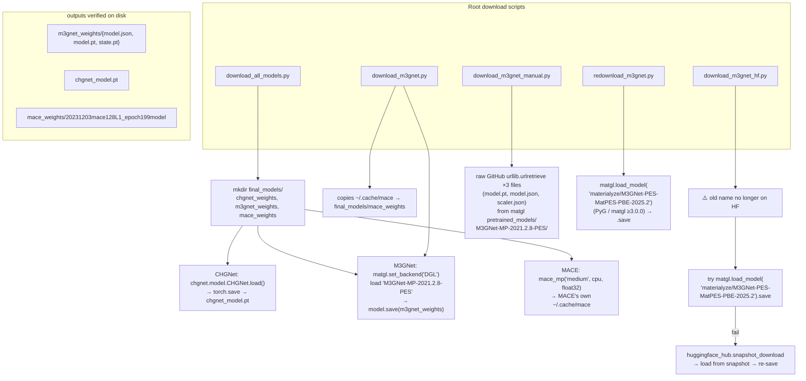
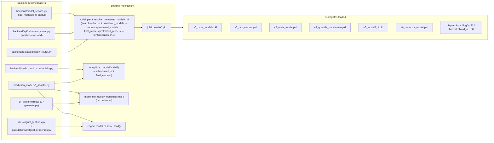
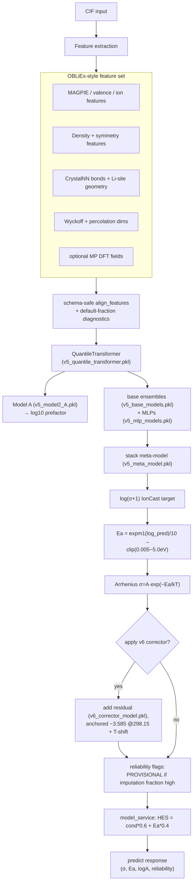
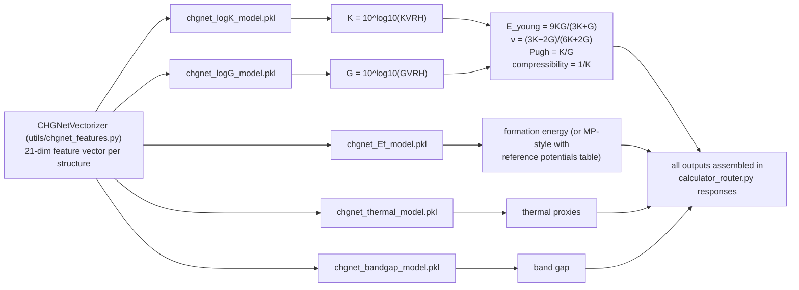
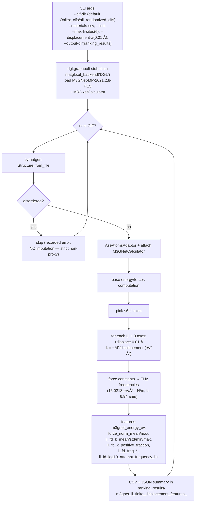
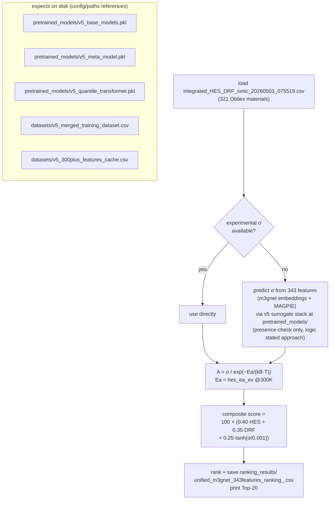
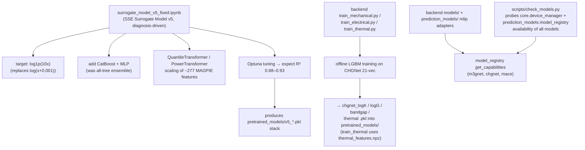

# IndianMatter — MODELS CODE Flow Chart (Artifact)

> Scope: root-level model download/feature scripts, `final_models/`, `pretrained_models/`, `Obliex_cifs/`, `configs/`, training notebooks, backend model loaders.
> Model artifacts on disk (actual inventory):

## 0. Model Artifact Inventory (verified on disk)

| Path | Size | What it is |
|---|---|---|
| `final_models\chgnet_weights\chgnet_model.pt` | 1.74 MB | full torch-pickled CHGNet universal Interatomic Potential |
| `final_models\m3gnet_weights\model.json` | 5.5 KB | matgl architecture JSON |
| `final_models\m3gnet_weights\model.pt` | 3.8 KB | matgl small tensor/file |
| `final_models\m3gnet_weights\state.pt` | 1.2 MB | matgl weight state |
| `final_models\mace_weights\20231203mace128L1_epoch199model` | 44.4 MB | MACE-MP medium raw checkpoint |
| `pretrained_models\v5_base_models.pkl` | 266 MB | v5 stackfold ensemble (XGB/LGBM/ET) |
| `pretrained_models\v5_meta_model.pkl` | 674 B | stacking meta-model |
| `pretrained_models\v5_mlp_models.pkl` | 13.7 MB | MLP member models |
| `pretrained_models\v5_model2_A.pkl` | 2.5 MB | "Model A" variant |
| `pretrained_models\v5_quantile_transformer.pkl` | 1.4 MB | QuantileTransformer scaler |
| `pretrained_models\v6_corrector_model.pkl` | 64 KB | v6 residual corrector |
| `pretrained_models\chgnet_logK_model.pkl` / `logG` | ~448 KB | mechanical surrogates |
| `pretrained_models\chgnet_bandgap_model.pkl` | 436 KB | electrical surrogate |
| `pretrained_models\chgnet_thermal_model.pkl` / `chgnet_Ef_model.pkl` | ~413 KB / 1.1 KB | thermal / formation-energy surrogates |
| `Obliex_cifs\all_randomized_cifs\` | 321 CIFs | research dataset (input to feature scripts) |
| `src\data\indianmatter\` | 38510.csv 2.68MB, chgnet_128_embeddings.csv 52.7MB, m3gnet_embeddings.csv 101.1MB, pymatgen_matminer.csv 59.8MB | embedded/training CSVs |

> ⚠️ Note: `final_models/` weights are effectively "cold storage" — the backend loads MLIPs by matgl/MACE cache names (e.g. `matgl.load_model(...)`), surrogates via `backend/model_paths.py` which resolves the root `pretrained_models/` first.

---

## 1. Model Acquisition Flow — Download Scripts



---

## 2. Runtime Model-Load Flow (who loads what, actual API behavior)



---

## 3. Surrogate-Stack Inference Flow (v5 + v6, property prediction)



Placeholder — actual code lives in `backend/model_service.py` and `predict_ionic_conductivity.py`; see backend artifact for endpoint wiring.

---

## 4. Bulk Property Surrogate Stack (BFSY + thermal + bandgap)



---

## 5. Feature Engineering Flow — `m3gnet_finite_displacement_features.py`



---

## 6. Unified Approach Flow — `unified_m3gnet_approach.py`



---

## 7. Training Flow — Surrogate Models



---

## 8. Model Dependency Matrix (file → file)

```
download_all_models.py ──→ final_models/{chgnet,m3gnet,mace}_weights/
download_m3gnet.py      ──→ final_models/{m3gnet_weights, mace_weights}
download_m3gnet_hf.py   ──→ final_models/m3gnet_weights (HF route)
download_m3gnet_manual.py ─→ final_models/m3gnet_weights (raw GitHub)
redownload_m3gnet.py    ──→ final_models/m3gnet_weights (PyG route)

backend/model_paths.py ── resolves → pretrained_models/*.pkl
backend/model_service.py ──→ v5_* + v6_corrector .pkl (via model_paths)
backend/api/calculator_router.py ──→ v5_*; keys off chgnet_logK_model.pkl
backend/routes/transport_router.py ──→ v5_base_models.pkl (+v6)
backend/predict_ionic_conductivity.py ──→ v5_* + v6 ; also matgl
backend/prediction_models/*_adapter.py ──→ matgl / mace / chgnet caches
backend/train_*.py ──produce→ pretrained_models/chgnet_*.pkl
backend/cif_pipeline/relax.py ──→ MACE-MP-0 (cache)
backend/cif_pipeline/generate.py ──→ CrystaLLM ckpt (CRYSTALLM_CHECKPOINT_PATH)

configs/config.json ──→ "Synthetic Observer" config, FINAL_MODELS paths (STALE)
configs/paths.json   ──→ models_dir=final_models/pretrained_models (STALE — real path is root pretrained_models/)
configs/temp_required_cols.json ──→ 200–600K temp-dep schema
surrogate_model_v5_fixed.ipynb ──produce→ pretrained_models/v5_*.pkl
Obliex_cifs/all_randomized_cifs ──input→ m3gnet_finite_displacement_features.py
integrated_HES_DRF_*.csv ──input→ unified_m3gnet_approach.py
ranking_results/ ──output→ FD features CSV/JSON + unified ranking CSV

src/data/indianmatter/*
  38510.csv          ← periodic-table search + explore API
  chgnet_128_embeddings.csv ← similarity/embedding model
  m3gnet_embeddings.csv    ← similarity/embedding model
  pymatgen_matminer.csv    ← descriptor joins
```

---

## 9. Full End-to-End Execution View

```mermaid
flowchart LR
    subgraph TRAIN["Training (offline)"]
        T1["M3GNet/CHGNet/MACE download scripts"]
        T2["surrogate notebook + train_*.py<br/>(LGBM/CatBoost/MLP/Optuna)"]
    end
    subgraph ARTIFACTS["Artifacts"]
        A1["final_models/ → torch/matgl/MACE weights"]
        A2["pretrained_models/ → v5/v6 + chgnet_*.pkl"]
        A3["small datasets: 38510.csv + embeddings"]
    end
    subgraph RUNTIME["Runtime (FastAPI)"]
        R1["startup: load_models()"]
        R2["predict-properties<br/>(BFSY+thermal+bandgap+ionic)"]
        R3["ionic-conductivity<br/>(IonCast + v6 corrector)"]
        R4["CIF pipeline<br/>(CrystaLLM + MACE relax)"]
        R5["explore/search<br/>(MP/OQMD/AFLOW/JARVIS/local CSV)"]
    end
    subgraph RESULT["Results"]
        RS1["σ / Ea / logA + reliability flag"]
        RS2["K, G, E, ν, Pugh, Ef, thermal, bandgap"]
        RS3["final CIF files"]
        RS4["ranked CSVs in ranking_results/"]
    end
    TRAIN --> ARTIFACTS
    ARTIFACTS --> RUNTIME --> RESULT
```



---

## 10. Stale/Gap Notes

| # | Note |
|---|---|
| 1 | `configs/config.json` + `configs/paths.json` point to `final_models/pretrained_models/…` — STALE; real path is root `pretrained_models/` |
| 2 | `download_m3gnet_manual.py` writes `scaler.json` but matgl `.save()` route doesn't — on-disk dir missing that file |
| 3 | Old HF model name `M3GNet-MP-2021.2.8-PES` no longer available; HF fallback uses `materialyze/M3GNet-PES-MatPES-PBE-2025.2` |
| 4 | Model A importance relies heavily on simulation-only columns (e.g. `diffusion_coefficient_300K` ~82%) — honesty warning hardcoded |
| 5 | MACE weight is copied only in `download_m3gnet.py`; `download_all_models.py` relies on MACE's own cache instead |
| 6 | `final_models/alignn_weights` referenced by `download_alignn_local.py` but absent on disk (ALIGNN returns placeholder) |

> Placeholder note: `RESULT` — σ outputs flow from `predict_ionic_conductivity.py` through members described in backend artifact §6.
