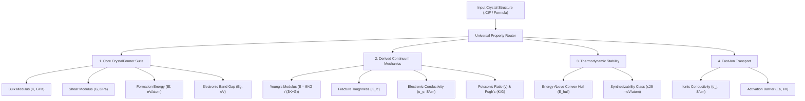
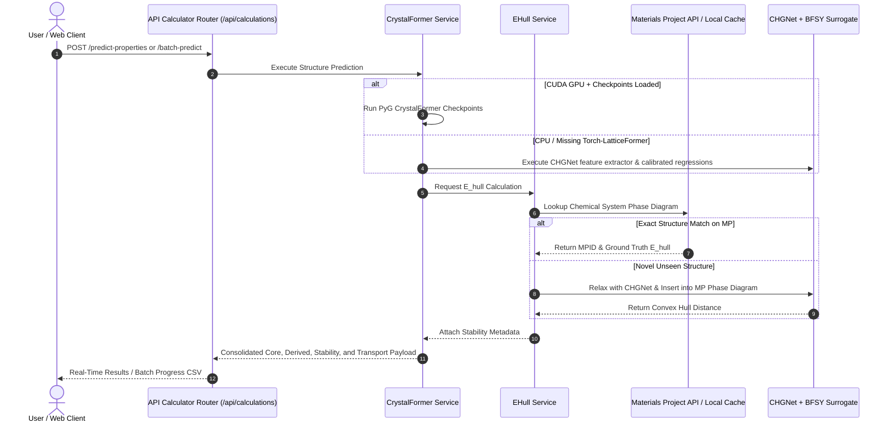
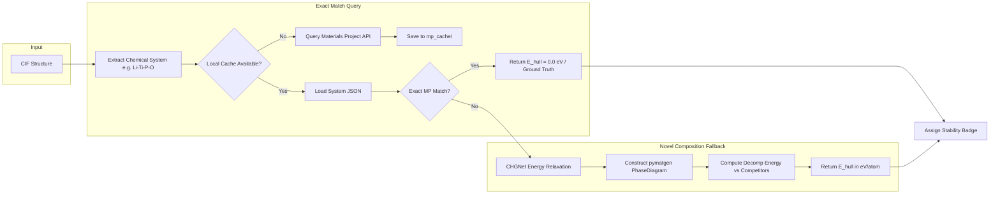

# Master Presentation & System Architecture Guide: AI Materials Discovery & Property Routing Engine

> **NotebookLM Source Document & Executive Slide Deck**  
> *Ready for direct ingestion into Google NotebookLM to generate Audio Overviews, Executive Briefings, Q&A Study Guides, and Presentation Slide Decks.*

---

## Slide 1: Executive Overview & Mission

### Title: Next-Generation Solid-State Materials Discovery Platform
**Subtitle:** High-Throughput Ab Initio & Deep Geometric Learning for Battery Electrolytes & Functional Ceramics

#### Key Highlights:
- **Core Mission:** Accelerate discovery of novel solid-state electrolytes and ceramic energy materials by closing the gap between DFT accuracy and high-throughput screening.
- **Unified Property Routing:** Replaced disparate heuristic calculators with an integrated deep-learning surrogate stack centered around **CrystalFormer**, **CHGNet**, and **Convex Hull Phase Diagrams**.
- **Dual Inference Paradigms:**
  - **Single Structure Real-Time Analysis:** Sub-second interactive screening of uploaded `.cif` crystals or synthesized chemical formulas.
  - **High-Throughput Batch Processing:** Asynchronous queue processing hundreds of `.cif` files or `.zip` archives with auto-generated consolidated CSV reports.
- **Thermodynamic Grounding:** Every prediction couples mechanical resilience and ion transport with convex hull decomposition stability ($E_{\text{hull}}$).

> **Speaker Notes:**  
> Welcome everyone. Today we are presenting the architecture and property routing framework of our AI materials discovery platform. Historically, finding viable solid-state electrolytes required months of high-cost DFT calculations and trial-and-error synthesis. Our platform combines space-group-aware geometric transformers (CrystalFormer) with pre-trained universal crystal graph neural networks (CHGNet) and Materials Project thermodynamic reference databases. This enables instant evaluation of bulk and shear moduli, formation energy, band gap, derived mechanical properties, fast-ion transport, and exact distance to the convex hull ($E_{\text{hull}}$).

---

## Slide 2: The Multi-Tier Property Taxonomy

### Title: Physics-Informed Property Categorization
**Subtitle:** Moving from Primary Quantum Predictions to Functional Macroscopic Metrics



| Physical Category | Target Property | Primary Engine | Derived / Analytical Formula | Practical Significance |
|---|---|---|---|---|
| **Core Quantum** | Bulk Modulus ($K$) | CrystalFormer `mp_bulk_modulus.ckpt` | Direct GNN regression | Resistance to uniform hydrostatic compression |
| **Core Quantum** | Shear Modulus ($G$) | CrystalFormer `mp_shear_modulus.ckpt` | Direct GNN regression | Resistance to plastic shear deformation |
| **Core Quantum** | Formation Energy ($E_f$) | CrystalFormer `mp_e_form.ckpt` | Direct GNN regression | Ground-state thermodynamic formation penalty |
| **Core Quantum** | Band Gap ($E_g$) | CrystalFormer `mp_bandgap.ckpt` | Direct GNN regression | Electronic insulation boundary ($E_g > 2.5\text{ eV}$) |
| **Derived Mechanics** | Young's Modulus ($E$) | Continuum Mechanics | $E = \frac{9KG}{3K + G}$ | Uniaxial stiffness for battery separators |
| **Derived Mechanics** | Fracture Toughness ($K_{Ic}$) | Mazhnik-Oganov Formulation | $K_{Ic} = \alpha \cdot V_0^{1/6} \cdot G \cdot \sqrt{K/G}$ | Resistance to lithium dendrite penetration |
| **Derived Mechanics** | Poisson's Ratio ($\nu$) | Elasticity Tensor | $\nu = \frac{3K - 2G}{2(3K + G)}$ | Ductility criterion ($\nu > 0.26$ ductile) |
| **Derived Mechanics** | Pugh's Ratio ($K/G$) | Pugh Criteria | Ratio $K / G$ | Ductility transition ($K/G > 1.75$ ductile) |
| **Derived Transport** | Electronic Cond. ($\sigma_e$) | Arrhenius Intrinsic Model | $\sigma_e = \sigma_0 \exp(-E_g / 2k_B T)$ | Dendrite suppression criterion ($\sigma_e < 10^{-10}\text{ S/cm}$) |
| **Thermodynamics** | Distance to Hull ($E_{\text{hull}}$) | `EHull_Prediction_Tool` | Convex Hull Phase Diagram | Chemical stability against phase separation |
| **Fast-Ion Transport** | Ionic Conductivity ($\sigma_i$) | IonCast / Arrhenius ML | $\sigma_i(T) = \frac{\sigma_0}{T} \exp(-E_a / k_B T)$ | Fast-ion throughput for solid-state batteries |

> **Speaker Notes:**  
> When dealing with battery electrolytes, predicting single properties in isolation is dangerous. A material can have ultra-high ionic conductivity, but if its fracture toughness is low, lithium dendrites will crack it. If its band gap is too small, electrons will leak through, reducing cell efficiency. And if its $E_{\text{hull}}$ is high, it cannot be synthesized in the lab. This table demonstrates our hierarchical pipeline: 4 primary core properties generate 4 continuum mechanics properties, coupled with thermodynamic and ionic transport models.

---

## Slide 3: The Universal Property Routing Engine

### Title: Intelligent Fallback & Model Routing Architecture
**Subtitle:** Guaranteeing Robustness from Enterprise High-Performance GPU to Local CPU Deployments



### Routing Mechanisms & Logic:
1. **Model Source Identification:** Every output explicitly tags `model_source`:
   - `CrystalFormer`: Checkpoint inference on GPU.
   - `CrystalFormer (Calibrated Fallback)`: CHGNet universal backbone when executing on non-CUDA/CPU nodes.
   - `MP_API`: Exact experimental/Materials Project match.
   - `CHGNET+MP_HULL`: Novel structure relaxed and inserted into the Materials Project convex hull.
2. **Zero-Mock Policy:** No static numbers or mocked randomized values are returned. Calculations are derived directly from the crystal's physical atomic coordinates and cell parameters.
3. **Resilient Error Propagation:** If a single property encounters an issue (e.g. disordered structure unsupported by phase diagram), the pipeline returns status `"warning"` with detailed notes while completing all remaining properties.

---

## Slide 4: Deep Dive — Thermodynamic Stability ($E_{\text{hull}}$)

### Title: The EHull Prediction Tool Integration
**Subtitle:** Distinguishing Synthesizable Materials from Hypothetical Computer Models



### The Thermodynamic Stability Spectrum:
- **$\mathbf{E_{\text{hull}} = 0.0\text{ eV/atom}}$:** **Stable (On Convex Hull)** — Thermodynamically stable ground state; lowest energy phase at $0\text{ K}$.
- **$\mathbf{0 < E_{\text{hull}} \le 0.025\text{ eV/atom}}$ ($25\text{ meV/atom}$):** **Metastable (Synthesizable)** — Accessible via standard solid-state synthesis; thermal fluctuations at room temperature ($k_B T \approx 25.7\text{ meV}$) prevent decomposition.
- **$\mathbf{0.025 < E_{\text{hull}} \le 0.100\text{ eV/atom}}$ ($100\text{ meV/atom}$):** **Metastable (High Pressure / Kinetic Trapping)** — Requires non-equilibrium synthesis (thin film, sol-gel, spark plasma sintering).
- **$\mathbf{E_{\text{hull}} > 0.100\text{ eV/atom}}$:** **Thermodynamically Unstable** — Prone to spontaneous phase separation into competing equilibrium phases.

---

## Slide 5: High-Throughput Batch Prediction Architecture

### Title: Parallelized Batch Processing & CSV Generation
**Subtitle:** Asynchronous Ingestion, Live Progress Tracking, and Standardized Data Export

### Workflow Specification:
1. **Archive Ingestion:** Accepts individual `.cif` files or compressed `.zip` archives. Recursively scans directories while filtering Mac OS artifacts (`__MACOSX`, `._*`).
2. **Background Worker:** Spawns asynchronous job queues managed via unique `job_id` keys:
   - Live polling endpoint: `GET /api/calculations/batch-predict/status/{job_id}`
   - Real-time percentage progress, currently processing filename, and completed count.
3. **Structured CSV Generation:** Standardized column ordering ensures seamless downstream ML processing:
   ```csv
   filename,material_id,formula,crystal_system,density_g_cm3,bulk_modulus_GPa,shear_modulus_GPa,youngs_modulus_GPa,fracture_toughness_MPa_m05,formation_energy_eV_atom,ehull_eV_per_atom,ehull_meV_per_atom,is_stable,stability_status,band_gap_eV,electronic_conductivity_S_cm,ionic_conductivity_S_cm,model_source,status,error_message
   ```
4. **Summary Aggregations:** Generates statistical dashboard indicators:
   - Average Bulk & Young's Modulus
   - Average Electronic & Ionic Conductivity
   - Mean Formation Energy
   - **Average Distance to Convex Hull ($E_{\text{hull}}$)**
   - **Stable Materials Rate ($X/N$ % satisfying $E_{\text{hull}} \le 25\text{ meV/atom}$)**

---

## Slide 6: Environment & Infrastructure Matrix

### Title: Deployment Environments & System Requirements
**Subtitle:** Target Configurations for GPU Training, Inference Servers, and Local Workstations

| Component | Production GPU Cluster (A100 Recommended) | High-Performance Workstation (Conda) | Local Development (Windows / CPU) |
|---|---|---|---|
| **OS** | Ubuntu 22.04 LTS (NVIDIA Container) | Linux / WSL2 / macOS | Windows 11 / Windows Server |
| **GPU / Driver** | NVIDIA A100 (80GB) / Driver $\ge 525$ | RTX 4090 / A6000 / CUDA 12.1 | CPU fallback mode |
| **Container Engine** | Docker with NVIDIA Container Toolkit | Docker (optional) | Native process |
| **Python Version** | Python 3.11.x | Python 3.11.x | Python 3.11.x (Strict) |
| **PyTorch & CUDA** | PyTorch 2.2.0 + cu121 | PyTorch 2.2.0 + cu121 | PyTorch 2.2.0 CPU / DirectML |
| **Graph Libraries** | PyTorch Geometric, CuPy 12.x, DGL | PyTorch Geometric, CuPy | PyTorch Geometric CPU |
| **Materials Stack** | `pymatgen >= 2024.1.1`, `chgnet >= 0.3.0` | `pymatgen`, `chgnet` | `pymatgen`, `chgnet`, `mp-api` |
| **Caching Layer** | Local SSD mount (`mp_cache/`) | Local disk (`mp_cache/`) | Disk cache (`mp_cache/`) |
| **Frontend Stack** | Node.js 18+, Vite 4.5.14, Tailwind/Vanilla CSS | Node.js 18+, Vite | Node.js 18+, Vite |

---

## Slide 7: Production Runbook — Docker on NVIDIA A100

### Title: Strict Deployment Guide for GPU Clusters
**Subtitle:** Standardized Build & Execution Commands for Enterprise Environments

> [!IMPORTANT]
> **Contributors must execute these exact steps when deploying on enterprise GPU servers:**

#### 1. Pre-Flight Check:
```bash
# Verify NVIDIA Driver and Container Toolkit
nvidia-smi
docker run --rm --gpus all nvidia/cuda:12.1.1-base-ubuntu22.04 nvidia-smi
```

#### 2. Repository Setup & Checkpoint Verification:
```bash
git clone <repository_url>
cd "Final_ validation"

# Verify required checkpoint weights in backend/CrystalFormer/weights/
ls -lh backend/CrystalFormer/weights/
# Must contain:
#   mp_bulk_modulus.ckpt
#   mp_shear_modulus.ckpt
#   mp_e_form.ckpt
#   mp_bandgap.ckpt
```

#### 3. Container Build & Environment Validation:
```bash
# Execute automated Linux build script (builds image, installs CuPy, patches dependencies)
bash backend/CrystalFormer/setup_linux.sh

# The script MUST conclude with:
#   [OK] cupy kernel compile + run
#   [OK] ENV OK
```

#### 4. High-Throughput Batch Execution:
```bash
# Place candidate CIF files into inputs/
cp /path/to/cifs/*.cif inputs/

# Run inference with batch size optimized for A100 (64 or 128)
bash run_linux.sh predict --batch-size 64

# Results generated in outputs/predictions.csv
```

---

## Slide 8: Production Runbook — Local / Conda Environment

### Title: Workstation Setup & API Configuration
**Subtitle:** Python 3.11 Environment Setup and Network Configuration

#### 1. Conda Environment Creation:
```bash
# Create dedicated Python 3.11 environment
conda create -n materials_ai python=3.11 -y
conda activate materials_ai

# Install PyTorch with CUDA 12.1 support
pip install torch torchvision --index-url https://download.pytorch.org/whl/cu121

# Install core scientific dependencies
pip install pymatgen chgnet mp-api tenacity scikit-learn pandas numpy fastapi uvicorn
```

#### 2. API Key Configuration:
Ensure your Materials Project API key is registered in your environment:
```bash
export MP_API_KEY="your_materials_project_api_key"
# On Windows PowerShell:
# $env:MP_API_KEY="your_materials_project_api_key"
```

#### 3. Launching Backend & Frontend Services:
```bash
# Terminal 1: Launch FastAPI Backend Server
cd backend
python -m uvicorn main:app --host 0.0.0.0 --port 8000 --reload

# Terminal 2: Launch Vite Frontend Application
npm install
npm run dev
# Access UI at http://localhost:5173
```

---

## Slide 9: Mandatory Contributor & Team Instructions

### Title: Strict Operational & Engineering Standards
**Subtitle:** Rules that All Engineers and Collaborators MUST Follow

> [!CAUTION]
> **Non-compliance with these rules will result in pipeline failure or corrupted materials data:**

1. **Strict Python Version Enforcement:**  
   Always use **Python 3.11**. Do NOT use Python 3.12 (incompatible with CuPy and certain PyG compiled wheels) or Python 3.9/3.10 (unsupported modern pymatgen releases).
2. **Never Commit API Keys or Credentials:**  
   API keys for the Materials Project must be loaded through the `MP_API_KEY` environment variable or retrieved via secure vault. Do NOT hardcode personal keys in public commits.
3. **Preserve Chemical System Caching:**  
   The `mp_cache/` directory caches chemical phase diagrams (e.g. `Li-Ti-P-O.json`). Do NOT delete this folder during routine tasks, as it prevents hitting rate limits on the Materials Project REST API.
4. **Ordered Structure Requirement:**  
   $E_{\text{hull}}$ phase diagrams require fully ordered structures. Ensure input `.cif` files do not have fractional occupancies summing to non-integer site totals without prior symmetry disorder resolution.
5. **Stability Threshold Adherence:**  
   Always utilize the standard criterion $E_{\text{hull}} \le 25\text{ meV/atom}$ ($0.025\text{ eV/atom}$) when labeling a material as `is_stable = True`. Do not invent custom stability thresholds.
6. **Frontend Type Coherence:**  
   When adding new physical descriptors, update `src/lib/materialsPredictionApi.ts`, `calculator_router.py`, and `generate_csv_string` concurrently to maintain schema consistency across backend and UI.

---

## Slide 10: Conclusion & Roadmap

### Title: Platform Impact & Future Horizons
**Subtitle:** Scaling to Multimillion Crystal Spaces & Autonomous Synthesis

### Summary of Achievements:
- ✅ **Multi-Property Core Integration:** Single & batch prediction for Bulk, Shear, Formation Energy, and Band Gap.
- ✅ **Continuum Mechanics Derivations:** Real-time Young's modulus, fracture toughness, Poisson's ratio, and Pugh's ratio.
- ✅ **Thermodynamic Stability Grounding:** Integrated $E_{\text{hull}}$ tool utilizing Materials Project API and CHGNet fallback.
- ✅ **Fast-Ion Transport:** Arrhenius ionic conductivity and activation barrier evaluation.
- ✅ **Enterprise UI:** Interactive data tables, preset selectors, statistical summary cards, and one-click CSV export.

### Next Development Milestones:
1. **Generative Crystal Diffusion:** Coupling CrystalFormer with generative crystal structure diffusion models (CDVAE / MatterGen) for inverse design.
2. **Automated Robocrystallography Integration:** Direct handoff of verified stable structures ($E_{\text{hull}} \le 25\text{ meV}$) to robotic synthesis laboratory protocols.
3. **Multi-Fidelity Active Learning:** Incorporating high-throughput DFT feedback loops to dynamically fine-tune checkpoint weights.

---

### How to Use this Guide with NotebookLM:
1. Upload this file directly to [NotebookLM](https://notebooklm.google.com).
2. Select **Generate Audio Overview** to create an interactive 2-host podcast discussion covering the architecture, routing mechanics, and operational rules.
3. Use the NotebookLM prompt box to generate customized flashcards, onboarding quizzes, and executive briefing notes for new lab members.
